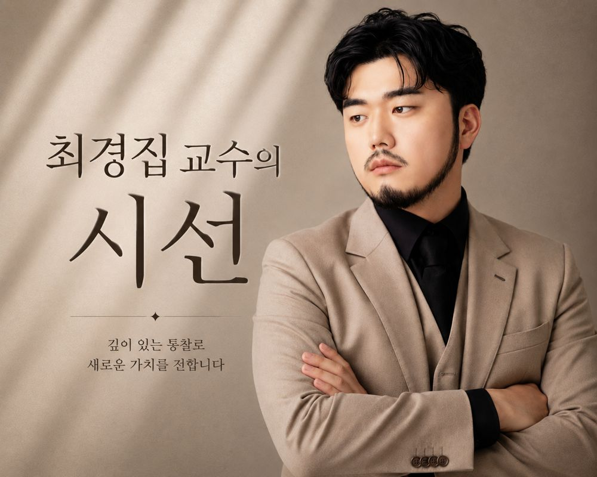

수능 앞 두 주, 식품 매대에서 가장 잘 팔리는 것은 성분이 아니라 불안이다.

이런 장면을 떠올려 보자. 수능을 한 달쯤 앞둔 저녁, 어머니가 마트 진열대 앞에 서 있다. 손에는 작은 상자가 들려 있다. 포장에는 '집중'이라는 글자가 크게 박혀 있다. 뒤집어 보면 깨알 같은 글씨로 '당류 가공품'이라고 적혀 있다. 어머니도 그것을 본다. 그런데도 장바구니에 넣는다.

그 마음을 탓할 수 있을까. 아이가 책상 앞에서 조는 걸 본 부모에게 '혹시라도'라는 말은 이성보다 힘이 세다. 파는 쪽도 그것을 안다. 그래서 이 계절이면 '집중'이라는 두 글자가 매대 앞으로 나온다.

## 71억 원어치가 팔렸다

식품의약품안전처는 지난 10월 28일, 수능을 앞두고 일반 식품을 수험생용 영양제처럼 광고한 업체 23곳을 적발했다고 밝혔다. 제품은 24종, 판매량은 상자로 41만 개, 금액으로는 약 71억 원이었다. 한 업체가 56억 원어치를 팔아 전체의 약 80%를 차지했고, 다른 업체는 매입 단가의 14배를 받았다.

문제가 된 제품은 당류 가공품과 사탕류, 젤리 같은 일반 식품이다. 건강기능식품이 아니다. 그런데 광고에는 '집중력 향상', '정신력 개선', '섭취 즉시 몰입력과 에너지를 높여주는' 같은 말이 붙었다. 해시태그로는 '대치동 영양제', '수험생 집중력 영양제'가 달렸다. ADHD나 우울증 같은 질병에 효과가 있다고 광고한 사례까지 있었다.

성분도 가볍지 않다. 점검 제품 가운데 10종에서 카페인이 든 과라나 추출물이 확인됐고, 일부 제품은 한 포에 카페인이 100㎎ 들어 있었다. 식약처는 이것이 **체중 40㎏인 청소년의 하루 최대 권고 섭취량 전부에 해당한다**고 설명했다. 어린이·청소년 권고량은 체중 1㎏당 2.5㎎이다. 50㎏이면 125㎎, 60㎏이면 150㎎이 상한이다. 식약처는 적발 업체에 대해 지자체에 행정처분을 요청하고 경찰에 고발했으며, 1억 원 이상 판매한 업체의 과세 자료는 국세청에 넘기기로 했다.

## 선은 생각보다 가까이 있다

이 이야기를 남의 집 불구경으로 넘길 일이 아니다. 71억 원을 판 업체만 걸린 것이 아니기 때문이다. 동네 반찬가게가 '수험생 도시락'이라 쓴 종이를 붙이는 것과, '집중력에 좋은 수험생 도시락'이라 쓰는 것 사이에는 생각보다 가까운 곳에 선이 그어져 있다.

**선을 가르는 기준은 간단하다. 상황을 말하면 괜찮고, 몸에 일어나는 일을 말하면 넘는다.** '수험생이 먹기 좋은'은 상황이다. '집중력이 좋아지는'은 몸에 일어나는 일이다. '밤늦게 먹기 편한'은 상황이고, '피로가 풀리는'은 몸이다. 앞은 손님이 자기 사정에 비추어 판단하는 말이고, 뒤는 가게가 효과를 약속하는 말이다.

여기서 억울해하는 사장님이 많다. "다들 그렇게 쓰는데 나만?" 맞는 말이다. 그런데 그 '다들'이 이번에 23곳 적발됐다. 단속은 늘 뒤늦게, 그리고 한꺼번에 온다. 그때 '남들도 그랬다'는 항변은 통하지 않는다.

더 중요한 것은 처벌이 아니다. **한 번 과장으로 판 물건은 그 손님을 영원히 잃는다.** 효과를 기대하고 샀는데 아무 일도 일어나지 않으면, 손님은 제품을 의심하기 전에 가게를 의심한다. 식품 장사는 한 번 팔고 끝나는 일이 아니다.

## 그래도 팔 수 있다

그러면 수능 시즌을 그냥 흘려보내야 하나. 그렇지 않다. 효능을 빼고도 팔 방법은 얼마든지 있다. 오히려 그쪽이 더 오래간다.

**시간을 파는 것이 첫 번째다.** 수험생 집의 문제는 영양이 아니라 시간이다. 아침에 입맛 없는 아이가 3분 안에 먹을 수 있는 것, 밤 11시에 속에 부담 없는 것, 도시락에 넣어도 식어서 맛이 가지 않는 것. 이것은 효능이 아니라 조건이다. 조건은 마음껏 말해도 된다.

**둘째는 부모의 부담을 덜어 주는 것이다.** 수능 전 한 달은 부모도 지친다. 매일 다른 반찬을 고민하는 집에 '이번 주 도시락 세 가지' 같은 묶음 하나면 충분하다. 새 상품을 만들 필요도 없다. 이미 있는 반찬을 요일별로 묶어 놓기만 해도 손님은 고민 하나를 덜어 간다.

**셋째는 솔직함이다.** 요즘 부모들은 생각보다 많이 알고 있다. "이건 영양제가 아니라 그냥 간식입니다. 다만 밤에 먹어도 속이 편합니다." 이렇게 쓴 종이 한 장이 '집중력 향상'보다 더 잘 팔리는 경우를 나는 여러 번 봤다. 과장된 말이 넘치는 매대에서 솔직한 말은 그 자체로 눈에 띈다.

## 불안을 팔지 않고 곁에 서기

수능철 마케팅의 본질은 불안이다. 불안은 분명히 잘 팔린다. 다만 불안을 파는 가게는 시험이 끝나는 날 함께 끝난다. 11월 셋째 주가 지나면 '집중'이라고 쓴 상자는 매대에서 사라지고, 그 가게를 다시 떠올릴 이유도 함께 사라진다.

반대로 그 한 달 동안 밥 한 끼를 편하게 해 준 가게는 시험이 끝나도 남는다. 수험생은 졸업하지만 그 집의 저녁은 계속되기 때문이다.

**효능은 말하지 말고, 사정을 헤아리면 된다.** 손님이 지금 무엇 때문에 힘든지를 알아보는 가게는 광고 문구가 필요 없다.

11월이다. 매대 앞에 붙일 종이 한 장을 다시 읽어 보자. 거기에 몸에 일어날 일이 적혀 있다면, 지금 고치는 편이 낫다.
