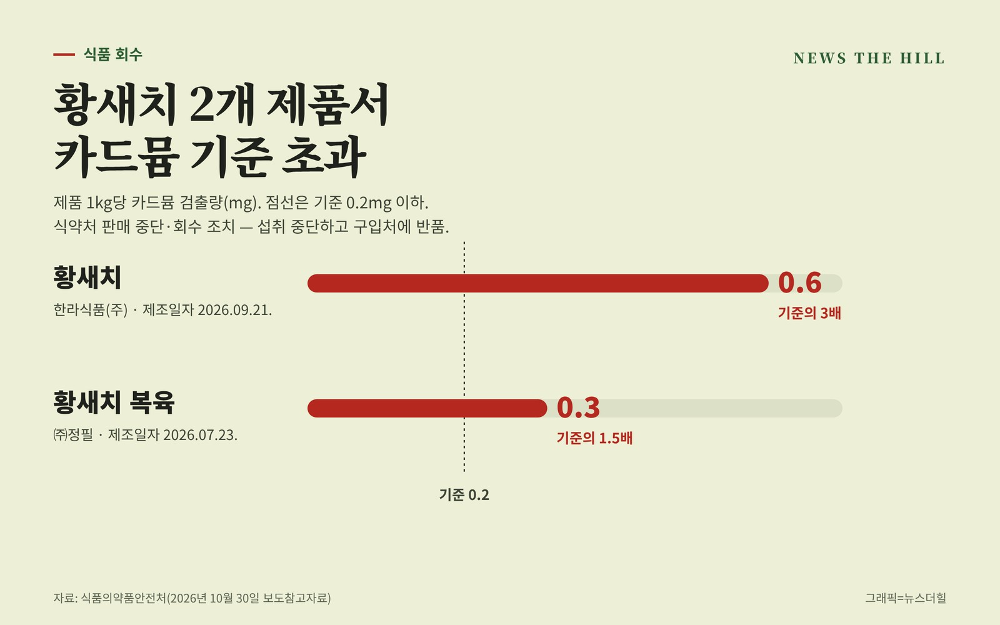

입력 2026-11-02

*그래픽=뉴스더힐(자료: 식품의약품안전처)*

황새치를 가공한 수산물 2개 제품에서 중금속인 카드뮴이 기준보다 많이 나와 회수에 들어갔다. 해당 제품을 샀다면 제품명과 제조일자를 확인해 볼 필요가 있다.

식품의약품안전처는 식품제조·가공업체 한라식품(주)(경기도 광주시)이 제조·판매한 '황새치'와 ㈜정필(경상남도 고성군)이 제조·판매한 '황새치 복육'에서 카드뮴이 기준을 넘어 판매를 중단하고 회수 조치한다고 지난달 30일 밝혔다. 두 제품의 식품유형은 모두 기타 수산물가공품이다.

## 회수 대상

- 한라식품(주)(경기도 광주시) '황새치': 제조일자 2026년 9월 21일로 표시된 제품(소비기한은 제조일로부터 24개월), 내용량 2~24kg, 생산량 1,648kg
- ㈜정필(경상남도 고성군) '황새치 복육': 제조일자 2026년 7월 23일로 표시된 제품(소비기한은 제조일로부터 24개월), 내용량 20.1kg, 생산량 3,966kg

## 얼마나 나왔나

이 제품들의 카드뮴 기준은 1kg당 0.2mg 이하다. '황새치'에서는 0.6mg, '황새치 복육'에서는 0.3mg이 검출됐다. 각각 기준의 3배, 1.5배(본지 계산)다. 검사는 서울특별시 보건환경연구원이 맡았고, 회수는 경기도 광주시청과 경상남도 고성군청이 각각 진행한다.

## 소비자 행동 요령

- 해당 제품을 샀다면 먹지 말고 산 곳에 반품한다. 식약처는 구매 소비자에게 섭취를 중단하고 구입처에 반품해 달라고 당부했다.
- 식품 관련 불법 행위를 보면 불량식품 신고전화 1399나 식품안전정보 앱 '내손안'으로 신고할 수 있다.

※ 이 기사는 식품의약품안전처 보도참고자료(공공누리 제1유형·텍스트에 한함)를 바탕으로 작성했습니다.
