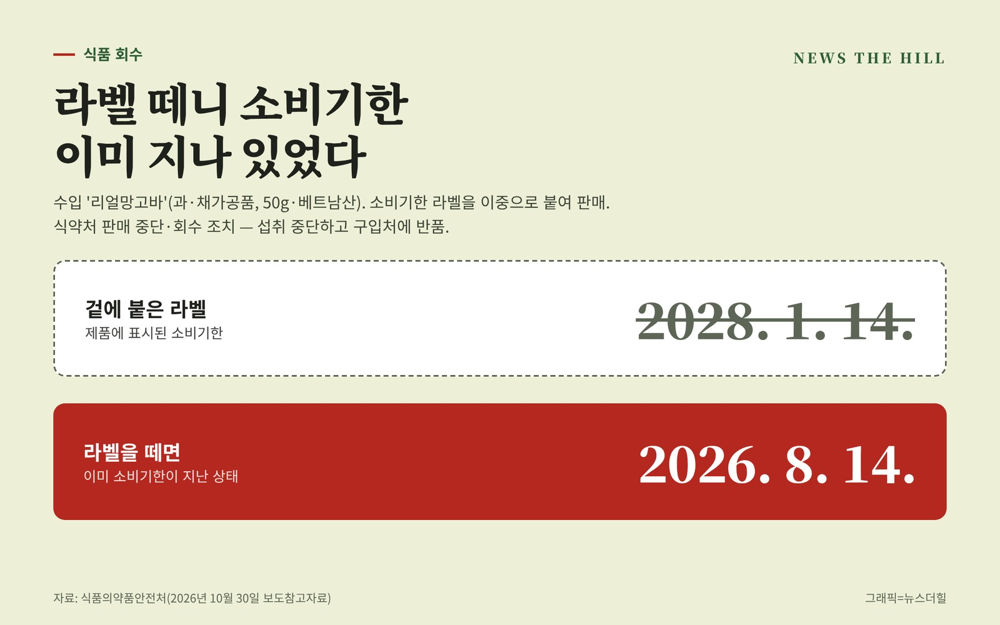

입력 2026-11-02

*그래픽=뉴스더힐(자료: 식품의약품안전처)*

소비기한 라벨을 한 겹 더 붙여 판매한 수입 망고 가공품이 회수에 들어갔다. 겉 라벨에는 2028년까지로 적혀 있지만, 라벨을 떼면 원래 소비기한이 이미 지난 제품이다.

식품의약품안전처는 수입식품등 수입·판매업체 (주)신광(서울시 영등포구)이 소비기한을 이중으로 표시해 수입·판매한 '리얼망고바'(식품유형 과·채가공품)를 판매 중단하고 회수 조치한다고 지난달 30일 밝혔다. 이 업체의 현재 업소명은 주식회사 신광글로벌(경기도 평택시)이다.

## 회수 대상

- 수입·판매업체: (주)신광(서울시 영등포구), 현재 주식회사 신광글로벌(경기도 평택시)
- 제품명(식품유형): 리얼망고바(과·채가공품)
- 제조회사(원산지): TAN LOC CONG TY TNHH TM DV XNK TAN LOC FRUIT(베트남)
- 표시된 소비기한: 2028년 1월 14일(제품 표시 제조일자 2025년 1월 15일)
- 내용량: 50g (수입량 9,924kg)
- 회수기관: 경인지방식품의약품안전청

## 무엇이 문제인가

식약처에 따르면 회수 대상은 소비기한이 '2028/01/14'로 표시된 제품이다. 이중으로 붙은 라벨을 떼면 소비기한이 '2026/8/14'로 적혀 있어, 이미 소비기한이 지난 상태다.

## 소비자 행동 요령

- 해당 제품을 샀다면 먹지 말고 산 곳에 반품한다. 식약처는 구매 소비자에게 섭취를 중단하고 구입처에 반품해 달라고 당부했다.
- 식품 관련 불법 행위를 보면 불량식품 신고전화 1399나 식품안전정보 앱 '내손안'으로 신고할 수 있다.

※ 이 기사는 식품의약품안전처 보도참고자료(공공누리 제1유형·텍스트에 한함)를 바탕으로 작성했습니다.
