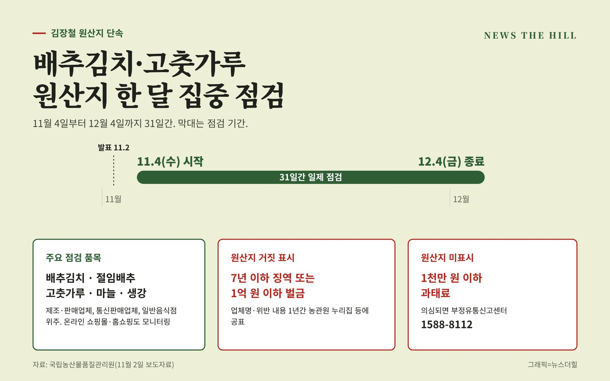

입력 2026-11-02

*그래픽=뉴스더힐(자료: 국립농산물품질관리원)*

김장을 앞두고 배추김치와 고춧가루, 마늘 같은 양념류의 원산지를 속여 파는 행위에 대한 집중 단속이 시작된다. 외국산을 국내산으로 바꿔 팔거나, 국내산이라도 유명 산지로 원산지를 속이는 경우가 주요 대상이다.

국립농산물품질관리원(농관원)은 11월 4일부터 12월 4일까지 31일간 배추김치와 김장채소 양념류의 원산지 표시를 일제 점검한다고 2일 밝혔다.

## 무엇을, 어디서 보나

- 점검 품목: 김장철에 소비와 유통이 몰리는 배추김치, 절임배추, 고춧가루(건고추), 마늘, 생강 등
- 점검 대상: 배추김치 등 제조·판매업체, 통신판매업체, 일반음식점 위주
- 투입 인력: 특별사법경찰관과 명예감시원. 김장 채소류 수급 상황, 가격 동향, 수입농산물 유통이력관리시스템 정보 등을 활용한다.
- 온라인: 사이버단속반이 통신판매중개사이트, 쇼핑몰, 홈쇼핑 등을 모니터링하고, 원산지 위반이 의심되는 업체는 현장 점검한다.

## 걸리면

원산지를 거짓으로 표시한 업체는 업체명과 위반 내용이 농관원 누리집 등에 1년간 공표되고, 7년 이하의 징역 또는 1억 원 이하의 벌금 처분을 받는다. 원산지를 표시하지 않은 경우에는 1천만 원 이하의 과태료가 부과된다.

## 소비자가 확인할 것

농관원은 보도자료에 붙인 식별 방법에서 국산 배추김치는 배추 껍질을 조금 제거해 녹색 부분이 많고 양념 색깔이 검붉으며, 중국산은 껍질을 많이 제거해 녹색 부분이 없고 양념 색깔이 밝은 적색이라고 설명했다. 깐마늘은 국산이 끝부분이 대부분 뾰족하고 연한 노란색을 띠는 반면, 중국산은 끝부분이 뭉툭하거나 뒤쪽으로 치우쳐 있고 흰색을 띤다고 했다. 다른 품목의 식별 방법은 농관원 누리집(www.naqs.go.kr)의 '업무소개 → 원산지관리 → 원산지 식별정보'에서 볼 수 있다.

농관원 김철 원장은 "김장철에 소비가 늘어나는 배추김치와 양념류에 대한 원산지 표시를 철저히 점검해 소비자가 안심하고 구매할 수 있도록 하겠다."고 밝히며 "농식품 구입 시 원산지를 반드시 확인하고, 원산지 표시가 없거나 거짓 표시가 의심될 경우 부정유통신고센터(1588-8112)로 신고해 줄 것"을 당부했다.

※ 이 기사는 농림축산식품부(국립농산물품질관리원) 보도자료(공공누리 제1유형, 출처표시)를 바탕으로 작성했습니다.
