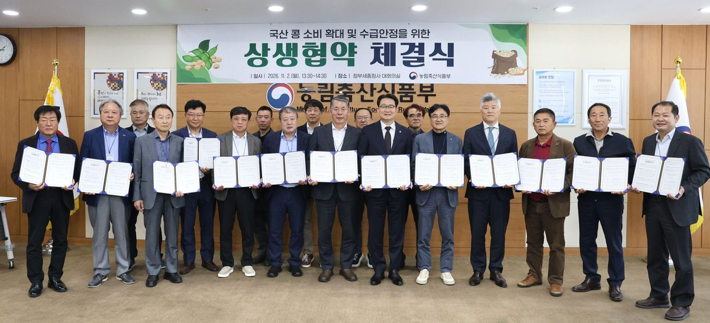
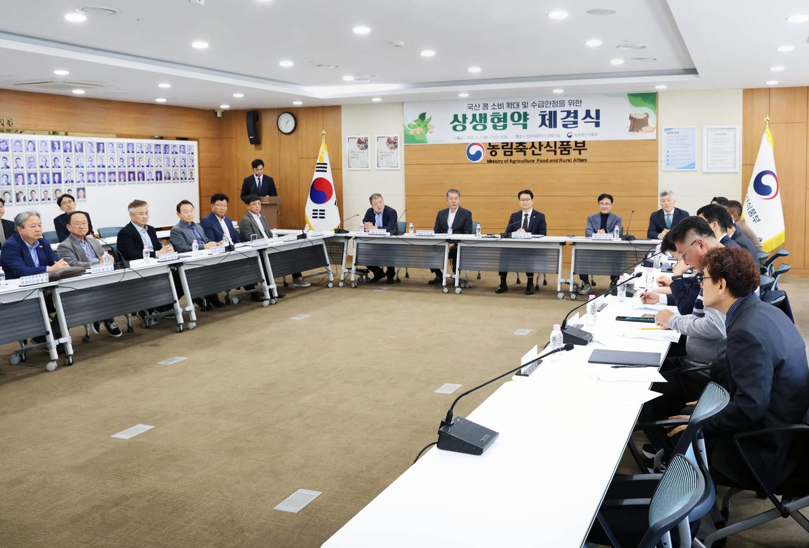

입력 2026-11-02

*2일 정부세종청사에서 열린 '국산 콩 소비 확대 및 수급안정을 위한 상생협약 체결식'에서 참석자들이 협약서를 들어 보이고 있다. 사진=농림축산식품부 제공*

국산 콩을 기르는 생산자와 콩을 원료로 쓰는 가공업계가 손을 잡았다. 생산은 늘었지만 소비가 따라가지 못하는 국산 콩을 가공업계가 더 사서 쓰고, 생산자는 업계가 원하는 품질과 물량을 맞춰 공급하기로 했다.

농림축산식품부는 2일 정부세종청사에서 콩 생산자단체, 식용대두·콩나물콩 가공업계와 「국산 콩 소비 확대 및 수급안정을 위한 상생협력 업무협약」을 체결했다고 밝혔다.

## 누가 참여했나

- 정부: 농식품부 김종구 차관
- 생산자단체: 농협두류전국협의회, 한국들녘경영체중앙연합회, 전국콩생산자연합회, 콩제주협의회 등
- 가공업계: 한국연식품협동조합연합회, 한국식품산업협회, 한국콩나물숙주농업인협회 등

농식품부는 국산 콩 생산이 계속 늘고 있지만 소비 증가가 이에 미치지 못하고, 식품업계에서는 안정적인 원료 공급이 필요하다는 목소리가 나와 생산자와 가공업계가 함께 수급안정 방안을 찾기 위해 협약을 추진했다고 설명했다.

## 협약 내용

- 정부: 국산 콩 소비기반을 넓히고 수급을 안정적으로 관리한다.
- 생산자단체: 가공업계가 필요로 하는 품질·규격·물량의 국산 콩을 안정적으로 생산·공급한다.
- 가공업계: 계약재배와 산지 구매 등으로 국산 콩 구매·사용을 늘린다.
- 함께: 국산 콩을 활용한 신제품 개발, 새 소비처 발굴, 공동 홍보·판촉에 협력한다.

세 주체는 앞으로 수급안정 방안을 계속 논의하기 위해 '콩 수급관리 상생협의체'를 구성했다. 이날 열린 첫 협의체에서는 최근 콩 수급상황을 공유하고 국산 콩 소비 확대와 안정적인 원료 공급을 위한 수급안정 방안, 앞으로의 협의체 운영계획 등을 논의했다.

*2일 정부세종청사에서 열린 상생협약 체결식과 협의체 회의. 사진=농림축산식품부 제공*

김종구 차관은 "앞으로는 생산된 콩이 안정적으로 소비되고 시장에서 제값을 받을 수 있도록 소비기반을 함께 키워나가는 것이 중요하다"라며, "이번 협약을 계기로 생산자는 시장 수요에 맞는 품질 좋은 콩을 안정적으로 공급하고, 콩 가공업계는 국산 콩 구매와 사용을 확대하며, 정부는 국산 콩 소비 확대와 안정적인 원료 수급을 지원하여 생산자와 가공업계가 함께 성장하는 상생형 수급체계를 구축해 나가겠다"라고 밝혔다.

※ 이 기사는 농림축산식품부 보도자료(공공누리 제1유형, 출처표시)를 바탕으로 작성했습니다. 사진은 농림축산식품부가 보도자료와 함께 제공한 것입니다.
