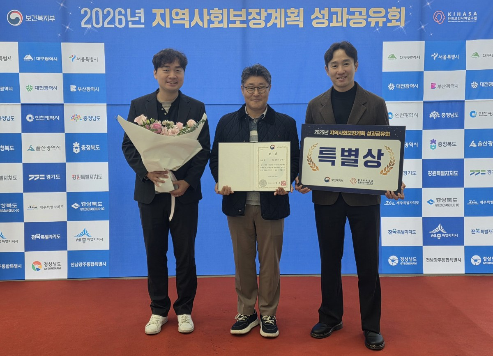

입력 2026-11-03

*'2026년 지역사회보장계획 성과공유회'에서 송파구가 특별상을 받는 모습. 사진=송파구 제공*

서울 송파구가 보건복지부 주관 「2025년 지역사회보장계획 시행결과 평가」에서 우수 지방자치단체로 뽑혀 '특별상'을 받았다. 시상은 10월 30일 정부세종청사에서 열린 성과공유회에서 이뤄졌다.

송파구는 3일 보도자료에서 이같이 밝혔다.

이번 평가는 「사회보장급여의 이용·제공 및 수급권자 발굴에 관한 법률」 제39조에 따라 지방자치단체의 2025년 지역사회보장계획 시행결과를 대상으로 진행됐다. 계획의 충실성, 목표 달성도, 시행과정의 적정성, 사업관리와 역량 강화 노력 등을 종합적으로 따졌고, 모두 44개 지방자치단체가 우수 지자체로 선정됐다.

송파구는 '누구도 소외되지 않는 복지 송파'를 목표로 9개 전략, 43개 사업으로 짜인 지역사회보장계획을 세우고 지역의 복지 수요와 특성을 반영한 복지사업을 추진해 왔다. 구는 지역 여건에 맞는 복지서비스 제공과 체계적인 사업 추진으로 주민 복지 증진과 사회보장체계 강화에 힘써 온 점이 이번 평가에서 인정받았다고 설명했다.

서강석 송파구청장은 "이번 수상은 지역주민과 지역사회보장협의체, 민간 복지기관 및 관계자들이 한마음으로 합심해 이뤄낸 뜻깊은 성과"라며 "앞으로도 구민의 다양한 복지 수요를 세심하게 살피고 민관 협력을 한층 강화해, 구민 누구도 소외됨 없는 따뜻하고 촘촘한 포용의 도시를 만들어 가겠다"고 말했다.

※ 이 기사는 송파구 보도자료(11월 3일)를 바탕으로 작성했습니다.
