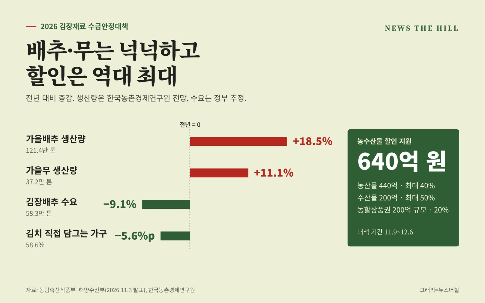

입력 2026-11-03

*그래픽=뉴스더힐(자료: 농림축산식품부·해양수산부, 한국농촌경제연구원)*

올해 김장은 배추와 무 걱정을 덜 수 있을 전망이다. 가을배추와 무 생산량이 지난해보다 크게 늘어 공급이 충분하고, 정부는 김장재료 할인에 역대 최대 규모인 640억 원을 쓴다.

농림축산식품부와 해양수산부는 3일 이런 내용의 「2026 김장재료 수급안정대책」을 합동 발표했다. 대책 대상 김장재료는 배추, 무, 고춧가루, 마늘, 대파, 쪽파, 양파, 생강, 갓, 배, 천일염, 새우젓, 멸치액젓이다.

## 공급은 넉넉, 수요는 줄어

한국농촌경제연구원(KREI) 전망에 따르면 올해 가을배추 생산량은 121.4만 톤으로 지난해보다 18.5%, 가을무는 37.2만 톤으로 11.1% 늘어난다. 양호한 기상 여건 덕분이다. 마늘·새우젓처럼 생산량이 다소 줄어든 양념류도 있지만 김장철 공급량은 충분할 것으로 정부는 내다봤다.

반대로 김장 수요는 줄었다. 가정에서 김치를 직접 담근다는 비율은 58.6%로 지난해(64.2%)보다 5.6%포인트 낮아졌고, 4인 가구 기준 김장 규모는 23.4포기로 지난해(23.5포기)와 비슷했다. 이에 따라 올해 김장배추 수요는 지난해(642천 톤)보다 9.1% 줄어든 583천 톤으로 추정됐다.

정부는 가격 하락에 따른 농가의 어려움과 소비자의 장바구니 부담을 함께 덜기 위해 11월 9일부터 12월 6일까지 대책을 추진한다.

## 할인은 어디서, 얼마나

- 농산물(440억 원): 대형·중소형마트 등에서 김장재료 전 품목과 수육용 돼지고기 등을 최대 40% 할인한다(10월 29일~12월 2일). 최근 값이 내린 오이, 애호박, 토마토, 파프리카, 샤인머스캣 등도 할인 대상에 넣는다.
- 농할상품권(200억 원 규모): 전통시장 등에서 쓸 수 있는 상품권을 20% 선할인 판매한다(최대 10만 원). 구매 기간은 고령층 11월 2일(월)~8일(일), 전체 11월 9일(월)~15일(일).
- 수산물(200억 원): 「대한민국 수산대전_김장 특별전」(10월 28일~11월 29일)에서 천일염, 새우젓, 멸치액젓, 굴과 대중성 어종 등을 최대 50% 할인한다.

## 비축 물량 풀고 원산지·잔류농약 점검

정부는 배추 46.5천 톤(비축 10, 출하조절시설 3.5, 계약재배 33)과 무 9천 톤(비축 2, 계약재배 7)을 미리 확보해 일시적인 공급 부족 등 비상시에 대응한다. 정부 비축 고추 500톤, 마늘 515톤, 양파 1,500톤도 가공·유통업체에 먼저 공급한다.

김장재료 원산지표시 단속(10월 27일~12월 5일)과 배추·무·고추·마늘 등 채소류 잔류농약 안전성 조사(10월 12일~11월 30일, 800건)도 강화한다. 김장비용 등 가격 정보도 주기적으로 제공한다.

이와 함께 「더하고 나누는 김장, 한 포기 더의 행복」을 핵심 메시지로 지방정부·농협과 함께 김치 담그기 행사와 나눔 캠페인, 농촌체험휴양마을 김장 체험행사, 공공기관·민간기업 임직원 김치 단체 구매와 선물하기 캠페인, 취약계층 김치 나눔 등을 벌인다.

송미령 농식품부 장관은 "올해는 전반적으로 김장채소 공급은 충분한 반면, 애쓰신 농업인들은 상대적으로 가격 하락에 따른 어려움이 염려된다"라고 하면서 "유네스코 문화유산으로 등재된 자랑스러운 김장 문화를 지닌 만큼, '한 포기 더 담고 나누기'에 동참해 어려운 농가와 이웃 사랑을 실천해주시길 바란다."라고 밝혔다.

황종우 해수부 장관은 "김장재료인 새우젓, 멸치액젓, 굴 등을 최대 50%까지 할인된 가격으로 공급하는 등 김장철 장바구니 부담 완화를 위해 최선을 다하겠다"고 밝혔다.

※ 이 기사는 농림축산식품부·해양수산부 보도자료(공공누리 제1유형, 출처표시)를 바탕으로 작성했습니다.
