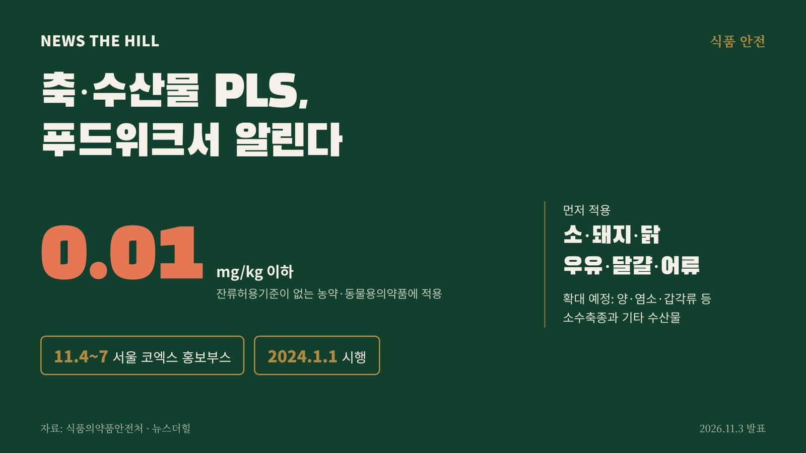

입력 2026-11-03

*그래픽=뉴스더힐(자료: 식품의약품안전처)*

식품의약품안전처가 11월 4일부터 7일까지 서울 코엑스(COEX)에서 열리는 '2026 푸드위크 코리아'에서 축·수산물 허용물질목록 관리제도(PLS)를 알리는 홍보부스를 운영한다.

식약처는 3일 이같이 밝혔다.

PLS(Positive List System)는 국내 잔류허용기준이 정해지지 않은 잔류물질(농약, 동물용의약품)에 일률기준인 0.01mg/kg 이하를 적용해 관리하는 제도다. 축·수산물 PLS는 2024년 1월 1일부터 소, 돼지, 닭, 우유, 달걀 같은 다소비 축산물과 어류를 대상으로 먼저 시행됐고, 앞으로 양, 염소, 갑각류 등 소수축종과 기타 수산물로 적용 대상을 넓힐 예정이다.

## 부스에서는

- 축·수산물 PLS 홍보 영상과 공모전 수상작 전시. 공모전은 'PLS로 축·수산물을 안심하고 소비할 수 있다는 내용'을 주제로 올해 7~9월 숏폼 영상을 받았다.
- 관람객 참여형 이벤트와 설문조사, 참여자 기념품 증정

푸드위크 코리아는 국내외 프리미엄 식품부터 대체·신식품, 제조자동화, 스마트유통, 팜테크까지 선보이는 국제 종합 식품 전시회다. 식약처는 식품산업 관계자와 일반 소비자에게 축·수산물 PLS를 친근하게 알리고 먹거리 안전관리에 대한 공감대를 넓히기 위해 부스를 마련했다고 설명했다.

※ 이 기사는 식품의약품안전처 보도참고자료(정책브리핑, 공공누리 제1유형)를 바탕으로 작성했습니다.
