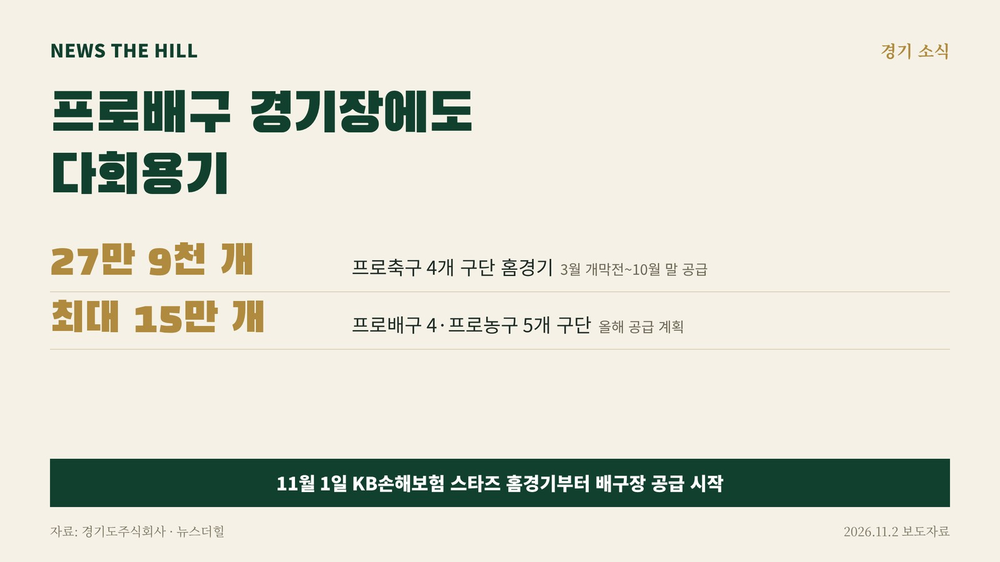

입력 2026-11-03

*그래픽=뉴스더힐(자료: 경기도주식회사)*

경기도와 경기도주식회사가 도내 프로스포츠 경기장에 다회용기를 공급하는 사업이 프로배구까지 넓어졌다.

경기도주식회사는 지난 1일 이충문화체육센터에서 열린 KB손해보험 스타즈의 시즌 첫 홈경기를 시작으로 프로배구 경기장에 다회용기 공급을 시작했다고 2일 밝혔다.

올해 공급 대상은 KB손해보험 스타즈, IBK기업은행 알토스, 한국전력 빅스톰, 현대건설 힐스테이트 등 도내 프로배구 4개 구단과 고양소노 스카이거너스 등 프로농구 5개 구단의 홈경기다. 경기도주식회사는 이들 경기에 최대 15만 개의 다회용기를 공급할 계획이다. 프로농구 5개 구단 홈경기에는 지난달부터 공급하고 있다.

관람객이 경기장 안에서 식음료를 다회용기에 제공받고 반납하면, 전문 세척업체가 위생적으로 씻어 다시 쓰는 방식이다. 경기장 내 일회용품 사용을 줄이고 다회용기 사용 문화를 넓히려는 사업이다.

경기도주식회사는 올해 프로축구 정규리그 기간(3월 개막전~10월 말) 화성FC·안산그리너스·안양FC·부천FC 등 4개 구단 홈경기에 모두 27만 9천 개의 다회용기를 공급했다. 안산 열린음악회, 광명 특화지구 골목비어축제, 시흥 평생학습축제, 안산 김홍도축제 등 도내 주요 행사에도 다회용기를 지원해 왔다.

※ 이 기사는 경기도·경기도주식회사 보도자료(경기도뉴스포털 보도자료, 공공누리 제1유형·출처표시)를 바탕으로 작성했습니다.
