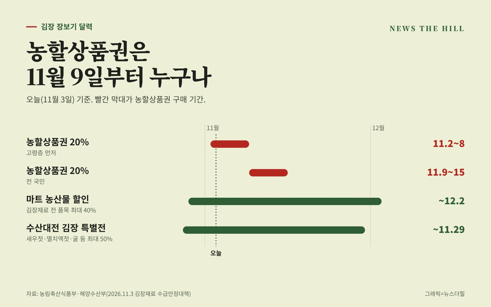

입력 2026-11-03

*그래픽=뉴스더힐(자료: 농림축산식품부·해양수산부)*

김장 장보기 할인은 품목마다 기간이 다르다. 농축산물을 20% 싸게 살 수 있는 농할상품권(농축산물 할인 상품권)은 11월 9일(월)부터 15일(일)까지 전 국민이 살 수 있고, 그 앞 주인 11월 2일(월)부터 8일(일)까지는 고령층 우선 구매 기간이다.

농림축산식품부와 해양수산부가 3일 발표한 「2026 김장재료 수급안정대책」에 따르면 이번 농할상품권은 200억 원 규모로 발행되며, 할인율은 20%(최대 10만 원)다.

## 농할상품권, 어떻게 사고 어디서 쓰나

- 무엇: 액면가보다 20% 싸게 파는 모바일 상품권. 농식품부는 10월 27일 발표에서 모바일 농할상품권을 11월 2일부터 15일까지 20% 할인 판매한다고 밝혔다.
- 어디서 사나: 지난 추석 때는 '비플페이 앱 등'을 통해 발행됐다(농식품부 9월 1일 보도자료). 이번 회차의 판매 앱과 1인 구매 한도는 판매처 안내를 확인해야 한다.
- 어디서 쓰나: 전통시장 등. 농식품부는 7월부터 사용처를 전통시장 여부와 관계없이 국산 농축산물을 주로 취급하는 점포까지 넓혔다고 밝힌 바 있다.

## 같은 기간 겹치는 할인

- 마트 농산물 할인(10월 29일~12월 2일): 대형·중소형마트 등에서 김장재료 전 품목과 수육용 돼지고기 등을 최대 40% 할인. 최근 값이 내린 오이, 애호박, 토마토, 파프리카, 샤인머스캣 등도 대상이다.
- 「대한민국 수산대전_김장 특별전」(10월 28일~11월 29일): 천일염, 새우젓, 멸치액젓, 굴과 대중성 어종 등을 최대 50% 할인.

올해 가을배추와 무는 생산량이 지난해보다 각각 18.5%, 11.1% 늘어 공급이 충분할 것으로 정부는 내다봤다. 정부는 김장비용 등 가격 정보도 주기적으로 내놓겠다고 밝혔다.

※ 이 기사는 2026년 11월 3일 기준 농림축산식품부·해양수산부 「2026 김장재료 수급안정대책」(11월 3일), 농림축산식품부 보도자료(10월 27일 코리아 그랜드 페스티벌, 9월 1일 추석 대책, 7월 1일 먹거리 물가 대책, 1월 28일 설 대책)를 확인해 작성했습니다(공공누리 제1유형, 출처표시).
