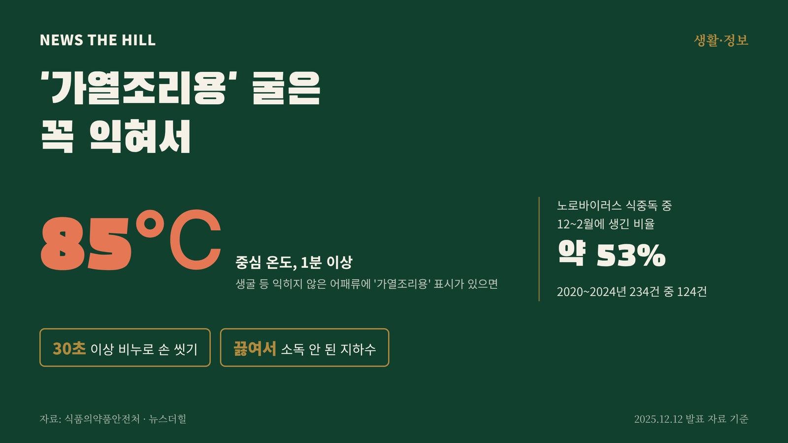

입력 2026-11-03

*그래픽=뉴스더힐(자료: 식품의약품안전처)*

겨울에 굴을 산다면 포장 표시부터 살펴볼 필요가 있다. 생굴 등 익히지 않은 어패류 제품에 '가열조리용' 같은 표시가 있으면 날로 먹지 말고, 중심 온도 85℃에서 1분 이상 익혀 먹어야 한다. 식품의약품안전처가 노로바이러스 식중독 예방 수칙으로 안내하는 내용이다.

## 왜 겨울에 조심하나

식약처에 따르면 노로바이러스는 낮은 온도에서도 살아남아 겨울철부터 이듬해 봄까지 주로 발생하는 대표적인 식중독 원인 병원체다. 구토, 설사 등 급성 위장염을 일으키고 전염성이 강하다.

식약처가 2025년 12월 발표한 자료를 보면 최근 5년(2020~2024년)간 노로바이러스 식중독은 모두 234건이었고, 이 가운데 12월부터 이듬해 2월까지 발생한 것이 124건으로 약 53%를 차지했다. 오염된 음식물이나 지하수를 먹어서 걸리는 경우와 환자의 분변·구토물·침, 오염된 손 등 사람 간 접촉으로 퍼지는 경우가 많다.

## 집에서 지킬 것

- 굴 등 어패류: 익히지 않은 제품에 '가열조리용' 등의 표시가 있으면 반드시 중심 온도 85℃, 1분 이상 가열해 먹는다.
- 손 씻기: 노로바이러스는 입자가 작고 표면에 잘 달라붙는다. 비누 등 세정제를 써서 흐르는 물에 30초 이상, 손가락과 손등까지 씻는다.
- 채소·과일: 물에 담갔다가 흐르는 물에 깨끗이 씻는다.
- 조리도구: 열탕 소독하거나 기구 등 살균소독제로 소독한 뒤 세척한다.
- 지하수: 소독하지 않은 지하수는 반드시 끓여서 쓴다.
- 아픈 사람은 조리에서 빠진다: 구토, 설사 등 의심 증상이 있으면 음식 조리에 참여하지 않고, 증상이 나아진 뒤에도 2~3일은 쉬어야 한다.
- 집 안 소독: 화장실, 문손잡이, 수도꼭지 등은 염소 소독제로 소독한다.

특히 면역력이 약한 영유아는 노로바이러스에 걸리기 쉬워, 식약처는 어린이집·유치원 같은 영유아 시설에 위생관리를 거듭 당부하고 있다.

※ 이 기사는 2026년 11월 3일 기준 식품의약품안전처 보도자료 「식약처, 어린이집 등 영유아 시설 노로바이러스 식중독 주의 당부」(2025년 12월 12일, 정책브리핑, 공공누리 제1유형)를 확인해 작성했습니다.
