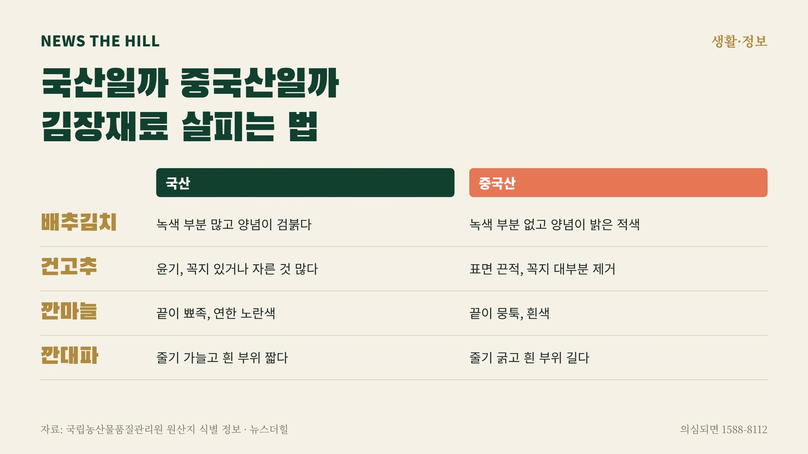

입력 2026-11-03

*그래픽=뉴스더힐(자료: 국립농산물품질관리원)*

김장재료를 살 때 가장 먼저 볼 것은 원산지 표시다. 표시가 있어도 미심쩍다면 생김새로 한 번 더 확인할 수 있다. 국립농산물품질관리원(농관원)이 김장철 원산지 집중 단속(11월 4일~12월 4일)을 알리며 함께 공개한 식별 정보를 품목별로 정리했다.

## 품목별로 보면

- 배추김치: 국산은 뿌리 직경이 작고 배추 껍질을 조금 제거해 녹색 부분이 많으며 양념 색깔이 검붉다. 중국산은 뿌리 직경이 크고 껍질을 많이 제거해 녹색 부분이 없으며 양념 색깔이 밝은 적색이다.
- 배추: 국산은 속잎이 알차고 촘촘하며 밑동의 너비가 좁고 동그란 원형이고, 흙이 묻어 있어 깨끗하지 않다. 중국산은 속잎이 알차지 못하고 휘어진 줄기가 있으며, 밑동의 너비가 넓고 완만한 원형이고 흙이 없이 깨끗하다.
- 건고추: 국산은 수확해 바로 말리므로 윤기가 있고 형태가 살아 있으며, 꼭지가 있거나 자른 것이 많다. 중국산은 냉동 홍고추를 말려 표면이 끈적끈적하고 씨가 붙어 있으며 꼭지가 대부분 제거돼 있다.
- 깐마늘: 국산은 끝부분이 대부분 뾰족하고 연한 노란색을 띠며 기형 마늘이 거의 없다. 중국산은 끝부분이 뭉툭하거나 뒤쪽으로 치우쳐 있고 흰색을 띠며 기형 마늘이 많이 섞여 있다.
- 통양파: 국산은 껍질이 부드러워 잘 찢어지고 뿌리털이 대부분 남아 있으며 줄기 부분이 길다. 중국산은 껍질이 질기고 잘 찢어지지 않으며 뿌리털이 제거돼 짧고 줄기 부분이 짧다.
- 깐대파: 국산은 줄기가 가늘고 고르지 않으며 흰색 줄기 부위가 짧고 굵기가 일정하지 않다. 중국산은 줄기가 굵고 고르며 흰색 줄기 부위가 길고 굵기가 대체로 일정하다.

그 밖의 품목은 농관원 누리집(www.naqs.go.kr)의 '업무소개 → 원산지관리 → 원산지 식별정보'에서 볼 수 있다.

## 의심되면 신고

농관원은 원산지 표시가 없거나 거짓 표시가 의심되면 부정유통신고센터(1588-8112)로 신고해 달라고 당부했다. 원산지를 거짓으로 표시한 업체는 7년 이하의 징역 또는 1억 원 이하의 벌금 처분을 받고, 원산지를 표시하지 않으면 1천만 원 이하의 과태료가 부과된다.

※ 이 기사는 2026년 11월 3일 기준 국립농산물품질관리원 보도자료(11월 2일, 붙임 '김장철 주요 품목 원산지 식별 방법', 공공누리 제1유형·출처표시)를 확인해 작성했습니다.
