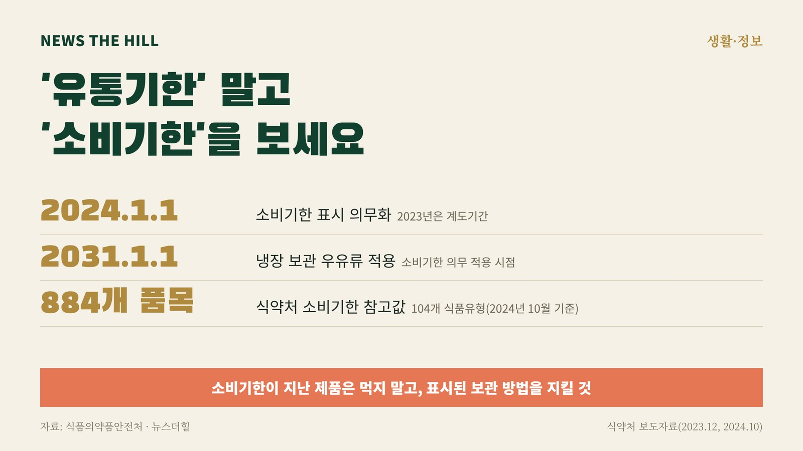

입력 2026-11-03

*그래픽=뉴스더힐(자료: 식품의약품안전처)*

식품 포장에 찍힌 날짜는 이제 대부분 '소비기한'이다. 식품의약품안전처는 영업자 중심의 '유통기한' 대신 식품을 안전하게 먹을 수 있는 기한을 알려주는 소비자 중심의 '소비기한'을 표시하도록 제도를 바꿨다. 2023년 1월 도입해 1년간 계도기간을 거쳤고, 2024년 1월 1일부터 의무로 적용됐다.

## 무엇이 달라졌나

- 유통기한: 제조일로부터 유통·판매가 허용된 기간을 알려주는 표시였다.
- 소비기한: 식품을 안심하고 먹을 수 있는 기한을 알려준다.
- 예외: 냉장 보관하는 우유류 제품은 2031년 1월 1일부터 소비기한 표시 의무가 적용된다.

식약처는 제도를 바꾼 이유로 식품 폐기물 감소와 탄소중립을 들었다.

## 소비자가 지킬 것

식약처는 제품에 표시된 날짜를 꼼꼼히 확인하고 보관 방법을 지키며, 소비기한이 지난 제품은 먹지 말고 산 식품은 되도록 빨리 먹으라고 당부했다.

## 기한은 누가 정하나

소비기한은 각 영업자가 제품 특성에 맞게 정한다. 식약처는 영업자가 참고할 수 있도록 품목별 설정 실험을 거친 '소비기한 참고값'을 내놓고 있으며, 2024년 10월 기준 104개 식품유형 884개 품목의 참고값을 제공했다. 관련 정보는 식품안전나라(www.foodsafetykorea.go.kr) '식품·안전 → 식품표시광고 → 소비기한'에서 볼 수 있다.

최근에는 소비기한 표시가 잘못된 제품이 회수되는 일도 잇따랐다. 식약처는 10월 30일 소비기한을 이중으로 표시한 과·채가공품을, 10월 16일에는 소비기한을 표시하지 않은 소스를 회수 조치했다. 산 제품이 회수 대상인지는 식품안전나라에서 확인할 수 있다.

※ 이 기사는 2026년 11월 3일 기준 식품의약품안전처 보도자료(2023년 12월 28일 「식품 소비의 새로운 기준, 소비기한 표시제도 안착」, 2024년 10월 21일 「소비기한, 이젠 선택 아닌 필수」, 2026년 10월 16일·30일 회수 조치)를 확인해 작성했습니다(정책브리핑, 공공누리 제1유형).
