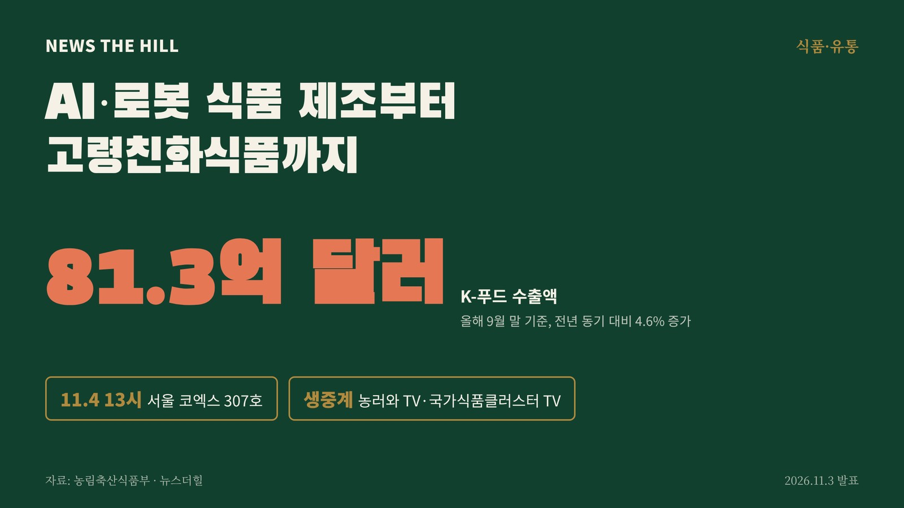

입력 2026-11-03

*그래픽=뉴스더힐(자료: 농림축산식품부)*

인공지능(AI)과 로봇을 활용한 식품 제조, 초고령사회에 맞춘 고령친화식품을 함께 다루는 국제학술대회가 4일 서울 코엑스에서 열린다.

농림축산식품부는 「제16회 국가식품클러스터 국제콘퍼런스」와 「제5회 고령친화식품산업 심포지엄」을 11월 4일(수) 오후 1시부터 서울 코엑스 콘퍼런스룸 307호에서 연다고 3일 밝혔다. 농식품부가 주최하고 한국식품산업클러스터진흥원이 주관한다. 현장 진행과 함께 유튜브 채널 '농러와 TV'와 '국가식품클러스터 TV'로도 생중계한다.

농식품부에 따르면 올해 9월 말 기준 K-푸드 수출액은 81.3억 달러로 지난해 같은 기간보다 4.6% 늘어 역대 최고 실적을 기록했다. 농식품부는 이런 성장세를 이어가려면 수출 확대와 함께 상품기획부터 생산·유통까지 식품산업 전반의 경쟁력을 높이는 혁신이 필요하다고 설명했다.

## 1부 국가식품클러스터 국제콘퍼런스(오후 1시 40분~4시)

주제는 'K-푸드 글로벌 선진화를 위한 식품산업 3X 혁신 전략'이다.

- 기조연설: 스테파니 프랭크 지멘스 선임 부사장 '식품산업 미래혁신기술의 필요성 및 적용 사례'
- AI 활용 상품기획 및 마케팅·홍보 전략(김봉수 더블유케이마케팅그룹 전무)
- 디지털 트윈을 통한 생산·유통 시뮬레이션 실증 사례(케인 칸 화웨이 상무)
- Physical AI 협동로봇 활용 식품생산 공정 유연화(박응서 두산로보틱스 팀장)
- 특별세션: 아비셰크 굽타 인디아그로 대표(방송인 럭키)가 K-Food Culture와 글로벌화 가능성을 소개

## 2부 고령친화식품산업 심포지엄(오후 4시~5시 20분)

'모두를 위한 식품(Food for all), 고령친화식품의 미래를 말하다'를 주제로 고령친화식품산업 지원 정책(농식품부), 지역사회와 연계한 고령친화식품 현장 실증(정순돌 이화여대 교수), 일본 케어푸드의 발전 과정과 세계 시장 전망(타카시 구로다 일본영양지원배식사업협의회 회장)을 공유한다.

우리나라는 2024년 초고령사회에 들어섰다. 농식품부는 '고령친화우수식품(늘편푸드)' 지정으로 관련 산업을 지원하고 있다. 늘편푸드는 고령친화우수식품을 소비자가 쉽게 알아볼 수 있도록 붙인 이름으로, '늘(언제나) 편하게 먹을 수 있는 음식'이라는 뜻이다.

농식품부 정경석 식품산업정책관은 "이번 행사는 AI·디지털·로봇 등 미래 혁신 기술을 통한 식품산업의 변화와 초고령사회에 따른 새로운 식품 수요를 함께 살펴보는 자리"라며, "기술혁신과 변화하는 소비자 수요에 대응해 K-푸드가 새로운 성장동력으로 자리매김할 수 있도록 산업계와 지속적으로 소통하고 지원해 나가겠다"고 밝혔다.

※ 이 기사는 농림축산식품부 보도자료(공공누리 제1유형, 출처표시)를 바탕으로 작성했습니다.
