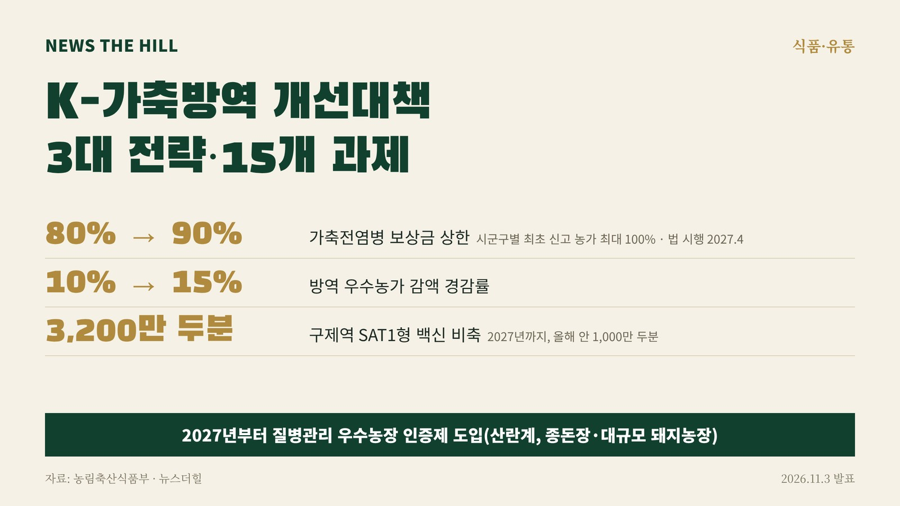

입력 2026-11-03

*그래픽=뉴스더힐(자료: 농림축산식품부)*

가축전염병이 생긴 축산농가에 주는 보상금 상한이 최대 80%에서 90%로 오르고, 시군구에서 처음 신고한 농가는 최대 100%까지 받을 수 있게 된다. 방역을 잘해 온 농가의 보상금 감액 경감률도 10%에서 15%로 높아진다.

농림축산식품부는 3일 이런 내용을 담은 「K-가축방역 개선대책」을 마련했다고 밝혔다. 고병원성 조류인플루엔자(AI) 3가지 유형 동시 발생, 인접국의 구제역 신종 유형 발생, 아프리카돼지열병(ASF) 전파경로 다양화(혈장단백 사료 등) 같은 새로운 위험에 대응하기 위해 2025년 세운 「중장기 가축방역 발전대책」을 보완한 것이다. 4월부터 10월까지 생산자단체·전문가·관계기관이 참여한 정책 태스크포스(TF)를 운영해 과제를 정했다.

대책은 ▲사전예방·현장 역량 강화 ▲발생 시 대응 실효성 제고 ▲방역관리체계 개선 등 3대 전략, 15개 과제로 짜였다.

## 농가에 달라지는 것

- 보상금: 상한을 최대 80%에서 90%로 올리고, 시군구별 최초 신고 농가는 최대 100%까지 지급할 수 있게 한다. 방역 우수농가의 감액 경감률은 10%에서 15%로 높인다. 고의로 구제역 백신접종 명령을 따르지 않은 농가는 엄격히 관리한다. 근거인 「가축전염병 예방법」은 10월 개정됐고 2027년 4월 시행된다.
- 우수농장 인증제(2027년~): 산란계, 종돈장·대규모 돼지농장을 대상으로 '청정인증농장'과 '우수관리인증농장'을 도입하고 방역물품 지원, 보상금 감액 경감 등 인센티브를 준다.
- 자율점검: 정부 주도 점검에서 농가 자율점검 중심으로 바꾼다. 정부는 점검을 하지 않은 농가, 무작위 선별 농가, 고위험 농가를 집중 점검한다.
- 교육: 농장주뿐 아니라 농장관리자·종업원까지 교육 대상을 넓히고, 외국인 종업원에게는 입국부터 농장 근무까지 단계별 다국어 교육을 한다.
- 가축처분·이동제한: 질병 특성과 위험도 평가에 따라 탄력적으로 적용한다. 시군 내 구제역 최초 발생 농가라도 조건을 충족하면 부분 처분을 하고, ASF 발생농장에서 돼지를 받은 농장은 정밀검사와 위험도 평가에 따라 처분을 미룰 수 있게 한다.

## 질병별 대응

- 구제역: 백신접종 누락 개체를 찾아 관리하고, 새로운 유형(SAT1형)에 대비해 위험지역 사전접종과 백신 비축을 추진한다. SAT1형 백신은 2027년까지 3,200만 두분(올해 안 1,000만 두분)을 비축한다.
- ASF: 야생멧돼지, 불법 축산물 유통, 혈장단백 사료 등 3대 전파 위험요인을 관리한다.
- 고병원성 AI: 지난해 발생이 많았던 산란계 농장을 중심으로 출입 사람·차량 사전등록제를 도입해 4단계 방역으로 강화한다. 상시백신 도입 여부를 검토하는 백신검토위원회를 10월부터 운영한다.
- 럼피스킨: 위험농가 대상 백신 접종, 전문업체를 통한 긴급방제를 추진한다.
- 5대 경제성 가축질병: 축산농가에 연간 약 6,200억 원(추정)의 손실을 주는 소바이러스성설사병, 돼지유행성설사병 등에 대해 실태조사·맞춤형 백신 공급·청정농장 인증 등 종합대책을 새로 마련한다.

백신 개발은 2027년까지 구제역 플랫폼 백신 상용화, 고병원성 AI 백신·진단법 개발을, 2030년까지 ASF 백신 개발을 추진한다. 「가축전염병 예방법」은 사전예방·위험관리 중심으로 전면 개편해 가축전염병 분류를 1·2·3종에서 긴급관리·중점관리·상시관리 등 위험도 중심으로 바꾸는 방안을 예시로 들었다.

농식품부 이동식 방역정책국장은 "그간 정부와 현장의 노력으로 가축 전염병을 예방하고 확산을 방지하는 성과가 있었으나, 새로운 전파경로 등 변화하는 방역 여건으로 인해 기존 체계만으로는 대응하기 어려운 부분도 있었다."라며, "이번 대책으로 관계기관 및 농가의 사전예방 역량을 높이고, 방역 미비점을 보완하여 변화하는 방역환경에 효과적으로 대응해 축산농가의 경제적 안정과 축산물의 안정적 공급을 위해 노력하겠다."라고 밝혔다. 이어 "지방정부와 관계기관, 축산농가의 관심과 협조를 부탁드린다."고 덧붙였다.

※ 이 기사는 농림축산식품부 보도자료(공공누리 제1유형, 출처표시)를 바탕으로 작성했습니다.
