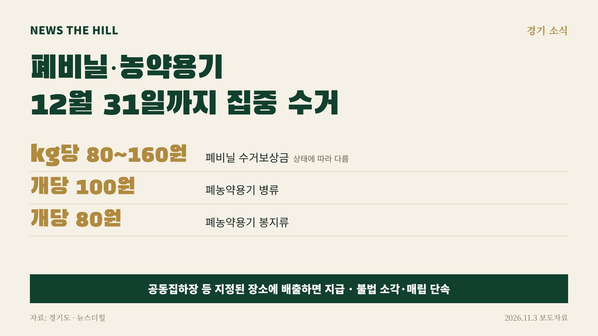

입력 2026-11-03

*그래픽=뉴스더힐(자료: 경기도)*

수확이 끝난 뒤 논밭에 남은 폐비닐과 농약 빈 용기를 정해진 곳에 내면 보상금을 받을 수 있다. 경기도는 12월 31일까지 폐비닐과 폐농약용기류를 집중 수거한다고 3일 밝혔다.

도는 시군과 함께 농경지 등에 방치된 영농폐기물을 거두고, 불법 소각·매립 단속도 강화한다. 농가에는 올바른 분리배출 방법과 수거보상금 제도를 안내한다.

## 보상금은

농가에서 나온 폐비닐과 폐농약용기류를 공동집하장 등 지정된 장소에 배출하면 보상금을 준다.

- 폐비닐: 상태에 따라 1kg당 80~160원
- 폐농약용기 병류: 개당 100원
- 폐농약용기 봉지류: 개당 80원

경기도는 올해 9월까지 폐비닐 1만 2,551톤과 폐농약용기류 358만 8,000개를 수거했다. 집중 수거는 영농폐기물이 많이 나오는 시기에 맞춰 해마다 상반기(2~5월)와 하반기(11~12월) 두 차례 한다. 농촌 폐기물의 불법 소각을 줄여 미세먼지와 환경오염을 막고 재활용을 늘리기 위해서다.

서진석 경기도 자원순환과장은 "영농폐기물 집중 수거는 미세먼지를 줄이고 농촌 환경오염을 방지하며 자원 재활용을 촉진하는 사업"이라며 "깨끗한 농촌 환경을 만들 수 있도록 농가의 적극적인 참여를 당부드린다"고 말했다.

※ 이 기사는 경기도 보도자료(경기도뉴스포털, 공공누리 제1유형·출처표시)를 바탕으로 작성했습니다.
