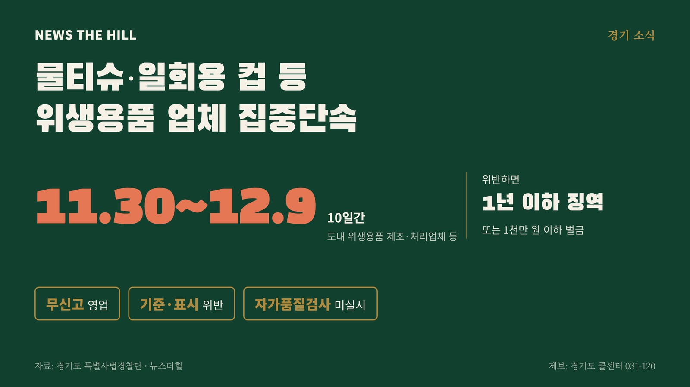

입력 2026-11-03

*그래픽=뉴스더힐(자료: 경기도 특별사법경찰단)*

물티슈와 일회용 컵, 화장지처럼 매일 쓰는 위생용품을 만드는 업체가 경기도의 집중 단속을 받는다.

경기도 특별사법경찰단은 11월 30일(월)부터 12월 9일(수)까지 10일간 도내 위생용품 제조·처리업체 등의 불법행위를 집중 단속한다고 3일 밝혔다.

위생용품은 몸에 직·간접적으로 닿는 제품이다. 세척제와 헹굼보조제, 일회용 컵·숟가락·젓가락·빨대, 화장지·물티슈·면봉·기저귀, 칫솔·치실 등이 해당한다.

## 무엇을 보나

- 영업신고 없이 위생용품을 제조·가공·소분하거나 위생물수건처리업을 운영하는 행위
- 기준·규격에 맞지 않는 위생용품을 제조·판매하는 행위
- 제품명·제조연월일 등 표시기준을 어긴 행위
- 자가품질검사를 하지 않은 행위
- 영업시설 위생관리, 원료의 위생적 보관·관리 등 영업자 준수사항 위반

「위생용품 관리법」에 따라 무신고 영업, 기준·규격에 맞지 않는 제품의 제조·판매, 자가품질검사 미실시 등은 1년 이하의 징역 또는 1천만 원 이하의 벌금에 처해질 수 있다. 특사경은 위반 업체를 관련 법령에 따라 수사하고, 행정처분이 필요한 사항은 관할 행정기관에 통보할 방침이다.

권문주 경기도 특별사법경찰단장은 "위생용품은 도민들이 일상생활에서 자주 사용하는 제품인 만큼 제조·유통 과정에서 철저한 안전관리가 필요하다"며 "위생용품 불법 제조·유통행위에 대한 지속적인 단속을 통해 도민들이 안심하고 사용할 수 있는 안전한 생활환경을 조성하겠다"고 말했다.

불법행위 제보는 경기도 특별사법경찰단 누리집(gg.go.kr/gg_special_cop)이나 경기도 콜센터(031-120)로 하면 된다.

※ 이 기사는 경기도 보도자료(경기도뉴스포털, 공공누리 제1유형·출처표시)를 바탕으로 작성했습니다.
