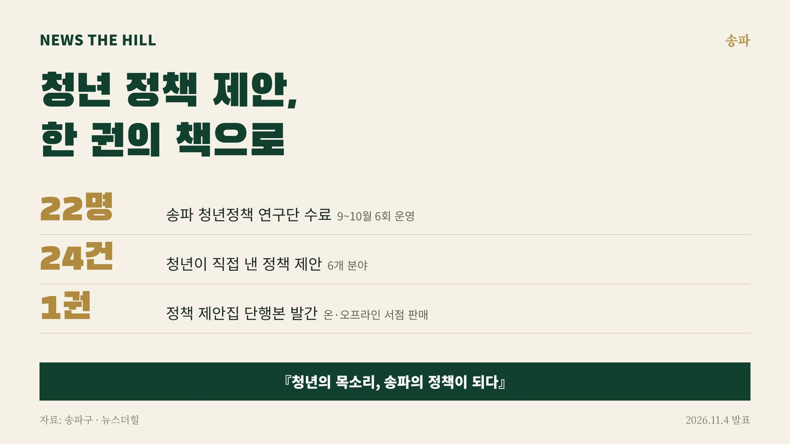

입력 2026-11-04

*그래픽=뉴스더힐(자료: 송파구)*

송파구 청년들이 일상에서 겪은 불편을 정책으로 다듬어 한 권의 책으로 펴냈다. 서울 송파구는 '2026 송파 청년정책 연구단' 수료식을 열고, 청년들이 직접 발굴한 정책 제안 24건을 담은 단행본 『청년의 목소리, 송파의 정책이 되다』를 발간했다.

송파구는 4일 보도자료에서 이같이 밝혔다.

'송파 청년정책 연구단'은 기존 '청년정책 아카데미'를 개편한 것으로, 9~10월 모두 6회 운영됐다. 참여 청년들은 전문가 강의와 글쓰기 워크숍을 거쳐 일상 속 문제를 정책으로 구체화하고 이를 정책 에세이로 썼다. 제안은 교육·성장, 문화·관계, 복지·일상, 생활·안전, 일자리·진로, 참여·교류 등 6개 분야에서 모두 24건이 나왔다. 120만 구독자를 둔 여행 유튜버 '희철리즘'의 해외 청년정책 특별강연도 열렸다.

## 주요 정책 제안

- '적발되지 않는다는 강력한 믿음': QR 신고와 금연구역 경계 안내로 금연구역의 실효성을 높이는 방안
- '송파 청년 RE:PLAY': 연극으로 청년의 자기탐색과 관계 형성을 돕는 프로그램
- '송파 청년 리스타트 패스': 진로 전환을 고민하는 청년의 재도전 지원
- '송파 AI 두드림': 지역 현장의 문제를 AI 기술로 직접 해결하는 프로젝트형 교육

지난달 21일 열린 수료식에서는 청년 22명이 교육과정을 마쳤다. 수료증과 표창 수여, 우수 정책제안 발표, 참여 소감 발표가 이어졌다.

책에는 청년들이 직접 겪은 일상의 불편과 이를 풀기 위한 정책 아이디어가 담겼다. 수료생들은 공동저자로 이름을 올렸다. 책은 현재 온·오프라인 서점에서 판매 중이다.

구는 정책 제안집을 관계부서와 공유하고 실현 가능성과 적용 방안을 검토해 앞으로 구정 운영과 청년정책 발굴에 활용할 계획이다. 송파구는 2023년부터 청년정책 아카데미(현 청년정책 연구단)를 운영해 왔으며, 청년들이 제안한 어학·자격증 응시료 지원 정책은 실제 조례 제정과 사업 시행으로 이어졌다고 구는 설명했다.

서강석 송파구청장은 "청년들이 일상에서 느끼는 불편과 고민을 스스로 정책으로 발전시키고, 이를 한 권의 책으로 완성했다는 점에서 의미가 크다"며 "앞으로도 청년들의 참신한 생각과 목소리가 구정에 반영될 수 있도록 청년들이 직접 참여하고 제안할 수 있는 기회를 지속적으로 확대하겠다"고 밝혔다.

※ 이 기사는 송파구 보도자료(11월 4일)를 바탕으로 작성했습니다.
