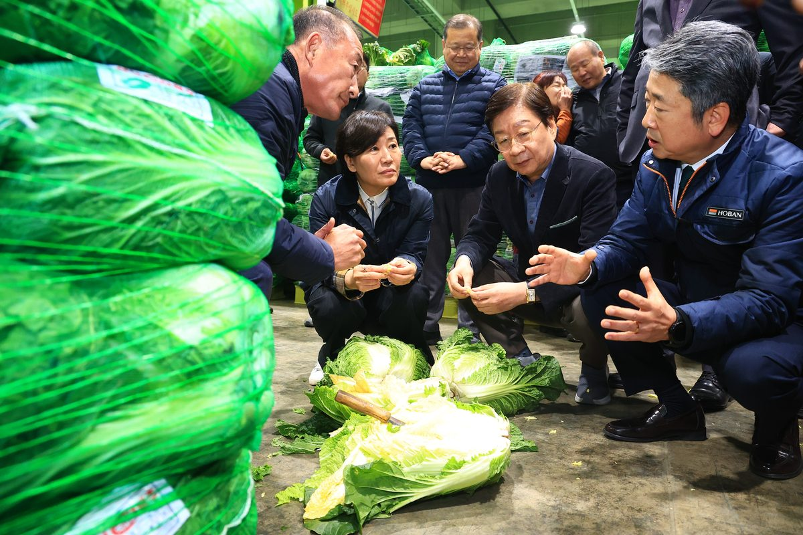
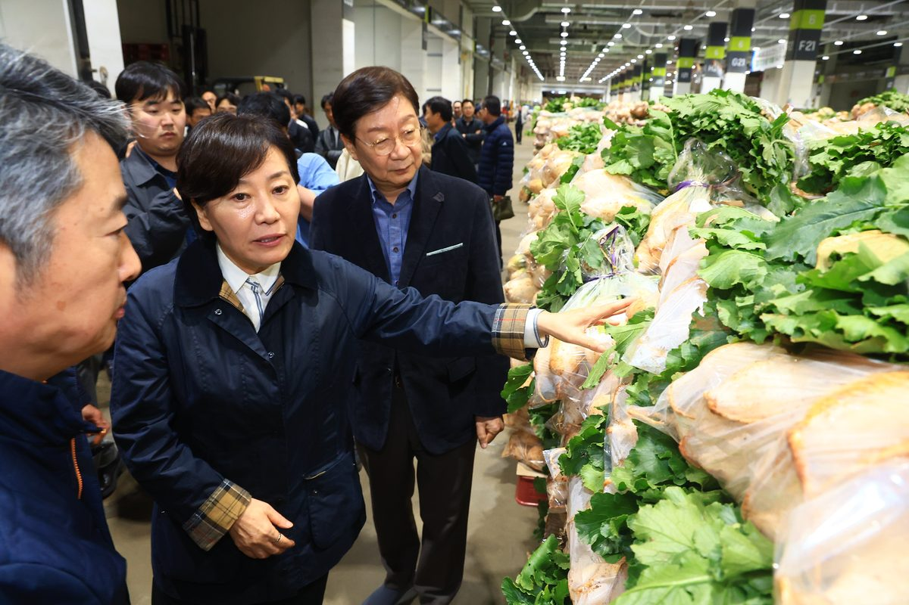

입력 2026-11-04

*송미령 농림축산식품부 장관이 3일 서울 송파구 가락시장을 찾아 배추 출하 상황을 살피고 있다. 사진=농림축산식품부 제공*

배추와 무 값이 내려가자 정부가 소비 촉진과 수급 조절에 함께 나선다. 송미령 농림축산식품부 장관은 3일 서울 송파구 가락시장을 찾아 배추, 무 등 주요 김장재료의 출하 상황과 도매가격을 점검하고 현장 관계자 의견을 들었다.

농림축산식품부는 4일 보도자료에서 이같이 밝혔다.

농식품부에 따르면 올해 김장재료 가격은 지난해 같은 기간보다 약 8% 낮다. 특히 주재료인 배추와 무는 작황이 좋아 김장 성수기(11월 중순~12월 상순) 출하량이 지난해와 평년보다 늘어날 것으로 전망된다.

농식품부는 3일 김장재료 수급안정대책을 발표하고 역대 최대 규모(640억 원)의 할인행사와 소비촉진 캠페인, 정부 비축 공급, 안정 생산 지원 등을 추진한다고 밝혔다.

## 배추 1만 톤·무 3천 톤 수매비축

배추와 무가 한꺼번에 시장에 쏟아지는 '홍수 출하'를 막기 위해 농식품부는 11월 상순부터 배추 1만 톤, 무 3천 톤을 수매비축한다. 공급과잉이 이어지면 산지 일시 출하정지 같은 추가 대책도 시행할 예정이다. 소비 쪽에서는 '김장 한 포기 더 하기' 등 소비촉진 캠페인을 함께 벌인다.

*송미령 장관이 가락시장의 김장채소 출하 현장을 둘러보고 있다. 사진=농림축산식품부 제공*

송미령 장관은 "올해는 배추, 무 등 주요 품목 가격 하락으로 농가의 어려움이 큰 상황이다."라고 하면서 "도매법인, 농협경제지주 등 관계기관·단체에서는 김장 붐 조성을 통한 소비 확대 유도와 함께 수급조절, 출하자 지원 등을 통해 농산물 가격과 농가 소득이 안정될 수 있도록 적극 협조해달라"고 당부했다.

김장재료 할인 기간과 농할상품권 구매 방법은 본지 11월 3일 기사 「가을배추 18.5%·무 11.1% 더 나온다…김장재료 할인에 역대 최대 640억 원」에서 볼 수 있다.

※ 이 기사는 농림축산식품부 보도자료(공공누리 제1유형, 출처표시)를 바탕으로 작성했습니다. 사진은 농림축산식품부가 보도자료와 함께 제공한 것입니다.
