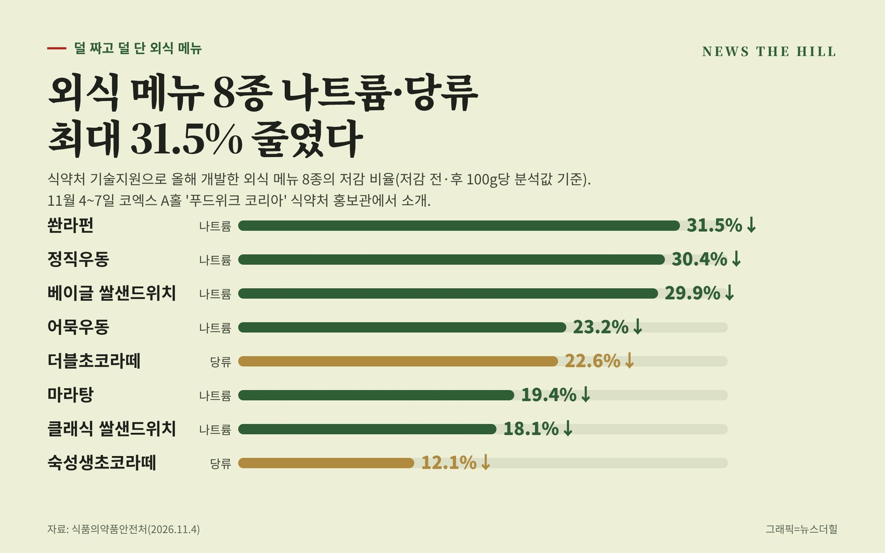

입력 2026-11-04

*그래픽=뉴스더힐(자료: 식품의약품안전처)*

편의점 떡볶이와 도시락, 김밥, 외식 우동과 마라탕까지 나트륨과 당류를 줄인 식품이 새로 나온다. 식품의약품안전처는 올해 나트륨·당류 저감 제품 개발 지원사업으로 가공식품 15종(나트륨 10종, 당류 5종)과 조리식품(외식 메뉴) 8종(나트륨 6종, 당류 2종) 등 모두 23종을 개발했다고 4일 밝혔다.

식약처는 저감 식품 유통을 늘리고 소비자 선택권을 넓히기 위해 2021년부터 이 사업을 해 왔다. 지난해까지 가공식품 41종, 조리식품 29종의 개발을 지원했다.

## 편의점 가공식품 15종

올해 가공식품은 주로 편의점에서 파는 제품이다. 14개 업체의 15종 개발을 지원했다.

- 떡볶이: 소스 원료 배합을 조정해 나트륨을 약 30% 줄였다.
- 도시락: 소스에 들어가는 소금을 줄여 나트륨을 약 15% 낮췄다.
- 빵류: 설탕을 줄이고 초콜릿·단호박 풍미를 살려 당류를 최대 45% 낮췄다.
- 김밥·삼각김밥·샌드위치: 나트륨이 적은 원재료를 쓰거나 소스 양을 줄였다.
- 소스: 물엿을 줄이고 원료 배합을 바꿔 당류를 줄였다.

식약처 설명자료에 따르면 소시지(나트륨 40%↓)와 아이스크림(당류 40%↓)도 포함됐다. 가공식품의 저감률은 시중 유통 제품 평균값, 자사 유사제품 또는 시장 점유율 상위 제품과 비교한 수치다. 떡볶이·도시락·김밥 등 8종은 이미 판매 중이고 소시지·빵·소스·아이스크림 등 7종은 11월 출시 예정이다(업체 사정에 따라 바뀔 수 있음).

개발한 가공식품에는 '나트륨을 줄인', '당류를 낮춘' 같은 저감 표시를 붙여 소비자가 쉽게 알아볼 수 있게 했다.

## 외식 메뉴 8종

4개 업체의 외식 메뉴 8종도 개발했다. 빵과 소스의 원료·배합비를 바꾼 샌드위치(나트륨 18.1~29.9%↓), 육수에 넣는 소금과 조미료를 줄인 우동(23.2~30.4%↓)과 마라탕·쏸라펀(19.4~31.5%↓), 설탕을 줄이고 알룰로스·나한과추출물로 단맛을 보완한 초코라떼(당류 12.1~22.6%↓)다. 외식 메뉴의 저감률은 저감 전·후 분석값을 기준으로 냈다.

## 코엑스 홍보관에서 시식

식약처는 11월 4일(수)부터 7일(토)까지 서울 코엑스에서 열리는 '2026 푸드위크 코리아(제21회 서울국제식품산업전)'에서 '덜 짜고 덜 단 저감 식품·메뉴 홍보관'(코엑스 A홀)을 운영한다. 올해 개발한 식품·메뉴와 함께 식품업계가 자체 개발해 시중에 유통 중인 나트륨·당류 저감 식품 54종도 전시한다. 개발 식품 15개 품목은 날짜별로 시식 행사(품목별 100인분)를 연다(일정 변동 가능).

- 4일(수) 오후: 쌀떡볶이·밀떡볶이
- 5일(목): 참치샐러드샌드위치·왕돈까스김밥(오전), 단백김밥·참치김치삼각김밥(오후)
- 6일(금): 덜 단 시오소스·덜 단 청양시오소스·소시지(오전), 초코라떼 2종·밀크 젤라또(오후)
- 7일(토) 오전: 쌀낭시에 2종·매콤 치아바타

공공배달앱 '먹깨비'와 함께하는 저감 메뉴 표출 사업도 홍보한다. 소비자가 배달 주문을 할 때 나트륨·당류 함량이 기준보다 낮거나 함량을 조절할 수 있는 메뉴를 음식점 배지나 메뉴 말머리로 안내하는 사업이다.

오유경 식약처장은 "국민이 일상 생활 속에서 나트륨과 당류 섭취를 줄이기 위해서는 다양한 저감 식품이 개발·유통되고, 소비자가 쉽게 선택할 수 있는 환경을 조성하는 것이 중요하다"며 "앞으로도 저감 기술개발을 적극 지원하고 덜 짜고 덜 단 식품이 널리 확산될 수 있도록 노력하겠다"고 전했다.

※ 이 기사는 식품의약품안전처 보도자료(정책브리핑, 공공누리 제1유형·출처표시)를 바탕으로 작성했습니다.
