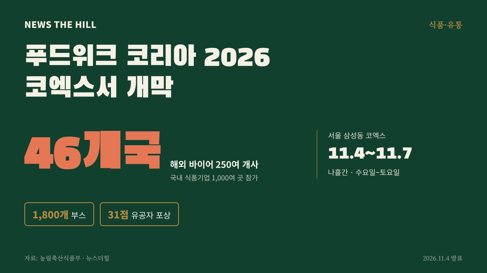

입력 2026-11-04

*그래픽=뉴스더힐(자료: 농림축산식품부)*

국내 최대 규모 식품산업 박람회인 '푸드위크 코리아 2026'이 11월 4일(수) 서울 삼성동 코엑스에서 개막했다. 행사는 11월 7일(토)까지 나흘간 열린다.

농림축산식품부는 4일 보도자료에서 이같이 밝혔다. 올해 행사에는 46개국 250여 개사의 해외 바이어와 국내 식품기업 1,000여 곳이 참여하며, 부스는 1,800개로 역대 최대 규모다.

## 소비자 행사에서 수출 상담 중심으로

올해 푸드위크 코리아는 기존 소비자(B2C) 중심 행사에서 글로벌 기업 간 거래(B2B) 중심 박람회로 바꾼 첫해다. 현장에서는 'K-푸드 바이어 초청 수출상담회(BKF+)' 등이 함께 열린다.

스페인 유통사 메르카도나(Mercadona), 일본 식자재 유통사 고베물산(Kobe Bussan) 등 해외 바이어가 직접 방한해 국내 식품기업과 1:1 상담을 한다. 딸기 등 신선 농산물 수출을 늘리기 위한 3자 업무협약(MOU)도 맺는다.

## 조리 로봇·스마트 주방 시연

전시장에는 AI와 자동화를 접목한 스마트 팩토리, 물류·유통 솔루션, 외식 매장용 조리 로봇과 스마트 주방 기기가 나온다. 푸드테크 기반 특수의료용도식품(케어푸드), 할랄·비건 인증 식품과 유기가공식품 홍보관, 전통주와 제철 음식 페어링 공간도 운영한다.

행사 기간에는 다음 부대행사가 열린다.

- 2027 식품외식산업 전망
- 국가식품클러스터 국제 콘퍼런스
- 글로벌 푸드테크 기술 표준화 심포지엄
- 비건인증·할랄 세미나

## 은탑산업훈장에 조희숙 한식공간 대표

개막식에서는 식품·외식산업 발전 유공자 시상식도 열렸다. 은탑산업훈장은 전통 한식 계승·발전과 전문인력 양성에 힘쓴 (주)한식공간 조희숙 대표가 받았다.

산업포장은 삼양식품(주) 윤아리 상무(계약재배를 통한 농가 보호·품질 강화), 월항농협 공선출하회 이대훈 회장(참외 등 신시장 개척), (주)제너시스 비비큐 동행위원회 이현주 대표(상생협력·국산 닭고기 소비 촉진), 농업회사법인(주)감홍로 이기숙 기술이사(전통주 제조기술 계승) 등 4명이 받았다. 대통령 표창 7점을 포함해 모두 31점이 수여됐다.

김종구 농식품부 차관은 개막식에서 "이번 「푸드위크 코리아 2026」은 국내 우수 식품기업들이 세계 무대로 도약하는 가장 강력한 발판이자, 푸드테크 등 미래 식품산업의 혁신을 눈으로 확인하는 자리"라며, "K-푸드의 글로벌 위상을 더욱 공고히 하고, 우리 식품산업이 세계 시장을 선도할 수 있도록 정책적 지원과 소통을 아끼지 않겠다"고 밝혔다.

※ 이 기사는 농림축산식품부 보도자료(정책브리핑, 공공누리 제1유형·출처표시)를 바탕으로 작성했습니다.
