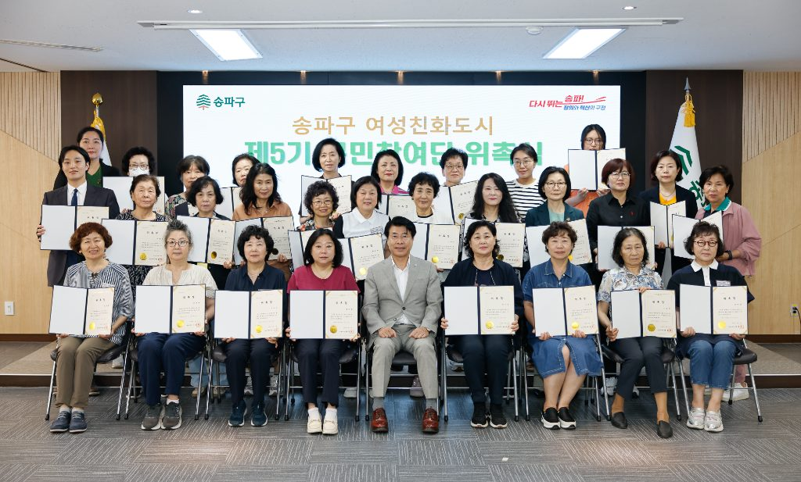

입력 2026-11-05

*송파구 여성친화도시 제5기 구민참여단 위촉식. 사진=송파구 제공*

서울 송파구가 성평등가족부가 주관하는 '2026년 여성친화도시'에 최종 선정됐다. 2016년 처음 지정된 뒤 2021년 재지정에 이어 세 번째로, 3회 연속 지정이다.

송파구는 5일 보도자료에서 이같이 밝혔다.

여성친화도시는 여성과 남성이 지역 정책에 균형 있게 참여하고, 여성의 사회·경제적 활동과 지역사회 안전, 가족 돌봄 등을 지원하는 정책을 추진하는 지방자치단체를 지정하는 제도다. 올해 지정 심사에서는 전국 30개 지방자치단체가 최종 선정됐다. 서울에서는 9개 자치구가 신청해 송파구를 포함한 5개 구가 선정됐다.

## 일자리·안전·돌봄 정책

- **일자리**: 구는 여성경력이음센터를 운영하고, 여성 일자리 협의체를 중심으로 지역 취업지원기관 간 협력체계를 만들어 왔다. 올해 5월에는 유관기관과 함께 미니 취업박람회 '다-내-일'(다가가는 내 My job 일자리 상담프로그램)을 열어 맞춤형 취업상담과 직업훈련 정보를 제공했고, 상담·홍보 참여 실적은 모두 139건이었다.
- **안전**: 관내 여성안심귀갓길 15개 구간을 운영하며 경찰 등 관계기관과 합동점검을 했다. 구민참여단이 직접 생활시설을 살펴 개선사항을 제안했고, 이에 따라 여성문화회관 화장실에 비상벨을 설치하고 여성경력이음센터 화장실 조도를 개선했다.
- **돌봄**: 아버지의 양육 참여를 돕는 '송PAPA 아버지교실' 수료 인원은 지난해 1,175명, 올해 상반기 533명이다. 손자녀 양육에 참여하는 조부모를 위한 아카데미와 성장지원 프로그램을 운영하고, 공공산후조리원인 송파산모건강증진센터도 운영하고 있다.
- **지역사회 활동**: 여성 리더십 교육 수료생이 경험과 생각을 구민과 나누는 강연 프로그램 '송파를 바꾸는 시간(송바시)'에는 올해 수료생 10명이 강연자로 참여해 관객 160명과 만났다. 여성문화회관 문화봉사단을 통해 여성들이 재능을 지역사회에 나누도록 지원하고 있다.

서강석 송파구청장은 "여성친화도시 3회 연속 지정은 여성의 사회참여를 넓히고, 일자리부터 안전, 돌봄까지 구민의 일상에 필요한 정책을 꾸준히 추진해온 노력의 결과"라며 "앞으로도 구민의 목소리에 귀 기울이며 누구나 안심하고 행복하게 생활할 수 있는 송파를 만드는 데 힘쓰겠다"고 말했다.

※ 이 기사는 송파구 보도자료(11월 5일)를 바탕으로 작성했습니다.
