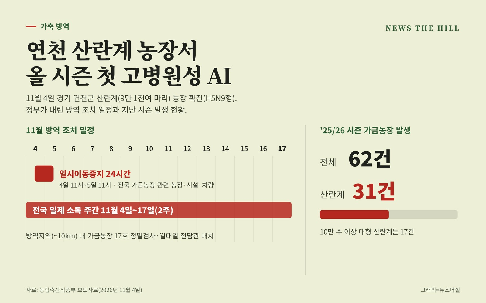

입력 2026-11-05

*그래픽=뉴스더힐(자료: 농림축산식품부)*

경기 연천군의 산란계 농장에서 고병원성 조류인플루엔자(AI)가 확진됐다. '26/'27 시즌 국내 가금농장에서 나온 첫 사례다. 정부는 11월 4일부터 17일까지 2주간을 '전국 일제 소독 주간'으로 정하고, 대형 산란계 농장과 밀집단지의 출입 통제를 강화한다.

고병원성 조류인플루엔자 중앙사고수습본부(본부장 송미령 농림축산식품부 장관, 이하 중수본)는 4일 보도자료에서 이같이 밝혔다.

## 발생 상황

산란계 9만 1천여 마리를 기르는 연천 농장의 농장주가 닭 폐사가 늘자 경기 북부동물위생시험소에 신고했고, 정밀검사 결과 4일 고병원성 조류인플루엔자(H5N9형)로 확진됐다.

중수본은 최근 야생 조류에서 고병원성 AI가 계속 검출되고 있고, 지난 시즌 산란계 농장 발생이 많았다고 설명했다. '25/26 시즌 발생 62건 가운데 산란계 농장이 31건이었고, 이 중 10만 수 이상 대형 산란계 농장은 17건이었다.

## 지금까지 한 조치

- H5형 항원 확인 직후 '조류인플루엔자 긴급행동지침(SOP)'에 따라 초동대응팀을 투입해 출입을 통제하고, 발생농장 살처분과 역학조사를 하고 있다.
- 전국 가금농장 관련 농장·시설·차량에 4일 11시부터 5일 11시까지 24시간 일시이동중지(Standstill) 명령을 내렸다.
- 발생농장 방역대(~10km) 안 가금농장 17호를 정밀검사하고, 전국 철새도래지·소하천·저수지 주변 도로와 가금농장 진입로 등을 소독하고 있다.

## 강화하는 방역 대책

- 방역지역(~10km) 안 가금농장 17호에 일대일 전담관을 배치해 사람·차량 이동통제, 소독, 정밀검사 이행을 집중 관리한다.
- 전국 밀집지역(14개소)과 대형 산란계(10만 수 이상) 농장 관리를 위해 20만 수 이상 대형 산란계 농장에 통제초소를 설치한다. 가금농장에 드나드는 알차량과 외부인력(백신접종팀, 상하차반 등)은 사전 등록하고 출입 통제를 강화한다.
- 전국 산란계 농장을 대상으로 관할 지방정부가 매주 특별점검을 하고, 농식품부·검역본부·행정안전부가 합동 특별점검을 한다.
- 11월 4일부터 17일까지 2주간 '전국 일제 소독 주간'으로 정해 가금농장, 축산시설, 차량 소독을 강화한다.
- 가금단체·계열사와 수시로 방역상황을 점검하고, 전국 가금농장에 문자·알림톡으로 방역수칙을 알린다. 중점관리대상 농장 2,940호에는 농장전담관이 직접 전화한다.

박정훈 식량정책실장은 "이번 경기 연천군 발생은 '26/'27시즌 가금농장 첫 발생 사례로, 지난 시즌 피해가 컸던 산란계 농장에서 발생했다는 점에서 우려가 크다"고 말했다. 그는 경기도와 연천군에 방역관리에 미흡한 부분이 없는지 점검하고 이동통제·소독·검사 등 방역 조치에 만전을 기해 달라고 당부했다.

박 실장은 또 "지속적으로 철새가 도래하고 있어 전국 어느 지역에서도 추가 발생할 수 있는 엄중한 상황인 만큼, 전국 지방정부와 가금농가는 사람·차량 출입통제와 전국 일제 집중 소독주간에 농장 내외부 및 철새도래지 주변 도로 등 소독을 철저히 실시해 달라"고 거듭 당부했다.

※ 이 기사는 농림축산식품부 보도자료(공공누리 제1유형, 출처표시)를 바탕으로 작성했습니다.
