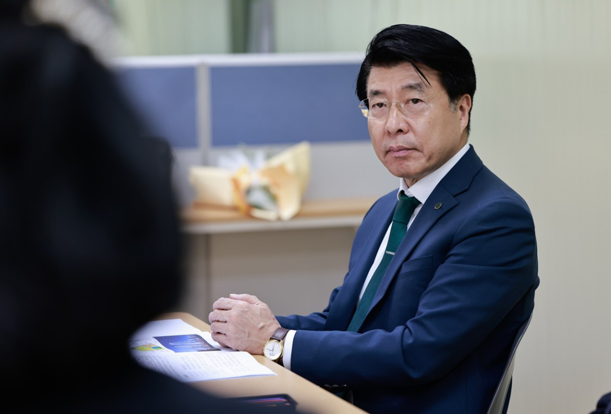

입력 2026-11-05

*송파구가 '정비사업 공정회의' 보도자료와 함께 공개한 사진. 사진=송파구 제공*

송파구가 재개발·재건축 조합 사무실을 직접 찾아가 사업 진행 상황을 점검한다.

송파구는 10월 30일부터 11월 13일까지 2주 동안 '조합을 찾아가는 정비사업 공정회의'를 연다고 4일 밝혔다. 대상은 500세대 이상 재건축 정비사업 15곳과 재개발 정비사업 3곳 등 모두 18개 조합이다.

## 조합 사무실 방문해 공정·애로사항 점검

구청 재건축·재개발 담당 부서가 조합 사무실을 방문하고, 조합 관계자와 정비사업 용역사가 함께 참여한다. 세부 일정은 조합과 협의해 정한다.

회의에서는 조합별 사업 추진 단계와 공정 현황을 점검하고 현장의 애로사항을 듣는다. 개선이 필요한 사항에 대한 행정지도와 함께, 조합원 간 소통과 원활한 의사결정 방안도 함께 찾는다. 구는 조합별 진행 상황에 맞춰 행정을 지원해 사업 지연 요인을 줄이고, 서울시 정비사업 표준처리기한과 연계해 주택 공급을 뒷받침하겠다고 밝혔다.

## 잠실5단지 사업시행계획인가가 '민선 9기 1호 결재'

구에 따르면 민선 9기가 출범한 7월 1일 송파구의 첫 결재는 잠실주공5단지 사업시행계획인가였다. 잠실5단지는 2003년 사업을 시작한 뒤 정비계획 수립과 설계 공모 등에서 여러 차례 난관을 겪었다. 이튿날인 7월 2일에는 장미아파트의 정비계획 수립과 정비구역 지정을 마쳤다.

최근에는 송파한양1차아파트와 가락우창아파트의 조합설립인가를 각각 접수 3일 만에 처리했다고 구는 설명했다.

서강석 송파구청장은 "민선9기에는 재개발·재건축을 더욱 신속하게 추진해 '초격차의 도시 송파'를 만들어 가겠다"며 "구민의 오랜 염원인 정비사업이 속도감 있게 추진될 수 있도록 조합 현장의 어려움을 직접 살피고, 필요한 행정적 지원을 아끼지 않겠다"고 말했다.

※ 이 기사는 송파구 보도자료(11월 4일)를 바탕으로 작성했습니다.
