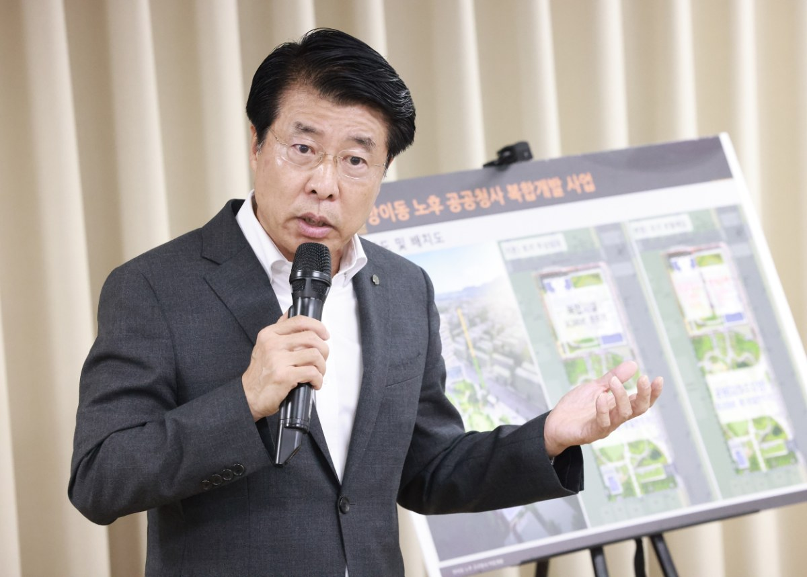

입력 2026-11-05

*송파구가 '방이동 노후공공청사 복합개발사업' 보도자료와 함께 공개한 사진. 사진=송파구 제공*

오랫동안 미뤄진 방이2동 복합청사 건립을 두고 송파구가 사업 부지 일부를 한국토지주택공사(LH)에 팔아 재원을 마련하는 방안을 추진한다.

송파구는 '방이동 노후공공청사 복합개발사업'을 정상화하기 위해 LH와 협의해 사업 구조를 바꾸는 방안을 마련했다고 3일 밝혔다.

## 주민센터·복지관·청년주택 160호 들어설 부지

이 사업은 방이동 52번지 일대 1만1,276㎡ 부지에 낡은 방이2동 주민센터와 복지관, 경로당, 어린이집, 우리동네키움센터, 도서관 등 주민 편의시설과 청년주택 160호를 짓는 계획이다. 지하 2층에는 383면 규모 공영주차장도 들어간다.

당초 협약은 구가 LH에 주택용지를 무상으로 제공하고, LH가 청년주택 160호를 지어 30년간 운영한 뒤 구에 무상으로 넘기는 방식이었다. 주민센터·복지관 등 공공시설 건립비는 모두 구가 부담하는 구조였다.

## 발굴조사로 3년 5개월 지연…사업비 두 배로

2021년부터 약 3년 5개월 동안 이어진 문화재 발굴조사 등으로 사업이 늦어지는 사이 공사비와 인건비가 올라, 사업비는 당초 614억 원에서 1,178억 원으로 약 두 배가 됐다.

구는 지난 9월 LH와 주택용지 분할 매입 방식으로 사업 구조를 바꾸는 데 합의했다고 설명했다. 변경안은 전체 부지의 약 20%인 청년주택용지 2,260㎡를 LH에 파는 방식이다. LH는 이 부지에 청년주택을 짓고 운영하며, 구는 매각 대금으로 공공시설을 당초 계획과 같은 규모로 짓는다는 계획이다.

## 구의회는 매각안 상정 안 해…구 "다른 재원 없다"

구는 지난 10월 주택용지 매각을 위한 공유재산관리계획안을 구의회에 냈지만, 구의회는 이 안건을 본회의에 상정하지 않고 심의 대상에서 제외했다.

구는 공공청사기금과 통합재정안정화기금은 이미 쓰임새가 정해져 있거나 앞으로 예산 편성에 필요한 재원이고, 추가 국비·시비 확보도 어려워 주택용지 매각이 필요하다는 입장이다. 구가 10월 13일부터 이틀 동안 방이2동 거주자 등을 대상으로 한 조사에서는 응답자의 96%가 신속한 사업 추진에 찬성했다고 구는 밝혔다. 구는 구의회에 사업계획 변경의 필요성을 설명하고 관련 절차를 추진할 방침이다.

서강석 송파구청장은 "공공청사는 구민의 공간인데, 오랫동안 사업이 지연되면서 그 피해를 구민이 감당하고 있는 상황을 더 이상 방치할 수 없다"며 "구민을 주인으로 섬기는 행정의 책임을 다해 사업의 걸림돌을 반드시 해결하고, 조속한 착공으로 주민 피해를 최소화하는 데 총력을 다하겠다"고 말했다.

※ 이 기사는 송파구 보도자료(11월 3일)를 바탕으로 작성했습니다. 구의회의 입장은 보도자료에 담기지 않았습니다.
