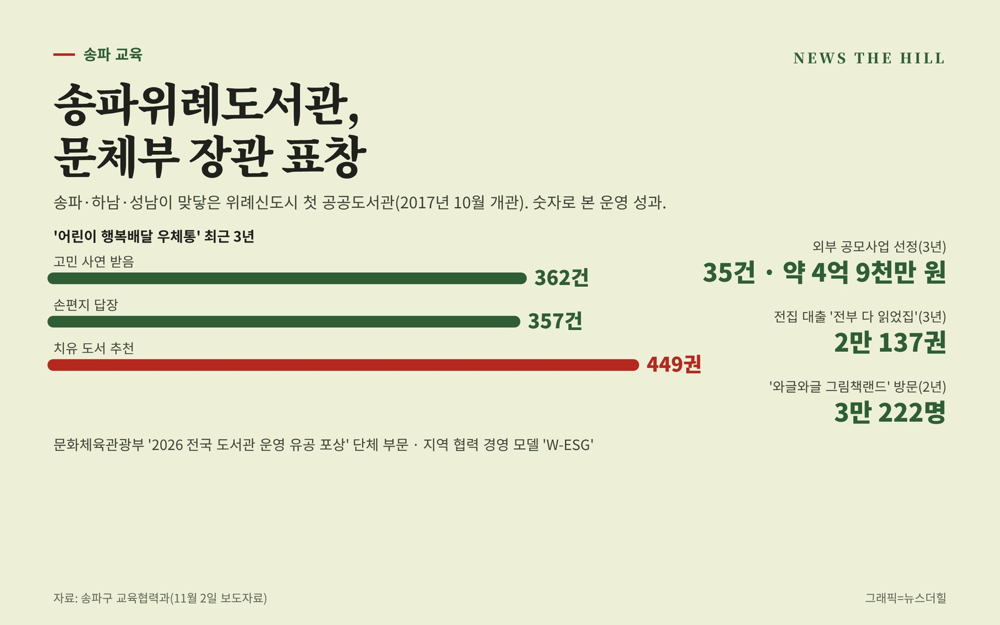

입력 2026-11-05

*송파위례도서관 운영 성과. 그래픽=뉴스더힐(자료: 송파구)*

송파구 송파위례도서관이 문화체육관광부 장관 표창을 받았다.

송파구는 송파위례도서관이 문화체육관광부 주관 '2026 전국 도서관 운영 유공 포상'에서 단체 부문 문체부 장관 표창을 받았다고 2일 밝혔다. 도서관 협력업무 유공 포상은 도서관끼리, 또는 도서관과 지역사회가 협력해 운영과 이용자 서비스를 개선한 개인과 단체에 주는 상이다.

## 송파·하남·성남 주민이 함께 쓰는 도서관

2017년 10월 문을 연 송파위례도서관은 송파구와 하남시, 성남시가 맞닿은 위례신도시의 첫 공공도서관이다. 세 지자체 주민이 함께 이용하는 지역 거점 도서관으로, 지역 특성을 반영한 경영 모델 'W-ESG'를 도입해 지역사회와 협력을 강화한 점이 좋은 평가를 받았다고 구는 설명했다.

## 고민 사연 362건에 357건 답장

대표 사업인 '어린이 행복배달 우체통'은 어린이가 고민을 적어 보내면 주민 독서심리상담 동아리 '꿈틀북솔리언'이 손편지로 답하고 책을 추천하는 프로그램이다. 최근 3년 동안 고민 사연 362건을 받아 357건에 답장했고, 치유 도서 449권을 추천했다.

외부 재원도 끌어왔다. 2023년부터 ㈜나래에너지서비스에서 모두 4,500만 원을 기부받았고, 최근 3년간 외부 공모사업 35건에 뽑혀 약 4억9,000만 원을 확보했다.

특화 서비스 이용도 늘었다.

- 중장년층을 위한 전집 대출 서비스 '전부 다 읽었집': 3년간 2만137권 대출
- 로비를 그림책 공간으로 꾸민 '와글와글 그림책랜드': 2년간 3만222명 방문

서강석 송파구청장은 "차별화된 특화 서비스와 적극적인 도서관 경영이 이룬 값진 결과"라며 "앞으로도 지역과 함께하는 도서관 정책을 확대하고, 모든 구민이 독서 문화를 누릴 수 있도록 힘쓰겠다"고 말했다.

※ 이 기사는 송파구 보도자료(11월 2일)를 바탕으로 작성했습니다.
