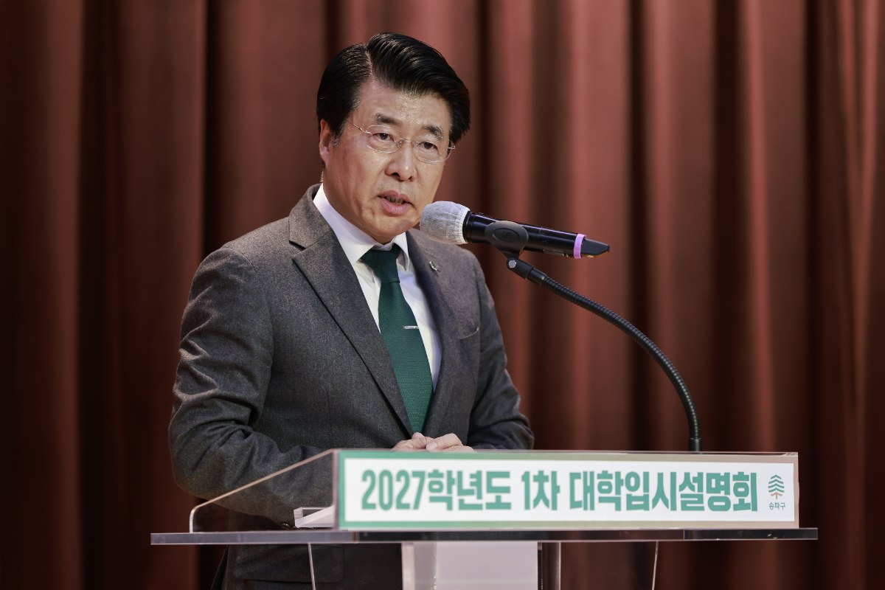

입력 2026-11-05

*송파구 '2027학년도 1차 대학입시설명회' 모습. 사진=송파구 제공*

대입제도가 바뀌는 고1·2 학부모를 위한 입시설명회가 송파에서 열린다.

송파구는 11월 16일(월) 오전 10시부터 12시까지 송파구청 4층 대강당에서 '2028학년도 대비 고1·2 대상 대학입시설명회'를 연다고 2일 밝혔다. 대상은 관내 고등학교 1·2학년 학부모 400명이다.

## 선택과목 없는 수능, 내신 5등급제

구는 내년부터 국어·수학·탐구 영역의 선택과목이 없어지는 통합형 수능이 도입되고, 고교 내신도 9등급제에서 5등급제로 바뀌면서 학생부 관리와 대학별 전형에 맞춘 진학 전략이 더 중요해졌다고 설명했다.

강의는 마포고등학교 진로진학 전문가 신호철 교사가 맡는다. 주요 내용은 다음과 같다.

- 2028학년도 대입 대비 학생부 기재 전략
- 송파구 고등학교 내신 분석과 특화 전략

설명회에 오지 못하는 학생과 학부모를 위해 강의 영상은 '송파런' 유튜브 채널에 올릴 예정이다.

## 신청은 '송파런' 누리집 선착순

신청은 11월 2일 오전 10시부터 송파런 누리집에서 선착순으로 받고 있다. 문의는 송파구청 교육협력과(☎02-2147-2471)로 하면 된다.

구는 관내 중·고등학생을 대상으로 매주 토요일 1대1 진학 컨설팅도 하고 있다. 올해 입시설명회는 모두 5차례로, 이번이 네 번째다. 12월에는 고3 수험생을 대상으로 수능 결과 분석과 정시 지원 전략을 안내하는 마지막 설명회가 열린다.

서강석 송파구청장은 "대입제도가 달라지는 만큼 학생과 학부모가 정확한 정보를 바탕으로 미리 준비하는 것이 중요하다"며 "앞으로도 지역 교육환경에 맞는 진학 정보를 제공해 학생들이 자신의 적성과 역량에 맞는 진로를 설계할 수 있도록 지원하겠다"고 말했다.

※ 이 기사는 송파구 보도자료(11월 2일)를 바탕으로 작성했습니다.
