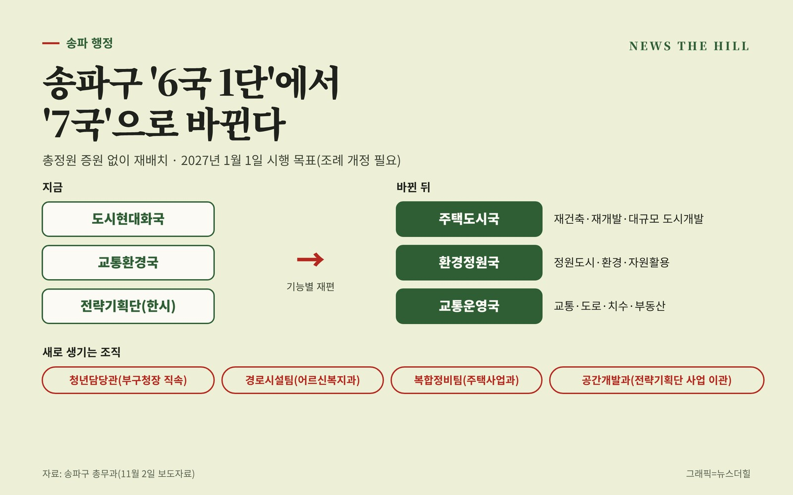

입력 2026-11-05

*송파구 민선 9기 행정조직개편안. 그래픽=뉴스더힐(자료: 송파구)*

송파구가 구청 조직을 '6국 1단'에서 '7국' 체제로 바꾸는 조직개편을 추진한다.

송파구는 청년·어르신 등 달라지는 행정 수요에 대응하고 재건축·재개발 등 도시개발사업을 효율적으로 추진하기 위해 '민선 9기 행정조직개편'을 추진한다고 2일 밝혔다. 「서울특별시송파구행정기구설치조례」 개정을 거쳐 2027년 1월 1일 시행이 목표다.

구는 인구 65만 명으로 서울 자치구 가운데 인구가 가장 많은 만큼 7국 체제로 바꾼다고 설명했다. 구에 따르면 서울 25개 자치구 가운데 17곳이 7국급 이상 조직을 두고 있다. 총정원은 늘리지 않고 기존 조직과 인력을 재배치한다.

## 청년담당관·경로시설팀·복합정비팀 신설

부구청장 직속으로 '청년담당관'을 새로 둔다. 여러 부서에 흩어진 청년 사업을 한곳에 모아 청년정책을 총괄하게 한다.

팀 단위 조직도 보강한다.

- 어르신복지과 '경로시설팀': 어르신 복지시설 설치·관리
- 주택사업과 '복합정비팀': 가로주택정비·모아타운 등 주택정비사업 지원

## 3개국을 기능별로 재편

기존 도시현대화국, 교통환경국, 전략기획단의 업무는 기능에 따라 세 개 국으로 나눈다.

- **주택도시국**: 재건축·재개발과 대규모 도시개발사업
- **환경정원국**: 정원도시 정책과 환경·자원활용
- **교통운영국**: 교통·도로, 치수·부동산 등 도시 기반시설 관리

12월 31일 존속기한이 끝나는 한시기구 전략기획단의 주요 사업은 주택도시국 '공간개발과'로 옮겨 이어간다. 전략기획단은 옛 성동구치소 부지 공공기여시설 조성, 송파ICT보안클러스터, 송파대로 명품거리 조성 등을 맡아 왔다.

서강석 송파구청장은 "이번 조직개편을 통해 민선 9기 송파 비전인 주거명품도시, 정원 속의 도시, 문화와 예술의 도시, 포용의 도시, 생활체육과 교육 창달의 도시를 실현하겠다"며 "구민을 주인으로 섬기는 명품도시 송파를 만드는 데 최선을 다하겠다"고 말했다.

※ 이 기사는 송파구 보도자료(11월 2일)를 바탕으로 작성했습니다.
