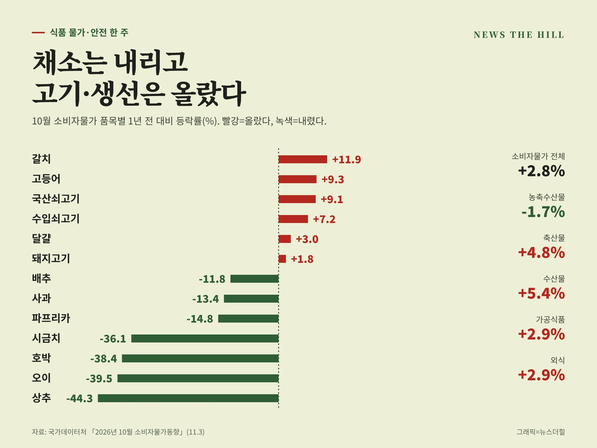

입력 2026-11-06

*10월 소비자물가 품목별 1년 전 대비 등락률. 그래픽=뉴스더힐(자료: 국가데이터처)*

장바구니 물가가 둘로 갈렸다. 상추·오이·호박 같은 채소는 1년 전보다 40% 안팎 내렸지만, 쇠고기·고등어·갈치는 올랐다. 같은 기간 김밥용 김과 수산물 가공품, 수입 망고 가공품이 잇따라 회수됐다.

뉴스더힐 기획취재팀이 10월 28일부터 11월 4일까지 정부가 낸 식품 물가·안전 발표를 모아, 장 볼 때와 집에 있는 식품을 확인할 때 알아둘 것을 정리했다.

## ① 물가 — 전체 2.8%, 농축수산물은 1.7% 하락

국가데이터처가 3일 발표한 10월 소비자물가지수는 1년 전보다 2.8% 올랐다. 9월(2.9%)보다 0.1%포인트 낮다.

먹거리만 보면 흐름이 엇갈린다. 농축수산물은 1년 전보다 1.7% 내렸다. 정부는 농축수산물 가격이 3개월 연속 전년보다 하락했다고 밝혔다. 반면 가공식품과 외식은 각각 2.9% 올랐다.

- 농산물: 7.5% 하락(채소류 11.2% 하락)
- 축산물: 4.8% 상승
- 수산물: 5.4% 상승
- 가공식품: 2.9% 상승(빵 5.9%, 즉석식품 12.4%)
- 외식: 2.9% 상승

품목별로는 상추(-44.3%), 오이(-39.5%), 호박(-38.4%), 시금치(-36.1%), 파프리카(-14.8%), 사과(-13.4%), 배추(-11.8%)가 많이 내렸다. 갈치(11.9%), 고등어(9.3%), 국산쇠고기(9.1%), 수입쇠고기(7.2%), 달걀(3.0%), 돼지고기(1.8%)는 올랐다. 신선식품지수는 1년 전보다 6.2% 내렸는데, 그 안에서도 신선채소(-11.3%)·신선과실(-8.6%)은 내리고 신선어개(생선·조개류)는 6.0% 올랐다.

권대영 재정경제부 제1차관은 3일 물가관계차관회의에서 "10월 소비자물가는 내구재 등 상승압력에도 불구하고, 정부의 정책 노력에 힘입어 농축수산물 가격이 전년대비 하락하여 2.8% 상승했다"고 말했다. 그러면서 "누적된 물가 상승의 여파로 체감물가는 여전히 높고 물가 상방압력과 리스크도 남아 있는 만큼, 경각심을 가지고 물가 관리에 모든 역량을 집중하겠다"고 했다.

## ② 김장 — 비용은 4.2% 낮고, 할인은 역대 최대

정부는 10월 하순 기준 4인 가족 김장비용을 약 23만8천 원으로 집계했다. 지난해보다 4.2% 낮은 수준이다. 가을배추(18.5%)와 가을무(11.1%) 생산이 늘 것으로 전망되면서 배추·무 걱정은 덜었다. 다만 새우젓 같은 일부 양념은 값이 올랐다.

김장재료 할인에는 역대 최대인 약 640억 원이 들어간다.

- 농산물 최대 40% 할인: 대형·중소형마트 등에서 10월 29일~12월 2일
- 농할상품권 20% 선할인: 전체 구매 기간 11월 9일~15일(최대 10만 원)
- 수산물 최대 50% 할인: 「대한민국 수산대전_김장 특별전」 10월 28일~11월 29일(천일염·새우젓·멸치액젓·굴 등)

배추·무가 한꺼번에 몰려 값이 더 떨어지는 것을 막기 위해 농식품부는 11월 상순부터 배추 1만 톤, 무 3천 톤을 수매비축한다. 국립농산물품질관리원은 11월 4일부터 12월 4일까지 배추김치·절임배추·고춧가루·마늘·생강 등의 원산지 표시를 집중 단속한다. 원산지 표시가 없거나 거짓 표시가 의심되면 부정유통신고센터(1588-8112)로 신고할 수 있다.

## ③ 회수 — 집에 있다면 제조일자부터 확인

이 기간 식약처가 알린 회수는 3건(4개 제품)이다. 모두 제품명과 제조일자(소비기한)가 함께 맞아야 회수 대상이다.

- 가공김 '바다명가 두번구운김밥김'(㈜해풍수산 소분, 70g): 제조일자 2026년 7월 14일 표시 제품. 카드뮴 0.5mg/kg 검출(기준 0.3mg/kg 이하). 10월 28일 발표.
- 기타 수산물가공품 '황새치'(한라식품(주))·'황새치 복육'(㈜정필): 각각 제조일자 2026년 9월 21일, 7월 23일 표시 제품. 카드뮴 0.6mg/kg, 0.3mg/kg 검출(기준 0.2mg/kg 이하). 10월 30일 발표.
- 수입 과·채가공품 '리얼망고바'(50g, 베트남산): 겉 라벨의 소비기한이 2028년 1월 14일로 표시된 제품. 라벨을 떼면 원래 소비기한 2026년 8월 14일이 적혀 있어 이미 지난 제품이다. 10월 30일 발표.

해당 제품을 샀다면 먹지 말고 산 곳에 반품하면 된다. 회수 제품 목록은 식품안전나라 '회수·판매중지' 메뉴에서 확인할 수 있고, 불량식품은 1399나 식품안전정보 앱 '내손안'으로 신고할 수 있다.

## ④ 수능 앞 — 해외직구 37개 차단, 찹쌀떡 배달점 점검

수능을 앞두고 '집중력 강화'·'키성장'을 내세운 해외직구 식품 60개를 식약처와 한국소비자원이 검사한 결과, 37개에서 국내 반입차단 대상 원료·성분이 검출되거나 표시돼 있었다(10월 29일 발표). 식약처는 관세청에 통관보류를, 방송미디어통신심의위원회에 판매사이트 접속차단을 요청했다. 해외직구 식품을 사기 전에는 식품안전나라 '해외직구식품 올바로' 누리집에서 반입차단 성분이 들어간 제품인지 확인하는 것이 좋다.

수험생 선물로 많이 찾는 과일 찹쌀떡·샌드위치를 만드는 배달음식점과 무인카페 4,000여 곳은 10월 30일부터 11월 13일까지 식약처와 16개 지방정부의 집중 점검을 받는다. 과일 찹쌀떡 등 조리식품 약 100건은 식중독균 검사를 한다.

## 장 볼 때 기억할 것

- 채소·과일은 1년 전보다 싸고, 쇠고기·생선·가공식품은 비싸다. 김장재료는 할인 기간(농산물 12월 2일, 수산물 11월 29일까지)을 활용할 만하다.
- 김치·고춧가루·마늘은 원산지 표시를 확인한다.
- 집에 김밥김·망고바가 있다면 제품명과 날짜를 회수 목록과 맞춰 본다.
- 해외직구 '집중력·키성장' 식품은 사기 전에 차단 목록부터 본다.

## 읽기 전에 알아둘 점

물가 수치는 국가데이터처 소비자물가지수의 1년 전 같은 달 대비 등락률로, 품목별 가격 수준이 아니라 변동률이다. 매장·지역에 따라 실제 가격은 다를 수 있다. 회수·할인·단속 내용은 각 발표 시점 기준이며, 자세한 내용은 아래 관련 기사에서 볼 수 있다.

**관련 기사**

- [가을배추 18.5%·무 11.1% 더 나온다…김장재료 할인에 역대 최대 640억 원](https://newsthehill.com/articles/news-2026110300002/)
- [송미령 장관 가락시장 점검…배추 1만 톤·무 3천 톤 수매비축해 '홍수 출하' 막는다](https://newsthehill.com/articles/news-2026110400002/)
- [김장철 배추김치·고춧가루 원산지 한 달 집중 단속…11월 4일부터 12월 4일까지](https://newsthehill.com/articles/news-2026110200003/)
- ['바다명가 두번구운김밥김'서 카드뮴 기준 초과…식약처 회수](https://newsthehill.com/articles/news-2026102900002/)
- [황새치·황새치 복육 2개 제품서 카드뮴 기준 초과…식약처 회수](https://newsthehill.com/articles/news-2026110200001/)
- [소비기한 라벨 겹쳐 붙인 수입 '리얼망고바'…떼어 보니 이미 지나, 식약처 회수](https://newsthehill.com/articles/news-2026110200002/)
- ['집중력 강화·키성장' 해외직구식품 60개 중 37개서 반입차단 성분…식약처, 국내 반입 차단](https://newsthehill.com/articles/news-2026103000001/)
- [수능 앞두고 '과일 찹쌀떡·샌드위치' 배달점·무인카페 4,000여 곳 점검](https://newsthehill.com/articles/news-2026103000002/)
- [집에 있는 식품, 회수 대상인지 확인하는 법](https://newsthehill.com/articles/news-2026103100001/)
- [[김장 물가 지도] 배추는 16% 내리고 새우젓은 39% 뛰었다…'어디서 사느냐'가 김장값 가른다](https://newsthehill.com/articles/feature-2026102800001/)

※ 자료: 국가데이터처(2026년 10월 소비자물가동향, 11.3), 재정경제부 등 관계부처(11월 물가관계차관회의, 11.3), 농림축산식품부·해양수산부(2026 김장재료 수급안정대책 11.3, 김장채소 소비촉진 11.4), 국립농산물품질관리원(김장철 원산지 표시 집중 점검, 11.2), 식품의약품안전처(가공김 회수 10.28, 기타 수산물가공품·과·채가공품 회수 10.30, 해외직구식품 공동조사 10.29, 배달음식점·무인카페 집중 점검 10.30). 모두 공공누리 제1유형(출처표시).
