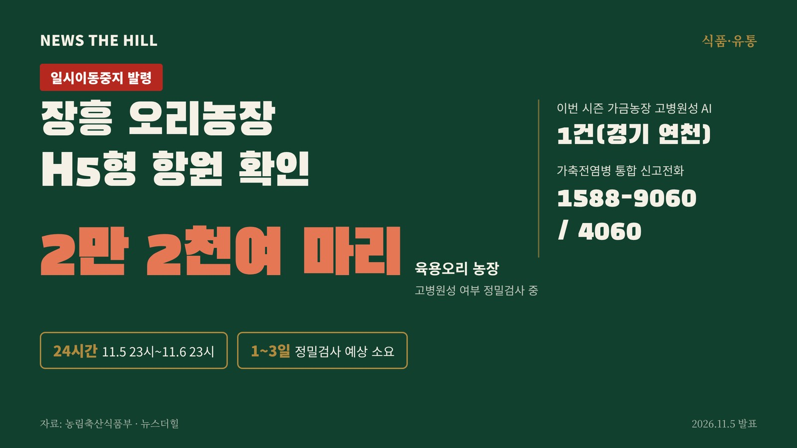

입력 2026-11-06

*그래픽=뉴스더힐(자료: 농림축산식품부)*

경기 연천 산란계 농장에 이어 전남광주 장흥의 육용오리 농장에서도 H5형 조류인플루엔자 항원이 나왔다. 방역 당국은 해당 농장 가축을 처분하고, 전남광주통합특별시와 발생농장과 같은 계열사의 오리 농장, 축산시설·차량 등에 24시간 일시이동중지 명령을 내렸다.

고병원성 조류인플루엔자 중앙사고수습본부(본부장 송미령 농림축산식품부 장관, 이하 중수본)는 5일 보도자료에서 이같이 밝혔다.

## 발생 상황

중수본에 따르면 5일 장흥 소재 육용오리 농장(2만 2천여 마리)에서 H5형 조류인플루엔자 항원이 확인됐다. 고병원성 여부는 농림축산검역본부가 정밀검사하고 있으며, 결과가 나오기까지 1~3일 정도 걸릴 것으로 예상된다.

11월 3일 이후 가금농장 고병원성 조류인플루엔자 발생은 경기 연천 1건이다.

## 방역 조치

- 조류인플루엔자 긴급행동지침(SOP) 등에 따라 해당 농장에 초동대응팀을 투입해 출입 통제, 가축처분, 역학조사를 하고 있다.
- 전남광주통합특별시와 의사환축 발생농장과 같은 계열사의 오리 농장, 축산시설(도축장, 사료공장 등), 축산차량 등에 11월 5일(목) 23시부터 11월 6일(금) 23시까지 24시간 일시이동중지(Standstill) 명령을 내렸다.

## 농가 당부

중수본은 축산농가에 철새도래지 출입금지, 외부 차량·인력 출입통제, 농장 매일 소독, 축사 출입 전 전용 장화 갈아신기, 기계·장비를 축사에 들일 때 세척·소독 등 기본 방역수칙을 철저히 지켜 달라고 강조했다.

또 기르는 가금에서 폐사 증가, 산란율 저하 같은 주요 의심증상뿐 아니라 사료섭취 저하, 침울, 졸음, 호흡기 증상, 녹변(녹색 설사) 등 경미한 증상이 보여도 곧바로 방역 당국에 신고해 달라고 당부했다. 가축전염병 통합 신고전화는 1588-9060 / 4060이다.

※ 이 기사는 농림축산식품부 보도자료(공공누리 제1유형, 출처표시)를 바탕으로 작성했습니다.
