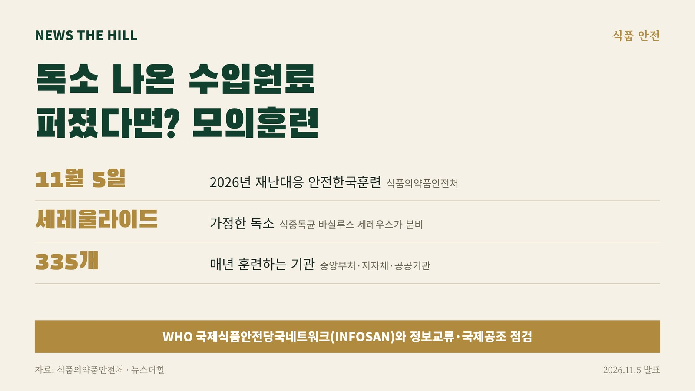

입력 2026-11-06

*그래픽=뉴스더힐(자료: 식품의약품안전처)*

식중독 독소가 검출된 수입원료로 만든 가공식품이 국내에 대량으로 풀려 환자가 잇따르는 상황을 가정한 모의훈련이 열렸다. 올해는 세계보건기구(WHO) 국제식품안전당국네트워크(INFOSAN)가 함께해 수입원료 사고가 났을 때 국내 대응과 국제공조를 어떻게 잇는지 점검했다.

식품의약품안전처(처장 오유경)는 5일 보도자료에서 식품 안전사고 때 피해 확산을 막고 위기대응 체계를 점검하기 위해 이날 '2026년 재난대응 안전한국훈련'을 실시했다고 밝혔다.

## 어떤 상황을 가정했나

훈련은 세레울라이드 독소가 검출된 수입원료를 쓴 가공식품이 국내에 대량 유통돼 다수의 환자가 생긴 상황을 가정해, 안전사고 주요 상황 대응 매뉴얼에 따라 진행했다. 세레울라이드는 식중독균인 바실루스 세레우스가 분비하는 물질로, 식약처는 잠복기가 0.5~6시간이고 강한 구토·오심·복통을 일으키며 탄수화물이 풍부한 식품에 존재한다고 설명했다.

재난대응 안전한국훈련은 「재난 및 안전관리 기본법」 제35조에 따라 매년 중앙부처·지자체·공공기관 등 335개 기관이 소관 재난과 위기에 대비해 하는 훈련이다.

## 무엇을 점검했나

- 제품과 환자에 대한 식중독 원인 조사
- 위해 원료의 수입·유통 경로 추적과 제품 회수
- 위기 수준 평가와 위기대응 조직 운영
- 국민 대상 위해정보 제공과 소통
- INFOSAN을 통한 해외 위해정보 확인과 관련국 간 정보교류

대규모 환자 발생에 따른 관계기관 간 협업과 신속한 의사결정 과정도 점검했다. 국민체험단이 훈련을 참관해 개선이 필요한 점을 제시했다.

INFOSAN은 식품안전 비상사태나 위해식품이 발생했을 때 정보를 신속히 공유하고 대응을 조정하기 위해 FAO와 WHO가 설립한 국제식품안전당국 네트워크다.

## 관계자 발언

WHO INFOSAN 관계자는 "이번 훈련은 식품 안전사고 발생 시 국가 간 신속한 정보교류와 긴밀한 협력이 피해 확산을 방지하는 데 중요하다는 점을 확인하는 의미 있는 기회였다"며, "앞으로도 식품안전 분야의 국제협력과 정보 공유를 한층 강화하고, 국경을 넘어 발생하는 식품안전 위기에 국제 사회가 긴밀히 연대하여 공동 대응할 수 있는 협력체계를 더욱 공고히 해 나가겠다"고 말했다.

오유경 처장은 이날 현장에서 "식품 안전사고는 수입원료의 유통과 가공식품의 국내 유통 과정에서 대규모 피해로 이어질 수 있어 신속한 원인 규명과 확산 방지가 중요하다"고 밝혔다. 또 "특히 국제적으로 연계된 식품 공급망에서 발생하는 위해 요인에 효과적으로 대응하기 위해서는 국내 대응뿐 아니라 국제기구 및 관계국과의 긴밀한 정보교류와 협력이 필수적이다"라고 강조했다.

식약처는 이번 훈련에서 확인한 개선 사항을 위기대응 매뉴얼에 반영하고, 다양한 식품 안전사고에 대비한 훈련과 관계기관 간 협력을 계속 강화할 계획이다.

※ 이 기사는 식품의약품안전처 보도자료(정책브리핑, 공공누리 제1유형·출처표시)를 바탕으로 작성했습니다.
