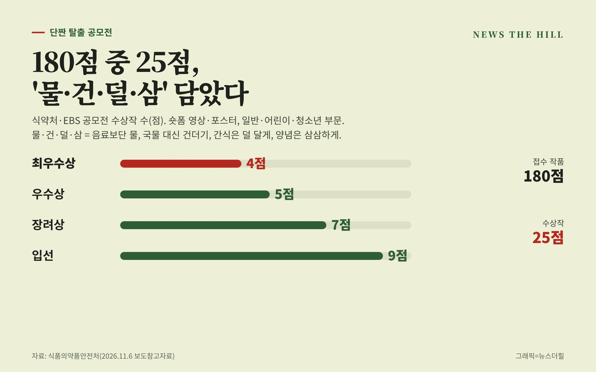

입력 2026-11-06

*그래픽=뉴스더힐(자료: 식품의약품안전처)*

국민이 직접 만든 나트륨·당류 줄이기 숏폼 영상과 포스터 가운데 25점이 수상작으로 뽑혔다. 수상작은 공모전 누리집에서 볼 수 있고, 식약처는 우수작을 홍보·교육 콘텐츠로 쓸 계획이다.

식품의약품안전처(처장 오유경)는 6일 보도참고자료에서 한국교육방송공사(EBS)와 함께 연 '대국민 단짠 탈출 공모전' 수상작 25점을 선정했다고 밝혔다.

## '물·건·덜·삼'이 주제

공모전 주제 '물·건·덜·삼'은 음료보단 물, 국물 대신 건더기, 간식은 덜 달게, 양념은 삼삼하게 등 일상 속 나트륨·당류 줄이기 실천 방법을 뜻한다. 어린이·청소년부터 성인까지 이 방법을 숏폼 영상이나 포스터로 만들어 내도록 했다.

7월 10일부터 8월 19일까지 '일반 부문'과 '어린이·청소년 부문'(만 18세 미만)의 영상·포스터 4개 분야에서 모두 180점이 접수됐다. 주제적합성, 완성도, 전달력, 공감도 등을 심사해 최우수상 4점, 우수상 5점, 장려상 7점, 입선 9점을 골랐다.

## 최우수상 4점

- 일반 부문 영상: '물의 반란·건더기의 반란'(건강반란군)
- 일반 부문 포스터: '한 계단, 더 건강하게'(식영이오)
- 어린이·청소년 부문 영상: '물은 챙기고 건더기는 든든하게, 덜 달고 삼삼하게'(정서우)
- 어린이·청소년 부문 포스터: '액상과당 네 몸에 꽈당!'(쌍둥이와 막둥이)

## 어디서 보나

수상작은 공모전 공식 누리집(www.2026minasu.kr)에서 확인할 수 있다. 영상 분야 최우수상 수상작은 EBS 유튜브 채널(EBS 교양)과 식약처 누리소통망, 마이나슈TV(유튜브 채널)에서도 볼 수 있다.

식약처는 선정된 우수작을 다양한 홍보·교육 콘텐츠로 활용해 국민이 일상에서 나트륨·당류 줄이기를 쉽고 재미있게 실천할 수 있도록 할 계획이라고 밝혔다.

※ 이 기사는 식품의약품안전처 보도참고자료(정책브리핑, 공공누리 제1유형·출처표시)를 바탕으로 작성했습니다.
