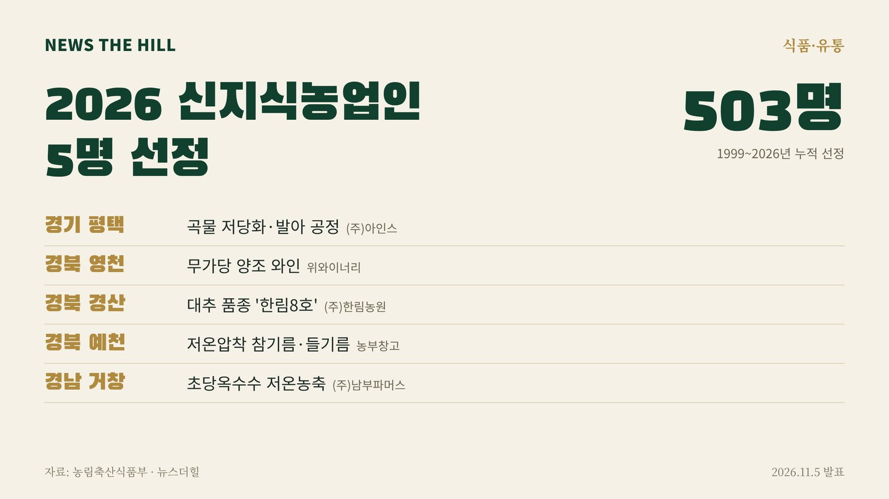

입력 2026-11-06

*그래픽=뉴스더힐(자료: 농림축산식품부)*

곡물 가공, 와인 양조, 대추 품종, 참기름·들기름 제조, 초당옥수수 농축 기술로 성과를 낸 농업인 5명이 올해 신지식농업인으로 뽑혔다. 가공·수출 분야 성과가 두드러졌고 청년농업인도 포함됐다.

농림축산식품부(장관 송미령, 이하 농식품부)는 5일 보도자료에서 2026년 신지식농업인 5명을 선정하고, 이날 전남광주통합특별시 화순군 하니움문화스포츠센터에서 열린 제21회 신지식농업인 지식전파대회에서 '신지식농업인 章'을 수여했다고 밝혔다.

## 어떻게 뽑았나

신지식농업인은 새로운 지식과 기술로 농업의 부가가치를 만들고 농업·농촌의 변화와 혁신을 이끄는 농업인으로, 「신지식농업인 운영규정(훈령)」에 따라 선발한다. 1999년부터 올해까지 모두 503명이 선정됐다.

올해는 각 시·도가 추천한 후보 40명을 대상으로 서류평가, 전문가 평가(면접평가)와 현지실사, 신지식농업인 운영위원회 심의를 거쳤다. 지역별로는 경북 3명, 경기·경남 각 1명이다.

## 선정자 5명

- 경기 평택시 농업회사법인 (주)아인스 이진영 대표: 곡물 부산물을 활용한 저당화·발아 공정 기술을 개발해 곡물의 기능성을 높이고 생산비 절감과 판매단가 상승을 이뤘다. 계약재배 확대와 해외 수출로 국내산 곡물 소비 확대에 기여하고 있다.
- 경북 영천시 영농조합법인 위와이너리 박진환 대표: 무가당 양조 기술로 고품질 와인을 생산해 포도의 부가가치를 높이고, 와인 체험프로그램과 관광 연계로 지역 특산물 소비를 늘리고 있다.
- 경북 경산시 농업회사법인 (주)한림농원 조이혁 대표: 수확 시기를 늦춘 대추 품종 '한림8호'를 개발해 출하 가격 상승과 노동력 절감 효과를 냈고, 재배기술 보급과 품종 산업화로 대추재배 농가 소득 증대에 기여했다.
- 경북 예천군 영농조합법인 농부창고 황영숙 대표: 저온압착 참기름·들기름 제조 기술을 개발해 유해물질 발생을 줄이고 영양소 보존성을 높였으며, 지역농가와의 계약수매와 해외 수출로 국산 참깨 소비를 늘렸다.
- 경남 거창군 농업회사법인 (주)남부파머스 윤의식 대표: 청년농업인으로 저온농축공법을 개발해 초당옥수수의 맛과 영양을 보존하고 상품성을 높였으며, 가공 표준화와 연중 유통체계를 갖췄다.

송미령 장관은 신지식농업인들에게 "창의적인 아이디어와 현장에서 축적한 기술과 노하우를 바탕으로 농업의 가치를 높이고, 혁신을 이끌고 있다"라며, "앞으로도 신지식농업인의 역량과 활동이 현장에서 실질적인 성과로 확대 될 수 있도록 더 많은 지원을 하겠다"라고 밝혔다.

※ 이 기사는 농림축산식품부 보도자료(공공누리 제1유형, 출처표시)를 바탕으로 작성했습니다. 보도자료의 '경북 예천시'는 '예천군'으로 바로잡았습니다.
