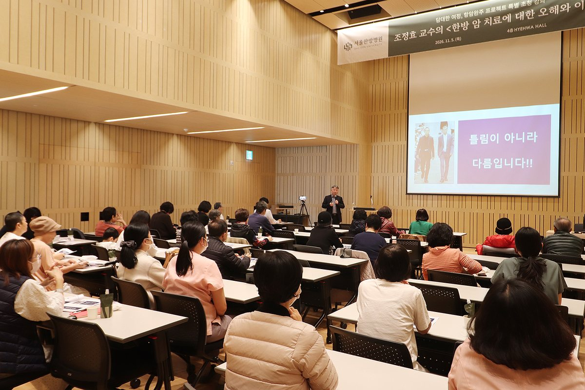
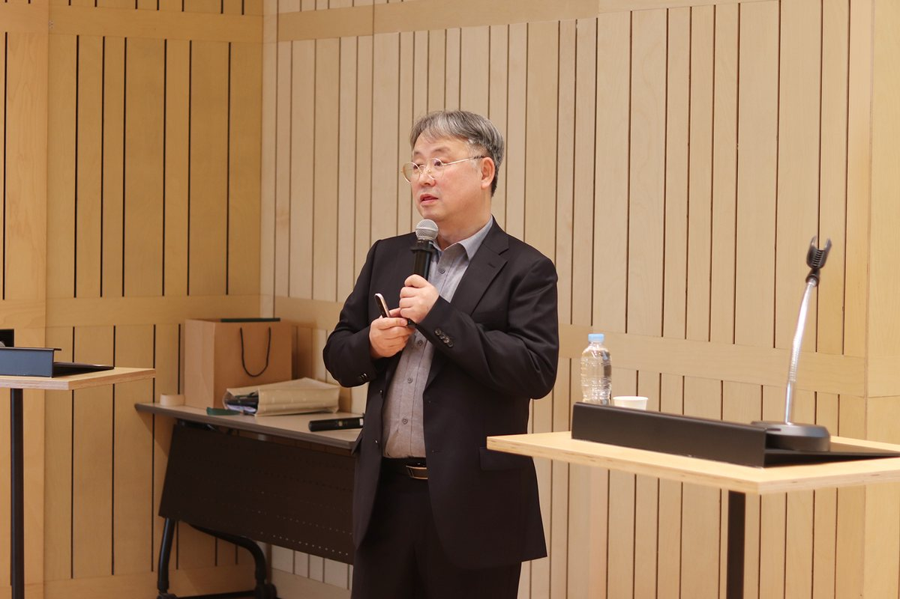
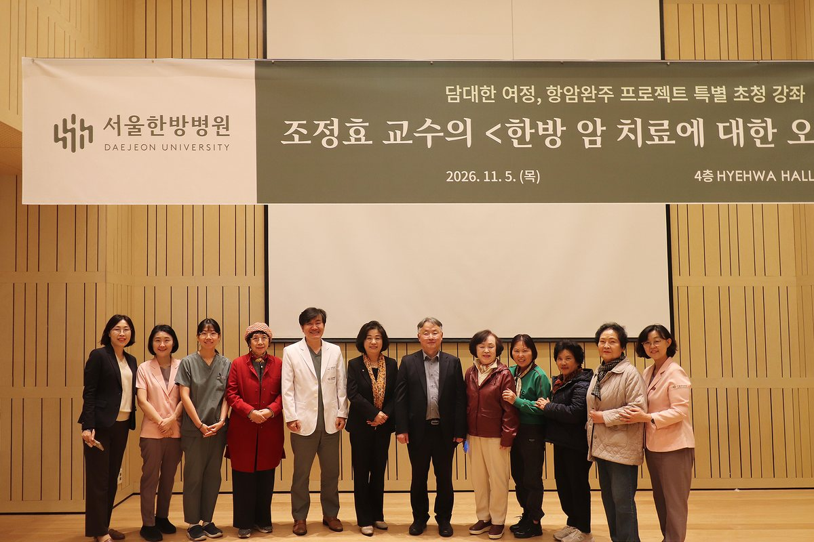

입력 2026-11-06

*5일 대전대학교 서울한방병원 4층 혜화홀에서 열린 '담대한 여정, 항암완주 프로젝트 특별 초청 강좌'에서 조정효 교수가 '한방 암 치료에 대한 오해와 이해'를 주제로 강연하고 있다. 사진=대전대학교 서울한방병원 제공*

"한의학과 서양의학은 틀림이 아니라 다름의 문제입니다."

암 환우와 가족, 일반인을 대상으로 한방 암 치료에 대한 궁금증을 풀어 주는 강좌가 송파구 문정동 대전대학교 서울한방병원에서 열렸다.

서울한방병원(병원장 조충식)은 5일 병원 4층 혜화홀에서 '한방 암 치료에 대한 오해와 이해'를 주제로 특별 건강강좌를 열었다고 밝혔다. 강연은 대전대학교 한의과대학 교수이자 대전한방병원 동서암센터장인 조정효 교수가 맡았다.

이번 강좌는 10월 수료한 서울한방병원 아카데미 1기 '담대한 여정, 항암완주 프로젝트'의 후속 프로그램으로 마련됐다. 일반인 누구나 무료로 참여할 수 있도록 열었고, 40여 명이 참석해 강연 내내 메모하며 귀를 기울였다.

*조정효 교수가 항암치료 중 한약 복용과 시기별 한방 치료의 목적을 설명하고 있다. 사진=대전대학교 서울한방병원 제공*

## "종양만 보고 사람을 보지 못하는 것 경계해야"

조 교수는 서양의학이 수술, 방사선, 항암화학요법 등으로 종양을 직접 없애는 데 집중한다면 한의학은 환자의 전신 상태와 면역력을 함께 살핀다고 설명했다. 그는 종양만 보고 사람을 보지 못한다는 뜻의 '지견종류불견인(只見腫瘤不見人)'을 경계하며, 암과 싸우는 환자의 삶을 돌보는 것이 한방 치료의 핵심이라고 강조했다.

항암치료 중 한약을 먹어도 되는지에 대한 불안에 대해서는 한약이 식약처 비임상시험 가이드라인과 품질관리 기준을 거친 한약재로 처방된다고 설명했다. 전문 한의사의 진단에 따라 처방된 한방 치료를 양방 치료와 함께하면 부작용 관리에 도움이 될 수 있다는 것이다.

## 시기별로 달라지는 치료 목적

조 교수는 한방 암 치료의 목적이 시기에 따라 다르다고 설명했다.

- 초·중기: 양방 치료 과정의 부작용을 줄이는 데 중점
- 완치 이후: 전이·재발 억제와 면역력 회복
- 말기: 삶의 질 개선

그는 암 치료의 궁극적인 목적이 종양 축소에 그치지 않고 환자가 건강한 일상을 되찾는 데 있다고 말했다.

강연 뒤에는 참석자들이 평소 궁금했던 점을 묻고 답하는 질의응답이 이어졌다. 조 교수는 "혼자가 아닌 함께할 때 희망은 조금씩 현실이 될 수 있다"며 강연을 마무리했다.

*강좌를 마친 참석자와 병원 관계자들이 기념촬영을 하고 있다. 사진=대전대학교 서울한방병원 제공*

조충식 병원장은 "한방 암 치료에 대한 궁금증과 오해를 바로잡는 자리가 되었기를 바란다."며 "앞으로도 환우들의 치료 여정에 든든한 동반자 역할을 이어가겠다"고 밝혔다.

서울한방병원은 이번 강좌의 만족도 조사 결과를 바탕으로 앞으로의 건강강좌 주제와 운영 방식을 보완하고, 아카데미 2기 운영도 준비할 계획이다.

## 조정효 교수는

한의학박사이자 한방내과 전문의로 대전대학교 한의과대학 교수로 재직 중이며 대전한방병원장을 지냈다. 대한통합암학회 인증 통합종양전문가·통합암치료 인정의이고, 미국 암학회(AACR) 회원, 대한한방내과학회 정회원, 대한암한의학회 대외이사로 활동하고 있다. 미국 퍼듀대학교에서 생화학 및 분자생물학을 연수했으며, 제13회 국제동양의학 학술대회 우수논문상과 제7회 대한한의학회 학술 우수상을 받았다.

**관련 기사**

- [서울한방병원 아카데미 1기 만족도 4.89점…참여자 85.7% "2기도 듣겠다"](https://newsthehill.com/articles/news-2026102800002/)
- [서울한방병원 '담대한 여정, 항암완주 프로젝트' 아카데미 1기 25명 수료](https://newsthehill.com/articles/news-2026102300009/)
- [조충식 대전대 서울한방병원장 "건강한 일상, 강건한 일생"](https://newsthehill.com/articles/interview-2026102700001/)

※ 이 기사는 대전대학교 서울한방병원이 보낸 보도자료를 바탕으로 작성했습니다.

*본지 발행인 최만수는 대전대학교 서울한방병원 명예자문위원이다.*
