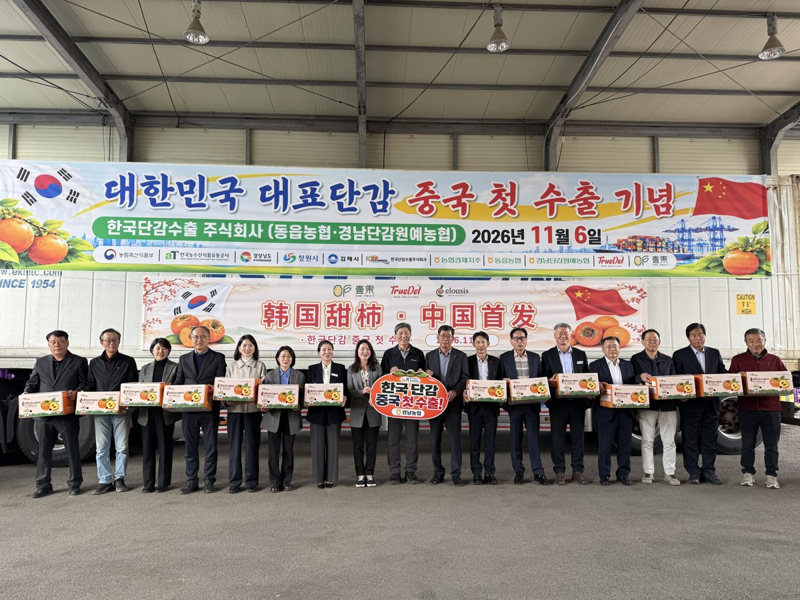
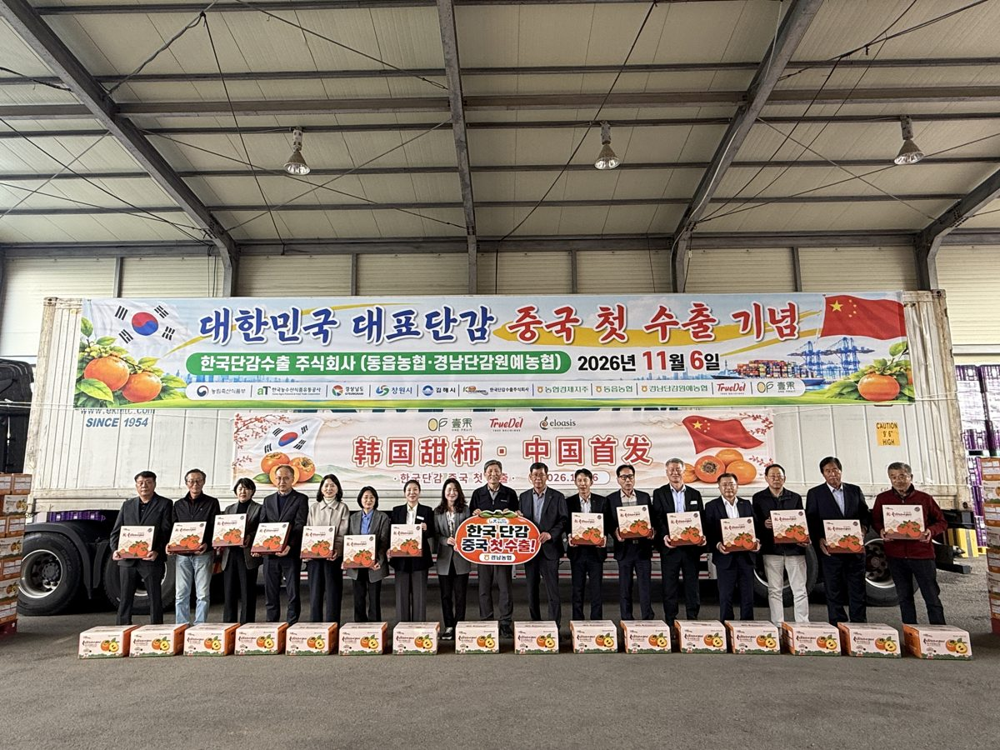

입력 2026-11-06

*6일 경남 창원시 동읍농협에서 열린 '한국산 단감 중국 첫 수출 선적식'. 사진=농림축산식품부 제공*

한국산 단감이 처음으로 중국에 수출된다. 2008년 시작된 검역협상이 17년 만인 지난해 타결된 데 따른 첫 수출이다. 첫 물량 약 19.6톤은 부산항을 떠나 11월 10일 상하이에 도착하고, 상하이 고급 유통매장 '시티슈퍼(City Super)' 등에서 판매된다.

농림축산식품부와 한국농수산식품유통공사(aT)는 6일 보도자료에서 이날 오후 경남 창원시 동읍농협에서 '한국산 단감 중국 첫 수출 선적식'을 열었다고 밝혔다. 동읍농협이 있는 경남은 전국 단감 수출의 99%를 차지하는 최대 주산지다.

## 첫 물량 1,960상자

첫 수출 물량은 40피트 컨테이너 1대 분량인 10kg 1,960상자(약 19.6톤)다. 동읍농협이 1,000상자, 경남단감원예농협이 960상자를 공급했다. 두 농협에서 중국 검역기준에 맞춰 선별·포장했다.

행사에는 단감수출통합조직인 한국단감수출㈜와 동읍농협, 농식품부, aT, 경상남도, 생산자단체, 수출업체 관계자 등이 참석해 선과장을 둘러보고 첫 출고를 축하했다.

## 17년 걸린 검역협상

한국산 감의 중국 수출 검역협상은 2008년 시작됐다. 지난해 11월 1일 경주 APEC 정상회의를 계기로 열린 한중 정상회담에서 송미령 농림축산식품부 장관과 쑨메이쥔 중국 해관총서장이 '한국산 감 생과실의 중국 수출 식물검역 요건' 양해각서에 서명하며 타결됐다.

이후 정부는 올해 2월 「한국산 감 생과실의 중국 수출검역요령」을 시행하고, 5월 경남 지역 5개 수출단지를 지정했다. 중국 해관총서는 10월 13~14일 수출 과수원·선과장을 원격으로 현지조사했고, 10월 30일 과수원 25곳과 선과장 6곳을 검역등록 목록에 올렸다. 농식품부는 당초 예상보다 승인이 1개월가량 앞당겨졌다고 밝혔다. 단감은 2019년 파프리카에 이어 중국 수출길이 열린 신선농산물이 됐다.

## 수출 80%가 동남아 등 5개국

지난해 한국산 감 수출량은 3,217톤(580만 달러)으로, 필리핀(1,032톤)·말레이시아(738톤)·홍콩(431톤)·싱가포르(225톤)·베트남(137톤) 5개국이 물량의 79.7%를 차지했다. 이 가운데 경남 수출량이 3,202톤(574만 6천 달러)이다.

농식품부는 중국 시장이 열리면서 수출 시장을 넓히고, 수확기 출하 물량을 해외로 분산해 국내 단감 가격 안정에도 도움이 될 것으로 기대했다.

*선적식 참석자들이 중국으로 수출되는 단감 상자를 들고 있다. 사진=농림축산식품부 제공*

## 중국 3개 거점 판촉

농식품부와 aT는 후숙 없이 바로 먹는 아삭함과 높은 당도를 내세워, 떫은감을 후숙해 먹는 중국산 감과 차별화한다는 계획이다. aT 상하이·베이징·홍콩 지사를 거점으로 연말까지 판촉을 이어간다.

- 화동(상하이): 11월 14일(토)~12월 27일(일) 과일 도매시장·고급 유통매장 론칭 판촉전, 경상남도와 함께 최고급 매장 'K-단감' 판촉전
- 화남(선전): APEC 정상회의(11월 18~19일)와 연계해 11월 21일(토)~24일(화) 'K-푸드 소비자 체험행사'와 B2B 바이어 상담회
- 화북(베이징): 11월 19일(목) 바이어 초청 상품설명회(35개사), 베이징 소매상품전시회(11월 20~22일) 참가, 12월 현지 소비자 론칭행사

세부 일정은 현지 여건에 따라 바뀔 수 있다. 농식품부는 첫 수출 이후에도 수출단지 병해충 관리와 선과장 검역을 지원하고, 수출단지 확대와 판로 다변화를 단계적으로 추진할 계획이다.

경상남도 류해석 농정국장은 "중국에서 경남 단감이 프리미엄 과일로 자리 잡을 수 있도록 현지 판촉과 생산 기반 강화를 적극 지원하겠다"라고 밝혔다.

농식품부 정경석 식품산업정책관은 "한국산 단감의 중국 수출은 17년에 걸친 검역협상과 정상외교, 그리고 경남 단감 농가와 수출업체가 함께 준비해 온 노력이 맺은 결실"이라며, "지난해 경주 APEC에서 열린 수출길이 올해 선전 APEC을 계기로 중국 소비자의 식탁까지 이어질 수 있도록 검역 관리부터 현지 판촉까지 빈틈없이 지원하겠다"라고 말했다.

※ 이 기사는 농림축산식품부 보도자료(정책브리핑, 공공누리 제1유형·출처표시)를 바탕으로 작성했습니다. 사진은 농림축산식품부가 보도자료와 함께 제공한 것입니다.
