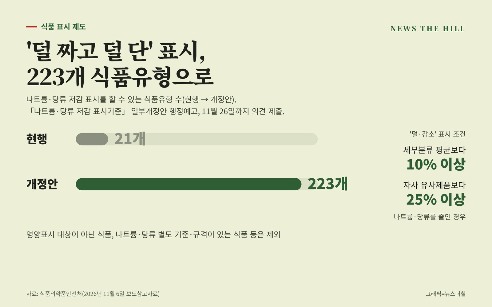

입력 2026-11-06

*그래픽=뉴스더힐(자료: 식품의약품안전처)*

나트륨이나 당류를 줄인 제품에 '덜', '감소' 같은 표시를 할 수 있는 식품이 크게 늘어난다. 지금은 21개 식품유형에만 허용되지만, 앞으로는 저감이 가능한 모든 가공식품(223개 식품유형)으로 넓어진다. 소스·과자·떡볶이 등에서도 저감 제품을 골라 사기 쉬워질 전망이다.

식품의약품안전처(처장 오유경)는 6일 보도참고자료에서 이런 내용의 「나트륨·당류 저감 표시기준」 일부개정안을 이날 행정예고했다고 밝혔다.

## 어떤 제품에 붙나

저감 표시는 유통 중인 제품의 세부분류별 평균값보다 나트륨·당류를 10% 이상, 또는 같은 제조사의 유사 제품보다 25% 이상 줄였을 때 '덜, 감소, 라이트, 줄인' 등의 말로 표시할 수 있게 한 제도다. 식약처는 2021년 이 기준을 도입한 뒤 나트륨·당류 주요 급원과 업계 수요를 고려해 대상을 21개 식품유형까지 늘려 왔다.

## 223개로 넓히되 일부는 제외

개정안은 소비자 관심과 업계의 대상 확대 요구를 반영해 표시 대상을 나트륨·당류 저감이 가능한 모든 가공식품(223개 식품유형)으로 확대한다. 다만 다음 식품유형은 제외한다.

- 영양표시 대상이 아닌 식품유형
- 고춧가루·우유·벌꿀처럼 주로 단일 원재료로 만드는 식품유형
- 영아용 조제유, 환자용 영양조제식품 등 나트륨·당류에 별도 제조·가공기준이나 규격이 있는 식품유형
- 기타 수산물가공품, 기타가공품처럼 대표성 있는 평균값을 내기 어려운 식품유형

## 평균값은 식약처가 제시

저감 여부를 판단하는 세부분류별 평균값은 식약처가 산출해 제시한다. 업계 수요를 반영해 매년 50개 안팎씩 단계적으로 늘리고 식약처 누리집에 공개한다. 평균값이 제시되지 않은 식품은 영업자가 직접 산출할 수 있지만, 객관적·과학적 근거를 갖추고 관련 분야 전문가의 자문을 받아야 한다.

평균값이 새로 게시되거나 바뀌면 게시일부터 1년 동안은 종전 값(새로 게시된 경우 영업자가 산출한 값)을 적용할 수 있다.

## 의견 제출

개정안은 식약처 누리집(www.mfds.go.kr) '법령·자료 > 입법/행정예고'에서 볼 수 있다. 의견이 있으면 11월 26일(목)까지 낼 수 있다.

※ 이 기사는 식품의약품안전처 보도참고자료(정책브리핑, 공공누리 제1유형·출처표시)를 바탕으로 작성했습니다.
