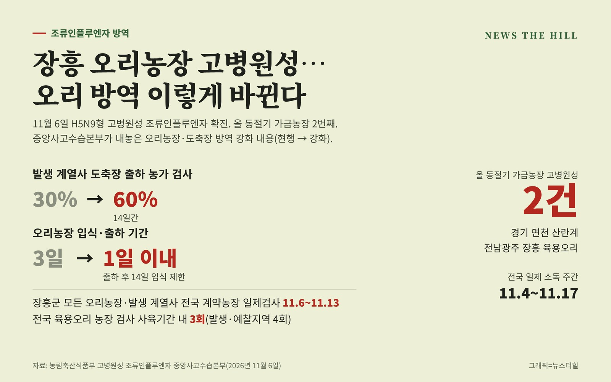

입력 2026-11-07

*그래픽=뉴스더힐(자료: 농림축산식품부)*

H5형 항원이 나왔던 전남광주 장흥의 육용오리 농장이 고병원성 조류인플루엔자(H5N9형)로 확진됐다. 경기 연천 산란계 농장에 이어 이번 동절기 가금농장 두 번째 발생이고, 오리농장에서는 처음이다. 방역 당국은 오리농장의 입식·출하 기간을 하루 이내로 줄이고 도축 단계 검사를 두 배로 늘리는 등 방역을 강화한다.

고병원성 조류인플루엔자 중앙사고수습본부(본부장 송미령 농림축산식품부 장관, 이하 중수본)는 6일 보도자료에서 장흥 육용오리(2만 2천여 마리) 농장의 확진 사실과 방역 강화 대책을 밝혔다. 중수본은 이날 이동식 방역정책국장 주재로 관계기관·지방정부 회의를 열었다.

## 발생 상황

농장주가 폐사가 늘어 장흥군에 신고했고, 정밀검사 결과 6일 고병원성으로 확진됐다. 중수본은 방역이 미흡한 농장 등에서 추가 발생 위험이 매우 높다며 전국 모든 가금농장이 차단방역을 강화하고 의심 증상이 있으면 지체 없이 신고해야 한다고 밝혔다.

H5형 항원 확인 직후 초동대응팀을 투입해 출입을 통제하고, 발생농장 살처분과 역학조사를 하고 있다. 전남광주통합특별시와 발생농장과 같은 계열사의 오리 농장, 축산시설(도축장, 사료공장 등), 축산차량에는 11월 5일(목) 23시부터 6일(금) 23시까지 24시간 일시이동중지 명령을 내렸다. 발생농장 방역대(10km) 안의 가금농장 23호는 정밀검사를 하고 있다.

## 방역 강화 내용

- 일제검사: 장흥군의 모든 오리농장과 발생 계열사의 전국 오리 계약사육 농장을 11월 6일부터 13일까지 검사한다. 전국 육용오리 농장의 검사 주기도 사육기간 내 3회(발생·예찰지역 4회)로 늘린다.
- 입식 절차: 오리농장의 입식·출하 기간을 3일에서 1일 이내로 줄이고, 출하 후 14일간 입식을 제한한다. 입식 전 환경검사와 방역점검에서 이상이 없어야 입식할 수 있다. 고위험지역 오리 사육제한(132호)도 11월부터 내년 2월까지 추진 중이다.
- 도축 단계: 발생 계열사 소속 도축장은 출하 농가 검사 비율을 30%에서 60%로 14일간 높인다. 각 계열사는 계약 사육농가와 축산시설을 자체 점검해 미흡한 점을 바로 고친다.
- 소독: 11월 4일부터 17일까지 2주간을 '전국 일제 소독 주간'으로 정해 가금농장, 축산시설, 차량 소독을 강화한다.
- 홍보: 지방정부, 생산자단체, 시군별 단체 대화방 등을 통해 발생 상황을 빠르게 알리고 의심축 신고를 안내한다.

## 당부

이동식 방역정책국장은 "전국 지방정부는 가금농장에 대한 관리, 예찰, 검사 등 방역조치를 빈틈없이 추진하고, 가금농장에서 핵심 방역수칙을 철저히 준수하도록 지속적으로 지도·홍보해 줄 것"을 요청했다.

아울러 "전국 어느 지역에서든 발생할 우려가 있으므로 발생 상황이 종료될 때까지 농장 내 사람·차량 출입통제, 소독 등 기본적인 차단방역 조치를 철저히 이행해 줄 것"을 당부했다.

※ 이 기사는 농림축산식품부 보도자료(정책브리핑, 공공누리 제1유형·출처표시)를 바탕으로 작성했습니다.
