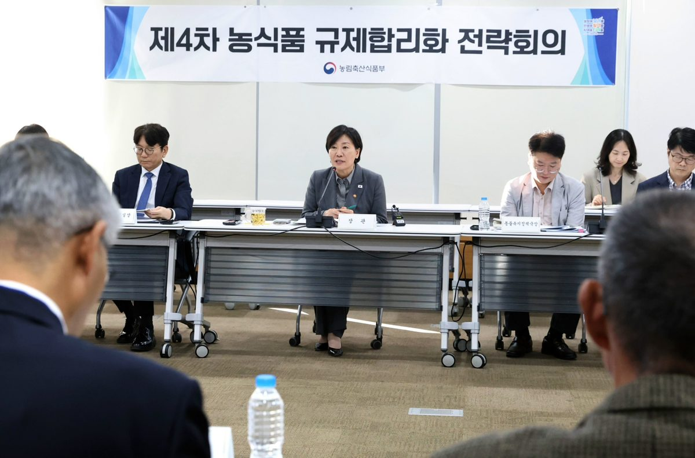

입력 2026-11-07

*6일 송미령 농림축산식품부 장관 주재로 열린 '제4차 농식품규제 합리화 전략회의'. 사진=농림축산식품부 제공*

농산물을 생산·유통하거나 식품을 만들 때 나오는 부산물을 재활용하기가 쉬워진다. 잔류농약 부적합으로 출하가 3개월 이상 묶인 농산물은 재조사를 받아 출하연기 기간을 조정할 수 있게 된다.

농림축산식품부는 6일 보도자료에서 이날 송미령 장관 주재로 '제4차 농식품규제 합리화 전략회의'를 열고 이런 내용을 담은 5개 분야 50개 규제합리화 과제를 새로 선정했다고 밝혔다. 회의에는 농식품 업계와 민간 전문가 등 20여 명이 참석했다.

## 식품·유통 관련 과제

- 농식품 부산물 재활용: 농축산물 생산·유통과 식품 제조 과정에서 나오는 농식품 부산물을 폐기물 재활용 가능 유형에 추가한다(기후부 협업, 폐기물관리법 시행규칙 개정·11월 12일 시행 예정). 지금은 폐기물로 분류돼 재활용하려면 재활용환경성평가와 폐기물처리업 허가 등이 필요하지만, 앞으로는 재활용환경성평가 없이 활용할 수 있다.
- 잔류농약 출하연기 재조사: 안전성 조사에서 잔류농약 부적합으로 출하연기 조치된 농산물 가운데 연기 기간이 3개월 이상인 경우 재조사를 해 기간을 조정할 수 있게 한다.
- K-푸드 수출지원사업 통합: 따로 운영되던 4개 수출지원사업을 '글로벌 Next K-푸드 개발육성 프로젝트'로 통합한다(12월). 수출기업이 사업마다 서류를 내야 하는 부담을 줄이기 위해서다.
- 축산물 공급: 사육 규모가 늘지 않는 산란계 등 축사의 증·개축을 허용하고, 과도한 가축사육 거리제한 기준을 합리화하는 방안을 추진한다(2027년 법령 개정). 농식품부에 따르면 국토 면적의 87.2%가 가축사육제한구역으로 지정돼 있다.
- 사료 안전: 아프리카돼지열병(ASF) 바이러스 불활성화에 필요한 돼지혈액 유래 혈장단백 사료의 표준 열처리 공정 기준을 마련한다.

## 농촌·농업 분야 과제

- 농업법인 사업범위에 영농형 태양광을 넣고, 발전 면적 2만㎡ 미만 소규모 영농형 태양광은 소규모 환경영향평가 면제를 추진한다. 「영농형 태양광 발전사업의 활성화 및 지원에 관한 법률」은 12월 17일 시행된다.
- 무인 자율주행 중 위험 감지·안전 정지 기능을 갖추도록 자율주행 농기계 안전기준을 신설하고, 수직농장도 종자업 등록이 가능하도록 시설기준을 추가한다.
- 「특정농지등의 정리에 관한 특별조치법」을 제정해 2026년 10월 31일까지 발생한 관행적 임대차 등 농지법 위반은 3년간 처분을 유예하고 적법한 상태로 바꿀 수 있게 한다. 투기 목적 취득 등은 특례에서 뺀다.
- 정책지원·인허가 신청이 필요한 79개 서비스의 제출 서류 450종 가운데 절반 이상을 정비하고, 농지임대차 변경 시 한 번만 신청하면 경영체·직불금까지 원스톱으로 바뀌는 서비스를 구축한다.
- 재해보험이 운영되지 않는 품목 재배 농가를 위한 선택형 농작물 준보험 도입, 방역수칙 위반 가축처분 보상금 최소 지급률 상향(평가액의 20%→30%), 동물병원 진료기록 열람·발급 허용 등도 포함됐다.

송미령 장관은 "이번에 확정된 규제합리화 과제들은 성장에 날개를 달고 민생에 활력을 주고 지역에 미래를 밝히는 출발점"이라며 "현장에서 농업인과 국민이 신속하게 변화를 체감할 수 있도록 법령 개정과 시스템 정비를 차질 없이 추진하겠다"고 밝혔다.

※ 이 기사는 농림축산식품부 보도자료(정책브리핑, 공공누리 제1유형·출처표시)를 바탕으로 작성했습니다. 사진은 농림축산식품부가 보도자료와 함께 제공한 것입니다.
