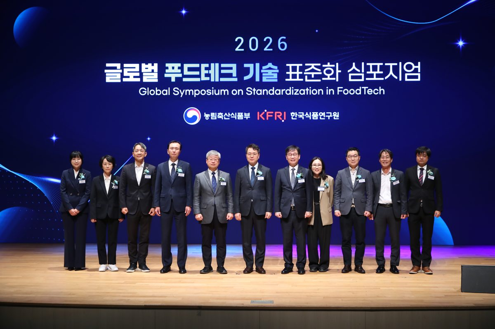

입력 2026-11-07

*6일 서울 코엑스에서 열린 '2026 글로벌 푸드테크 기술 표준화 심포지엄'. 사진=농림축산식품부 제공*

인공지능(AI)과 로봇으로 식품을 만드는 '식품 스마트팩토리'의 국내외 사례와 표준화 방향을 논의하는 자리가 열렸다. 농림축산식품부는 식품 분야 AI·자동화 연구개발 지원을 늘리고 국제표준화를 본격 추진하겠다고 밝혔다.

농식품부는 6일 보도자료에서 이날 서울 코엑스에서 '2026 글로벌 푸드테크 기술 표준화 심포지엄'을 열었다고 밝혔다. 올해로 세 번째인 심포지엄에는 국내외 전문가와 업계 관계자 400여 명이 참석했다.

## 해외 기업 사례

특별강연에서는 과학 커뮤니케이터 궤도가 '인공지능 기술의 현주소와 이에 따른 산업·사회적 변화'를 주제로 강연했다.

세션 1 '쉽게 이해하는 식품 스마트 팩토리'에서는 미라콤아이앤씨 정용대 컨설턴트가 식품산업 스마트팩토리의 개념과 도입 필요성을 설명했다. 미국 셰프 로보틱스(Chef Robotics)의 라자트 바게리아(Rajat Bhageria) CEO는 다양한 식재료 데이터를 로봇에 학습시켜 질감과 모양이 일정하지 않은 식재료를 담는 방식으로 제품 생산 1억 개를 넘긴 성과를 소개했다. 뉴질랜드 톰라 푸드(TOMRA Food)의 크리스토퍼 존스톤(Christopher Johnston)은 식품 제조공정에 센서와 AI 선별 기술을 도입한 사례를 발표했다. 농식품부는 이런 기술이 이물질 선별뿐 아니라 품질 예측과 식품 폐기물 감소에도 기여한다고 설명했다.

세션 2 '식품 스마트 팩토리의 미래와 준비'에서는 스위스 신테곤(Syntegon)의 스테판 슐레(Stephan Schuele)가 고속·고정밀 포장 기술을, 한국식품연구원 권기현 책임연구원이 AI 기반 푸드테크 스마트팩토리의 설계 방향과 기술 표준화 추진 전략을 발표했다.

## 정부 지원

농식품부는 지난해 12월 「푸드테크산업 육성에 관한 법률」을 시행했고, 「제1차 푸드테크산업 육성 기본계획」에 따라 식품산업 스마트 전환, 기술개발·투자, 인재양성, 글로벌 진출 등을 지원하고 있다. 6월에는 중소벤처기업부·식품의약품안전처와 함께 식품 제조업의 비용 절감과 생산 효율화를 위한 'K-푸드 스마트 제조 얼라이언스'를 출범했다.

김정욱 농식품부 농산업혁신정책실장은 "인공지능과 로봇을 활용한 스마트팩토리는 고효율, 고정밀 맞춤형 제품 생산 등 식품산업의 AX에 새로운 가능성을 열고 있다"며, "기술이 지능화·고도화될수록 기업과 소비자가 신뢰할 수 있도록 뒷받침하는 표준화의 역할도 더욱 중요해질 것"이라고 강조했다. 이어 "앞으로 식품 분야 AI·자동화 관련 R&D 지원을 확대하고, 푸드테크 기술과 수출 현안을 고려한 국제표준화를 본격 추진할 계획"이라고 밝혔다.

※ 이 기사는 농림축산식품부 보도자료(정책브리핑, 공공누리 제1유형·출처표시)를 바탕으로 작성했습니다. 사진은 농림축산식품부가 보도자료와 함께 제공한 것입니다.
