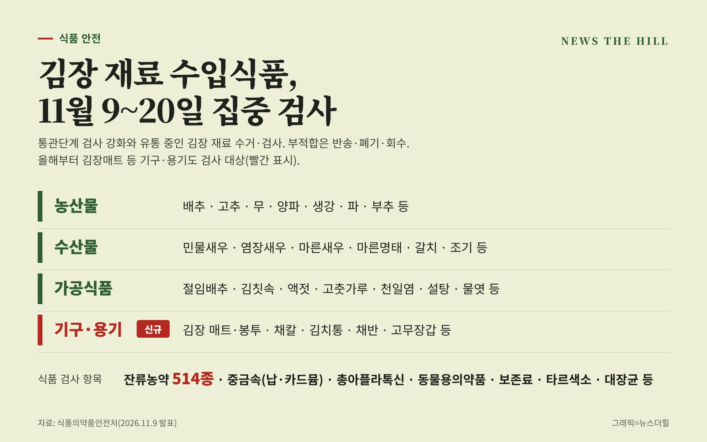

입력 2026-11-09

*그래픽=뉴스더힐(자료: 식품의약품안전처)*

김장철을 맞아 수입 배추·고춧가루·젓갈 같은 김장 재료가 통관과 유통 단계에서 더 꼼꼼히 검사를 받는다. 올해는 김장매트, 김치통, 고무장갑 등 김장에 쓰는 기구·용기도 처음으로 수거·검사 대상에 들어갔다.

식품의약품안전처는 9일 보도자료에서 11월 9일부터 20일까지 김장철 다소비 수입식품에 대한 통관·유통단계 안전관리를 강화한다고 밝혔다. 김장철에 소비가 늘어나는 수입 농·수산물과 가공식품은 통관단계 검사를 강화하고, 국내에 유통 중인 김장 재료는 집중 수거·검사한다.

## 무엇을 검사하나

- 농산물: 배추, 고추, 무, 양파, 생강, 파, 부추 등
- 수산물: 민물새우, 염장새우, 마른새우, 마른명태, 갈치, 조기 등
- 가공식품: 절임배추, 김칫속, 액젓, 고춧가루, 천일염, 설탕, 물엿 등
- 기구·용기류: 김장 매트·봉투, 채칼, 김치통, 채반, 고무장갑 등

식품은 잔류농약(514종), 중금속(납, 카드뮴), 총 아플라톡신, 동물용의약품, 보존료, 타르색소, 대장균 등을 검사하고, 기구·용기류는 재질별 기준·규격 항목을 본다.

통관단계에서는 중국산 배추와 절임배추에 대한 포름알데히드 검사도 계속한다.

## 부적합이면

통관단계에서 부적합 판정을 받은 수입식품은 수출국으로 반송하거나 폐기한다. 유통단계에서 부적합 제품이 확인되면 회수·폐기해 국내 유통을 막는다.

식약처는 앞으로도 김장철처럼 특정 시기에 소비가 늘어나는 수입식품의 안전관리를 강화할 계획이라고 밝혔다.

※ 이 기사는 식품의약품안전처 보도자료(정책브리핑, 공공누리 제1유형·출처표시)를 바탕으로 작성했습니다.
