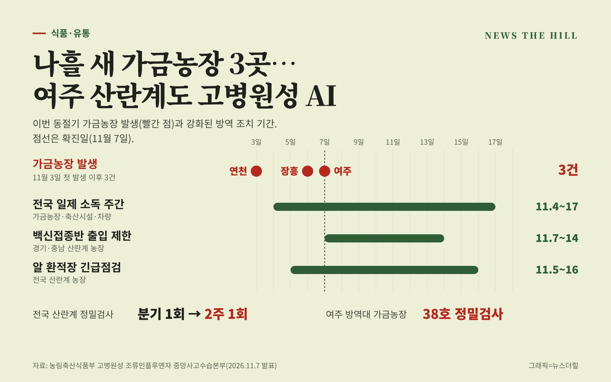

입력 2026-11-09

*그래픽=뉴스더힐(자료: 농림축산식품부)*

경기 여주의 산란계 농장에서 고병원성 조류인플루엔자(H5N1형)가 확진됐다. 경기 연천, 전남광주 장흥에 이어 이번 동절기 가금농장 세 번째 발생이다. 방역 당국은 전국 산란계 농장의 정밀검사 주기를 분기 1회에서 2주 1회로 줄이고, 노계는 도축장으로만 출하하도록 하는 등 방역을 강화한다.

고병원성 조류인플루엔자 중앙사고수습본부(본부장 송미령 농림축산식품부 장관, 이하 중수본)는 7일 보도자료에서 여주시의 산란계(26만여 마리) 농장이 11월 7일(토) 고병원성으로 확진됐다고 밝혔다. 중수본은 이날 이동식 방역정책국장 주재로 관계기관·지방정부 회의를 열고 방역 대책을 점검했다.

## 발생 상황

농장주가 닭 폐사가 늘어 여주시에 신고했고, 정밀검사 결과 고병원성으로 확진됐다. 11월 3일 가금농장에서 첫 발생한 뒤 4일간 3건이 확인됐고, 야생조류에서도 6건이 검출됐다. 중수본은 발생 지역이 넓어지고 야생조류를 통해 농장 안으로 바이러스가 들어올 위험이 매우 높은 상황이라고 밝혔다.

중수본은 초동대응팀을 투입해 출입을 통제하고 발생농장 살처분과 역학조사를 하고 있다. 경기·강원·충북의 닭 농장과 축산시설(도축장, 사료공장 등), 축산차량에는 11월 6일(금) 24시부터 7일(토) 24시까지 24시간 일시이동중지 명령을 내렸다. 발생농장 방역대(10km) 안의 가금농장 38호는 정밀검사를 하고 있다.

## 방역 강화 내용

- 방역지역: 방역지역(10km) 안 모든 축종을 일제검사한 뒤, 보호지역(3km) 안 농장은 5일마다 정밀검사한다. 방역지역 안 가금농장 38호에는 일대일 전담관을 둔다.
- 전국 산란계: 정밀검사 주기를 분기 1회에서 2주 1회로 줄인다. 산란계 밀집단지 14곳은 방역·소독 실태 점검과 농가별 폐사체 검사를 매주 한다. 20만 마리 이상 대형 산란계 농장뿐 아니라 종계·원종계·원종오리·밀집사육단지 등에도 이동통제초소를 세운다.
- 차량·인력: 경기·충남 산란계 농장에는 11월 7일(토) 9시부터 14일(토) 9시까지 7일간 백신접종반 출입을 제한한다. 전국 산란계 농장 알 환적장 운영 실태는 11월 5일부터 16일까지 긴급 점검한다.
- 노계 유통: 산란계·종계 노계는 도축장으로만 출하하고, 전통시장이나 다른 가금 사육농장(노계 전문 사육농장 등)으로 옮기는 것을 금지한다.
- 소독: 11월 4일부터 17일까지 2주간을 '전국 일제 소독 주간'으로 정해 가금농장, 축산시설, 차량 소독을 강화한다.

## 당부

이동식 방역정책국장은 "최근 경기 지역 가금농장에서 발생이 확인된 만큼 검역본부와 경기도에서는 추가 발생 방지를 위하여 발생 원인에 대한 역학조사를 면밀히 실시하고 미흡 사항을 신속하게 보완하도록 조치할 것"을 요청했다.

또 "정부는 11월 초에 불구하고 가금농장에서 3건이 발생하고 있어 야생조류를 통한 농장 내 바이러스 유입이 매우 높은 엄중한 상황으로 인식하고 있으며, 전국 지방정부와 생산자단체에서도 경각심을 갖고 가금농장 및 종사자가 기본적인 방역 수칙을 철저히 준수할 수 있도록 지도·점검에 각별히 신경 써줄 것"을 당부했다.

※ 이 기사는 농림축산식품부 보도자료(정책브리핑, 공공누리 제1유형·출처표시)를 바탕으로 작성했습니다.
