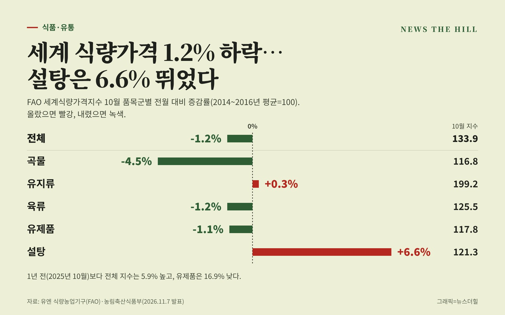

입력 2026-11-09

*그래픽=뉴스더힐(자료: 유엔 식량농업기구·농림축산식품부)*

국제 식량가격이 10월에 내렸다. 유엔 식량농업기구(FAO)의 10월 세계식량가격지수는 133.9포인트로 9월(135.6포인트)보다 1.2% 낮아졌다. 곡물·육류·유제품은 내렸고, 설탕은 브라질 사탕수수 수확 차질 등으로 6.6% 올랐다.

농림축산식품부는 7일 보도자료에서 FAO 발표를 이같이 정리했다. FAO는 24개 품목의 국제가격을 조사해 곡물, 유지류, 육류, 유제품, 설탕 5개 품목군별 지수를 매달 발표한다(2014~2016년 평균=100). 올해 지수는 6월 130.1, 7월 131.7, 8월 133.9, 9월 135.6으로 올랐다가 10월 133.9로 내려왔다.

## 품목군별 10월 지수

- 곡물: 116.8포인트, 전월보다 4.5% 하락(1년 전보다 12.5% 높음)
- 유지류: 199.2포인트, 0.3% 상승(1년 전보다 17.6% 높음)
- 육류: 125.5포인트, 1.2% 하락(1년 전보다 0.4% 높음)
- 유제품: 117.8포인트, 1.1% 하락(1년 전보다 16.9% 낮음)
- 설탕: 121.3포인트, 6.6% 상승(1년 전보다 28.9% 높음)
- 전체: 133.9포인트, 1.2% 하락(1년 전보다 5.9% 높음)

## 왜 움직였나

- 곡물: 국제 밀 가격이 4개월 연속 오른 뒤 하락세로 돌아섰다. 국제 수요가 부진한 가운데 아르헨티나를 중심으로 생산 전망이 좋아졌다. 옥수수도 9월 3년 만의 최고치를 기록한 뒤 내렸다. 반면 FAO 쌀가격지수는 일부 수출국의 수확 지연으로 1.6% 올랐다.
- 유지류: 대두유와 해바라기유 가격이 올라 유채유 하락분을 웃돌았다. 대두유는 바이오연료 수요와 남미의 계절적 공급 감소로 2022년 말 이후 최고 수준까지 올랐다.
- 육류: 유럽연합(EU)의 돼지고기 가격 약세, 호주의 양고기 공급 증가, 호주산 쇠고기 가격 하락이 영향을 줬다.
- 유제품: 버터·치즈 가격 하락 폭이 분유 가격 상승분보다 컸다.
- 설탕: 브라질 중남부 지역의 강우로 사탕수수 수확·압착이 차질을 빚었고, 인도 몬순 강우 부족 등으로 생산 전망에 대한 우려가 커졌다.

## 국내 물가와 곡물 전망

10월 국내 농축산물 소비자물가는 1년 전보다 2.6% 내려 9월(-1.0%)에 이어 하락세를 이어갔다. 농식품부는 김장철을 맞아 배추·무 등 주요 김장재료의 수급 상황을 면밀히 점검할 계획이라고 밝혔다.

FAO는 2026/27년도 세계 곡물 생산량을 2,999.5백만 톤으로 전년보다 1.7% 줄어들 것으로 내다봤다. 소비량은 2,971.4백만 톤으로 0.2% 늘고, 기말 재고량은 974.7백만 톤으로 1.8% 늘어날 것으로 전망했다.

※ 이 기사는 농림축산식품부 보도자료(정책브리핑, 공공누리 제1유형·출처표시)를 바탕으로 작성했습니다. 원자료는 유엔 식량농업기구(FAO) 발표입니다.
