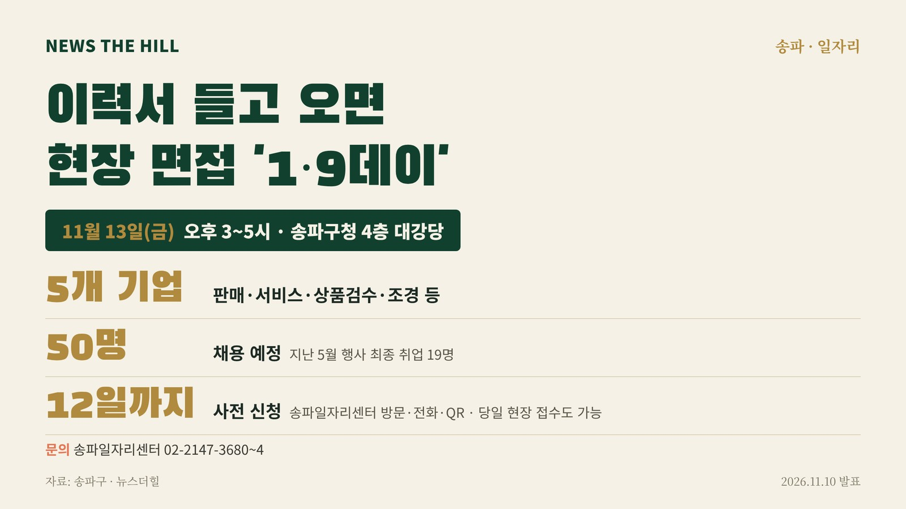

입력 2026-11-10

*그래픽=뉴스더힐(자료: 송파구)*

서울 송파구가 구직자들이 여러 기업의 채용 면접을 한자리에서 볼 수 있는 현장 채용박람회 '취업성공 1·9데이'를 13일(금) 연다. 5개 기업이 참여해 50명을 채용할 예정이다.

송파구는 10일 보도자료에서 이같이 밝혔다. 구에 따르면 최근 4년간 구직자 수는 큰 변화가 없었지만 기업의 신규 채용은 40% 넘게 줄었다. 구는 기업과 구직자를 직접 연결해 현장 면접부터 채용까지 지원한다는 계획이다.

행사는 송파구와 고용노동부 서울동부고용노동지청이 공동 주최하며, 13일 오후 3시부터 5시까지 송파구청 4층 대강당에서 열린다.

## 참여 기업

- 한국맥도날드 유한회사
- 롯데쇼핑(주) 롯데마트 송파점
- (주)가온지앤에프
- 페이머스 스튜디오(주)
- 현대조경개발홀딩스(주)

판매·서비스·상품검수·조경 등 여러 직종에서 인재를 모집한다.

'취업성공 1·9데이'는 '일(1)자리를 구(9)하는 날'이라는 뜻으로, 서류전형 부담을 줄이고 기업과 구직자를 현장에서 연결하는 채용행사다. 지난 5월 행사에서는 19명이 최종 취업했고, 참여자 만족도 조사에서 응답자의 92% 이상이 만족한다고 답했다. 가장 만족한 프로그램으로는 채용관(46%)과 맞춤형 일자리 상담(29%)이 꼽혔다.

행사장에서는 이력서 사진 촬영, 퍼스널컬러 진단, 지문적성검사, 맞춤형 일자리 상담, 이력서 컨설팅, 노동법률상담 등 취업 준비를 돕는 프로그램도 운영한다. 구는 행사 뒤에도 송파일자리센터를 통해 취업 알선을 이어가고 고용유지 등 사후관리도 지원할 계획이다.

## 신청 방법

- 사전 신청: 11월 12일(목)까지 송파일자리센터 방문, 전화(02-2147-3680~4) 또는 QR코드
- 사전 신청자는 문자로 안내받은 시간에 면접에 참여하며, 당일 현장 접수도 가능하다.
- 자세한 채용정보: 송파구 일자리 누리집(www.songpa.go.kr/job)

서강석 송파구청장은 "이번 행사가 구직자에게는 취업 기회를, 기업에는 필요한 인재를 만나는 자리가 되길 바란다"며 "앞으로도 기업과 구직자를 연결하는 맞춤형 채용 지원을 확대하겠다"고 전했다.

※ 이 기사는 송파구 보도자료(11월 10일)를 바탕으로 작성했습니다.
