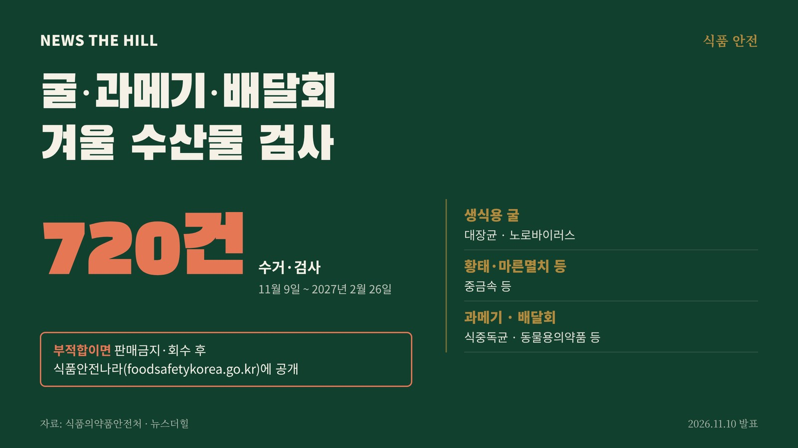

입력 2026-11-10

*그래픽=뉴스더힐(자료: 식품의약품안전처)*

겨울에 많이 먹는 생식용 굴, 과메기, 배달회, 마른김 같은 수산물이 내년 2월까지 집중 검사를 받는다. 부적합 판정이 나온 제품은 곧바로 판매가 금지되고 회수된다.

식품의약품안전처는 10일 보도자료에서 11월 9일부터 2027년 2월 26일까지 지방정부와 함께 겨울철 다소비 수산물을 집중 수거·검사한다고 밝혔다. 식약처에 따르면 2025년 수산물 생산량 393만 톤 가운데 겨울철(1·2·11·12월) 생산량이 약 38%(149만 톤)를 차지한다. 굴, 김 등 많이 소비되는 수산물이 본격 출하되는 시기다.

## 무엇을 검사하나

검사 대상은 온·오프라인에서 판매 중인 마른김, 과메기 등 단순처리 수산물과 생식용 굴, 배달회 등 모두 720건이다. 부적합 이력이 있는 검사항목을 중점적으로 본다.

- 생식용 굴: 대장균, 노로바이러스
- 황태·마른멸치 등 단순처리 수산물: 중금속 등
- 과메기, 배달회: 식중독균, 동물용의약품 등

## 부적합이면

검사 결과 부적합으로 판정된 수산물은 신속하게 판매금지·회수하고, 식품안전나라 누리집(www.foodsafetykorea.go.kr)에 공개한다.

식약처는 앞으로도 시기별로 생산·소비가 늘어나는 수산물의 안전관리를 강화할 계획이라고 밝혔다.

※ 이 기사는 식품의약품안전처 보도자료(정책브리핑, 공공누리 제1유형·출처표시)를 바탕으로 작성했습니다.
