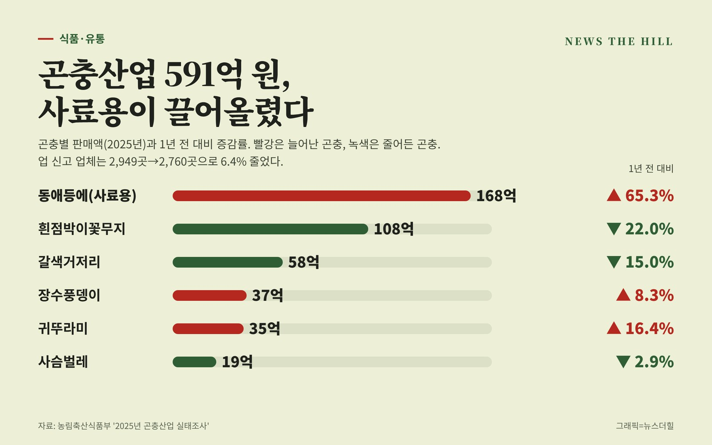

입력 2026-11-10

*그래픽=뉴스더힐(자료: 농림축산식품부)*

지난해 국내 곤충산업 규모가 591억 원으로 커졌다. 어분 대체 사료로 쓰이는 '동애등에' 판매가 1년 새 65.3% 늘며 성장을 이끌었다. 반면 식용 곤충 판매액은 15.1% 줄었다.

농림축산식품부는 9일 곤충 생산·가공·유통업 신고 농가와 법인 2,760곳을 대상으로 한 '2025년 곤충산업 실태조사' 결과를 발표했다.

## 규모는 커지고 업체 수는 줄고

2025년 곤충산업 규모는 591억 원으로 전년(528억 원)보다 11.8%(62억 원) 늘었다. 2020년(414억 원)과 비교하면 5년 새 177억 원(42.8%) 증가했다.

- 연도별 곤충 판매액: 2020년 414억 원 → 2021년 446억 원 → 2022년 449억 원 → 2023년 473억 원 → 2024년 528억 원 → 2025년 591억 원

신고 업체 수는 2,760곳으로 전년(2,949곳)보다 6.4% 줄었지만, 업체당 평균 판매액은 약 1,800만 원에서 약 2,100만 원으로 16.7% 늘었다.

용도별로는 식용 곤충이 201억 원(34.0%)으로 가장 많았고, 사료용 168억 원(28.4%), 기타 166억 원(28.1%), 애완·학습용 56억 원(9.5%) 순이었다. 곤충별로는 동애등에(168억 원), 흰점박이꽃무지(108억 원), 갈색거저리(58억 원), 장수풍뎅이(37억 원), 귀뚜라미(35억 원), 사슴벌레(19억 원) 순이었다. 지자체 곤충 축제에는 모두 592만 명이 찾았다.

## 사료용 동애등에, 1년 새 66억 원 늘어

동애등에 판매액은 168억 원으로 전년보다 66억 원(65.3%) 늘었다. 사육 농가도 241곳에서 285곳으로 18.3% 증가했다. 농식품부는 국제 어분 가격이 톤당 1,598달러에서 1,825달러로 14.2% 오르면서, 단백질 함량이 40~50%로 높고 가격 경쟁력을 갖춘 동애등에가 대체 단백질원으로 자리 잡았다고 풀이했다.

## 식용 곤충은 감소…기능성 원료 인정·거점단지 준공

식용 곤충 판매액은 전년(237억 원)보다 15.1% 줄어든 201억 원이었다. 농식품부는 올해 9월 '고소애(갈색거저리 유충)'가 건강기능식품 기능성 원료('근력 유지' 도움)로 인정받았고, 연간 최대 1,000톤을 생산할 수 있는 '춘천 곤충산업 거점단지'가 9월 준공돼 반등이 예상된다고 밝혔다.

농식품부는 곤충 사육시설 현대화를 지원하고 그린바이오 제품 상용화와 정책금융 지원을 계속 늘릴 계획이다.

정경석 농식품부 식품산업정책관은 "곤충은 고단백 기능성 원료이자 친환경 미래 자원으로 성장 잠재력이 매우 높은 분야"라며, "이번 실태조사 결과를 바탕으로 곤충산업이 고부가가치 그린바이오 산업으로 견고하게 자리 잡을 수 있도록 정책적 지원을 이어가겠다."라고 밝혔다.

※ 이 기사는 농림축산식품부 보도자료(정책브리핑, 공공누리 제1유형·출처표시)를 바탕으로 작성했습니다.
