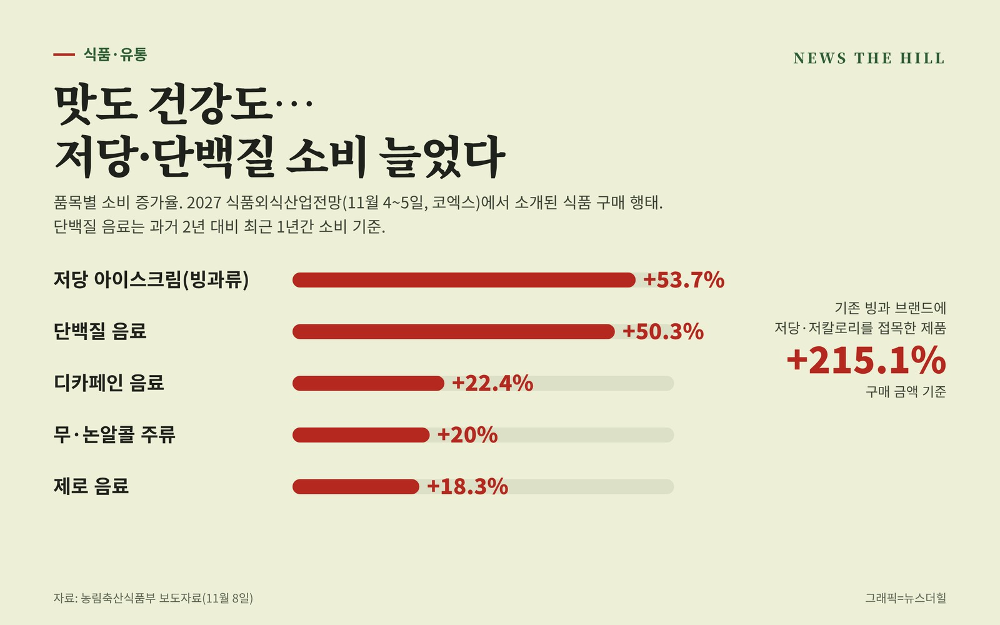

입력 2026-11-10

*그래픽=뉴스더힐(자료: 농림축산식품부)*

건강을 위해 맛을 포기하던 소비가 '건강과 맛을 함께' 찾는 쪽으로 바뀌고 있다. 저당 아이스크림 소비는 53.7%, 단백질 음료 소비는 50.3% 늘었고, 기존 빙과 브랜드에 저당·저칼로리를 접목한 제품은 구매 금액이 215.1% 증가했다.

농림축산식품부는 8일 보도자료에서 11월 4일(수)과 5일(목) 서울 코엑스에서 열린 '2027 식품외식산업전망'에서 이 같은 식품 소비 동향과 산업 전망이 논의됐다고 밝혔다. 행사에는 식품·외식 업계 종사자 등 700여 명이 참석했다. 강연은 11월 18일(수)부터 식품산업통계정보(FIS) 누리집(www.atfis.or.kr)에서 볼 수 있다.

## 웰니스·취향·경험이 소비를 가른다

전문가들은 최근 식품 소비가 웰니스, 취향(맛), 경험(가치) 등 세 가지 변수에 영향을 받는다고 진단했다. 단백질 식품, 식이섬유, 대체식 등 건강을 고려한 소비가 늘고, 대체당을 쓴 제로 식품이나 기능성 원료를 더한 제품(예: 유산균을 첨가한 이온음료)이 주목받고 있다는 것이다.

소비 과정의 경험과 만족을 중시하는 '가치소비'도 확산되고 있다. 고물가 속에서도 트러플 스낵, 싱글 오리진 커피 같은 '스몰 럭셔리' 소비가 대표적이고, 두바이 초콜릿 디저트, 과일 찹쌀떡처럼 SNS로 공유할 수 있는 식품이 큰 주목을 받았다.

- 단백질 음료: 50.3% 증가(과거 2년 대비 최근 1년간)
- 저당 아이스크림(빙과류): 53.7% 증가
- 디카페인 음료 22.4%, 무·논알콜 주류 20%, 제로 음료 18.3% 증가
- 기존 빙과 브랜드에 저당·저칼로리를 접목한 제품: 구매 금액 215.1% 증가

외식업에서도 건강과 즐거움을 함께 찾는 '헬시 플레저(Healthy Pleasure)' 흐름이 이어지고 있다. 커피 전문점의 디카페인 커피 매출이 늘고, 단백질·비타민 등을 추가하는 맞춤형 메뉴와 저당 떡볶이, 저당 숯불갈비 같은 메뉴가 나오고 있다. 외식 브랜드와 패션·의류업계의 협업, 러닝대회 같은 참여형 행사도 늘고 있다.

## AI가 식품 제조·외식 경영 바꾼다

식품 제조업은 글로벌 공급망 불안정, 인건비 상승, 다품종 소량 생산 확대, ESG 경영 요구 등에 직면해 있어, AI로 제조 데이터를 수집·표준화하고 공정을 최적화해 생산성과 품질을 높여야 한다는 전망이 나왔다. 외식업에서는 AI로 고객 특성과 소비 트렌드를 분석하고 원가를 검토해 매장에 맞는 메뉴를 개발하거나, 홍보 포스터·메뉴판 제작을 직접 해 비용을 줄일 수 있다는 기대가 소개됐다.

정경석 농식품부 식품산업정책관은 "이번 행사가 식품·외식산업의 흐름을 이해하고 대응 방안에 대해 생각해 볼 수 있는 뜻깊은 자리가 되었길 바란다."라고 말했다. 그는 정부가 웰니스 소비 트렌드에 식품·외식기업이 발 빠르게 대응할 수 있도록 간편식·건강식 등 식품 R&D를 확대하고 그린바이오 산업을 고도화하며, 푸드테크 연구지원센터와 혁신 클러스터 구축을 통해 식품·외식업계에 AI, 로봇 등 첨단기술 도입을 가속화할 예정이라고 밝혔다.

※ 이 기사는 농림축산식품부 보도자료(정책브리핑, 공공누리 제1유형·출처표시)를 바탕으로 작성했습니다.
