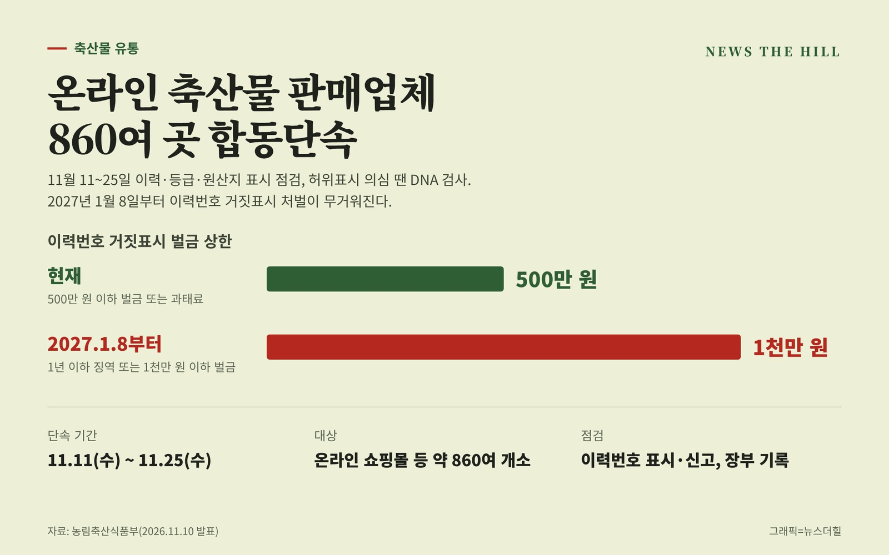

입력 2026-11-10

*그래픽=뉴스더힐(자료: 농림축산식품부)*

온라인 쇼핑몰 등에서 고기를 파는 업체들이 11일부터 2주 동안 이력·등급·원산지 표시 단속을 받는다. 내년 1월 8일부터는 축산물 이력번호를 거짓으로 표시하면 징역형까지 받을 수 있게 된다.

농림축산식품부는 10일 보도자료에서 2026년 4분기를 맞아 온라인 쇼핑몰 등을 통해 축산물을 유통·판매하는 업체를 대상으로 11월 11일부터 25일까지 약 2주간 이력·등급·원산지 표시 합동단속을 한다고 밝혔다.

## 무엇을 점검하나

농식품부는 온라인을 통한 축산물 판매가 계속 늘고 있어 이번 단속을 온라인 판매업체 중심으로 진행한다고 설명했다. 대상은 온라인 쇼핑몰 위반 의심 업체와 이력신고 위반 의심 업체 등 약 860여 개소다.

- 이력번호 표시와 신고
- 장부 기록
- 현장점검 중 이력번호 허위표시 등이 의심되면 DNA 동일성 검사 병행

## 내년 1월 8일부터 처벌 강화

「가축 및 축산물 이력관리에 관한 법률」이 개정(2026년 7월 7일)되면서 2027년 1월 8일부터 축산물 이력번호 거짓표시에 대한 처벌 수준이 높아진다. 농식품부는 판매업체 등이 정확한 이력번호를 표시하도록 단속과 함께 홍보도 할 예정이다.

- 현재: 500만 원 이하의 벌금 또는 과태료
- 2027년 1월 8일부터: 1년 이하의 징역 또는 1천만 원 이하의 벌금

전익성 농식품부 축산유통팀장은 "온라인에서도 소비자가 축산물을 안심하고 구매할 수 있도록 축산물 이력제 등을 지속 점검할 계획"이라며, "내년부터 축산물 이력번호 거짓표시에 대한 처벌이 강화되는 만큼 축산물 판매업체 등은 정확한 이력번호 표시에 적극적으로 동참해 주시길 당부드린다"라고 말했다.

※ 이 기사는 농림축산식품부 보도자료(정책브리핑, 공공누리 제1유형·출처표시)를 바탕으로 작성했습니다.
