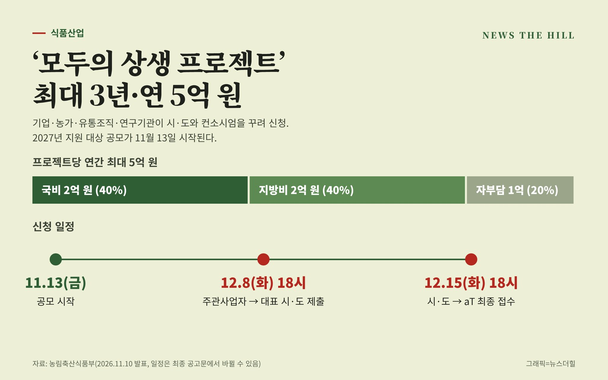

입력 2026-11-10

*그래픽=뉴스더힐(자료: 농림축산식품부)*

국산 농산물로 새 제품이나 메뉴를 만들려는 식품·외식 기업과 판로가 필요한 농가가 시·도와 컨소시엄을 꾸려 신청하면 최대 3년 동안 해마다 최대 5억 원 규모의 사업비를 받을 수 있다. 정부가 '모두의 상생 프로젝트' 지원 방식을 한 해 단위에서 여러 해 단위로 바꾸고 13일부터 2027년 지원 대상 공모를 시작한다.

농림축산식품부는 10일 보도자료에서 이같이 밝혔다. '모두의 상생 프로젝트'는 농업·농촌의 고유 자원과 기업의 기술·아이디어·유통망을 결합하는 민간 주도형 협력 모델이다. 농식품부는 지난 7월 27일 대한상공회의소에서 출범식을 열었고, 9월 '2026년 사회적가치페스타'에서 홍보관을 운영했으며, 추석에는 국산 농산물을 담은 '모두의 상생 선물세트'를 선보였다.

## 현장 사례

농식품부가 소개한 사례는 다음과 같다.

- 현대그린푸드: 태안 대파와 부여 연잎·밤 등을 기업급식 메뉴로 개발
- CJ제일제당: 지역 양조장의 원주에 브랜딩과 글로벌 유통망을 접목해 전통주 시장 개척
- 제주 청년기업 귤메달: 유니클로, CU, 배민 B마트 등과 협업해 감귤을 패션 콘텐츠와 디저트 상품으로 개발
- 한울농업회사법인: 고구마, 가루쌀 등으로 제품 다각화와 판로 확대, 국산 농산물 구매액 2023년 18억 원에서 2025년 58억 원으로

## 무엇이 달라지나

기존의 개별·단발성 지원에서 공동과제 중심의 '프로젝트형 다년도 지원체계'로 바뀐다. 1년 또는 2~3년 계획으로 신청할 수 있으며, 다년도 사업은 해마다 성과 평가를 거쳐 계속 지원 여부와 규모를 정한다.

- 참여: 주관사업자 1곳과 대표 시·도 1곳이 반드시 들어가는 컨소시엄. 기업·생산자단체·유통·물류조직·연구기관 등은 참여기관으로 함께할 수 있다.
- 지원 규모: 프로젝트당 연간 최대 5억 원(국비 2억 원, 지방비 2억 원, 자부담 1억 원)
- 지원 내용: 시험재배·생산 및 품질관리, 제품·메뉴 개발, 시험생산, 시장조사, 온·오프라인 판로개척, 수출 등
- 지원 제외: 원료구매대금, 시설·장비 구입·설치비, 통상 운영비 등
- 유형(예시): 생산중심형, 제품화형, 전주기 통합형, 대·중소 협력형, 마케팅·수출형 등

## 신청 일정

참여를 원하는 컨소시엄은 농식품부 누리집(www.mafra.go.kr)의 공고문을 확인하고 대표 시·도와 사전 협의를 거쳐야 한다.

- 11월 13일(금): 공모 시작
- 12월 8일(화) 오후 6시까지: 주관사업자가 대표 시·도에 신청서와 사업계획서 제출
- 12월 15일(화) 오후 6시까지: 시·도 검토·추천을 거쳐 한국농수산식품유통공사(aT)로 최종 접수

일정은 최종 공고문에서 바뀔 수 있다. 선정은 시·도 검토·추천, aT 서류점검, 전문가 평가·사업비 심의를 거쳐 농식품부가 확정한다. 문의는 aT 식품기업지원부(061-931-0721).

정경석 농식품부 식품산업정책관은 "모두의 상생 프로젝트는 우수한 국산 농산물을 활용해 시장 경쟁력을 높이려는 기업과, 안정적인 판로 개척이 절실한 농가 모두에게 확실한 성장의 기회가 될 것"이라며, "이번에 선정되는 프로젝트들이 단순한 지원에 그치지 않고 지속 가능한 비즈니스 모델과 장기적 거래로 뿌리내릴 수 있도록 지원할 계획이다. 역량 있는 기업과 지방정부의 많은 관심과 참여를 바란다"고 밝혔다.

※ 이 기사는 농림축산식품부 보도자료(정책브리핑, 공공누리 제1유형·출처표시)를 바탕으로 작성했습니다.
