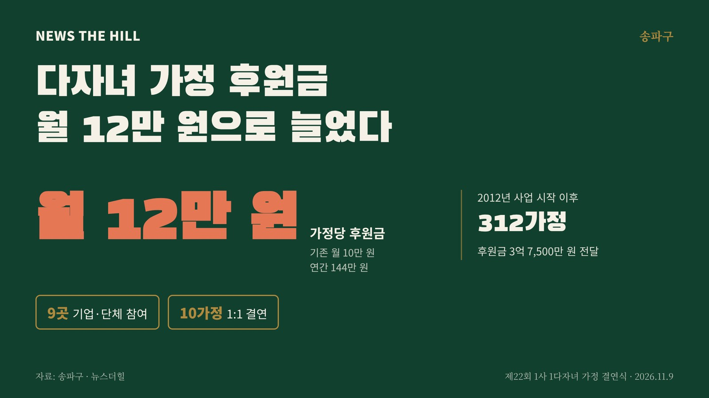

입력 2026-11-11

*그래픽=뉴스더힐(자료: 송파구)*

서울 송파구가 기업 후원으로 다자녀 가정을 돕는 '1사 1다자녀 가정 결연사업'의 지원금을 가정당 월 10만 원에서 월 12만 원(연간 144만 원)으로 늘렸다. 올해는 관내 9개 기업·단체가 다자녀 10가정과 후원 결연을 맺었다.

송파구는 11일 보도자료에서 지난 9일(월) 오후 3시 KT송파빌딩 3층 송파아카데미에서 '제22회 1사 1다자녀 가정 결연식'을 열었다고 밝혔다. 구는 고물가 등으로 커진 다자녀 가정의 양육 부담을 덜기 위해 지원금을 올렸다고 설명했다.

'1사 1다자녀 가정 결연사업'은 기업의 자발적 후원금으로 다자녀 가정의 양육 부담을 덜고 출산 친화적인 분위기를 만들기 위한 민관 협력 사업이다. 2012년 시작해 올해 22회째이며, 지금까지 312개 다자녀 가정에 후원금 3억 7,500만 원을 전달했다.

## 올해 참여 기업·단체

- 서울개인택시조합 새마을금고
- (사)섬김과 나눔
- 송파 고은빛산부인과의원
- 산림조합중앙회
- 송파구 한의사회
- 대명복지재단
- 한국 건강관리협회 서울강남지부
- 백제홍삼(주)
- (주)청밀로

후원 대상은 2025년 10월부터 2026년 9월 사이에 아이가 태어난 다자녀 10가정이다. 다섯째 자녀를 낳은 3가구, 넷째 자녀를 낳은 3가구, 세쌍둥이(셋째아) 1가구 등이 포함됐다.

서강석 송파구청장은 "송파구는 서울에서 아이가 가장 많이 태어나는 대표적인 출산·육아 친화 1333도시로, 오늘 결연은 지역사회와 기업이 한마음으로 다자녀 가정을 응원하는 매우 뜻깊은 결실"이라며 "앞으로도 기업의 선한 영향력이 아이들의 밝은 미래로 이어질 수 있도록, 아이 낳고 키우기 좋은 환경을 조성하고 저출생 극복을 위한 포용적 육아 정책에 힘쓰겠다"고 밝혔다.

구는 서울시 자치구 가운데 출생아 수 1위인 만큼 어린이집·유치원 원어민 영어교실 지원, 하하호호 놀이터와 장난감 도서관 확충, 송파키움센터 운영 등 보육 기반을 넓히고 있다. 앞으로 '출산축하용품 송파 베이비샤워' 등 맞춤형 지원도 늘릴 계획이다.

※ 이 기사는 송파구 보도자료(11월 11일)를 바탕으로 작성했습니다.
