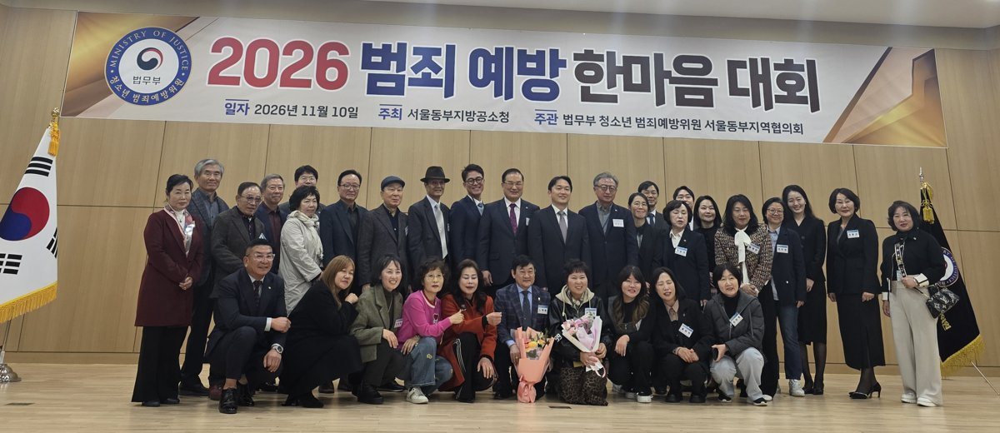
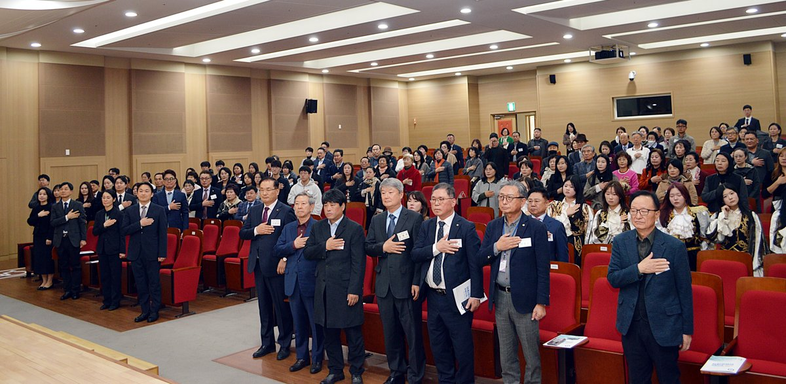
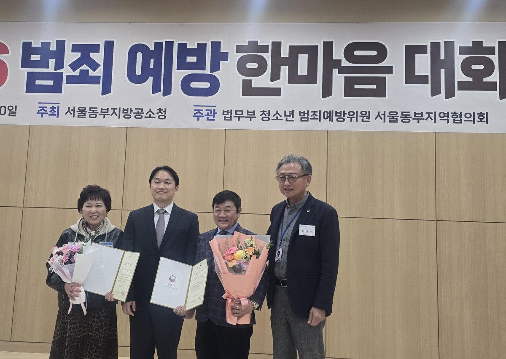

입력 2026-11-11

*10일 서울동부지방공소청 3층 대강당에서 열린 '2026 범죄예방 한마음대회' 참석자들이 기념촬영을 하고 있다. 사진=청소년범죄예방위원 서울동부지역협의회 제공*

서울동부지방공소청(청장 서정민)과 청소년범죄예방위원 서울동부지역협의회(회장 이선근)가 10일(화) 서울동부지방공소청 3층 대강당에서 '2026 범죄예방 한마음대회'를 열고 청소년 선도에 힘쓴 위원과 우수학생을 표창했다. 모범학생 12명에게는 장학금을 전달했다.

행사에는 서정민 공소청장과 황현아 차장검사 등 간부 직원, 이선근 협의회장과 정수호 고문, 부회장, 운영위원이 참석했다. 노준성(성동), 김영주(광진), 이석재(강동), 최만수(송파) 지구회장과 4개 지구 범죄예방위원, 장학생 등도 자리했다. 사회는 김숙정 강동지구 위원이 맡았고, 식전 행사로 일신여상 치어리딩 동아리가 공연했다.

*'2026 범죄예방 한마음대회' 참석자들이 국민의례를 하고 있다. 사진=청소년범죄예방위원 서울동부지역협의회 제공*

## 표창·감사패·장학금

- 공소청장 표창(위원): 이준호·황성옥 협의회 운영위원, 김종덕·엄기희(성동), 조진수·이장희(광진), 윤양순·천성덕(강동), 김춘자·노학래(송파) 지구 위원
- 공소청장 표창(우수학생): 이서현(성수고 1학년), 지우진(숭례중 2학년)
- 협의회장 감사패: 안은주(성동), 황윤정(광진), 박선하(강동), 김흥선(송파) 지구 위원
- 장학금: 김다은(경일중 2학년) 등 모범학생 12명

*표창 수상자들이 기념촬영을 하고 있다. 사진=청소년범죄예방위원 서울동부지역협의회 제공*

서 청장과 이 회장은 장학금을 전달하며 학생들을 격려했고, 공연을 맡은 일신여상 치어리딩 동아리에도 격려금을 전달했다.

## 올해 협의회 활동

협의회는 올해 상·하반기에 각 지구별로 중·고등학교 인근에서 청소년 마약·도박 예방 캠페인을 벌였다. 한부모·다문화 가정 등 소외 가정 자녀를 롯데월드에 초청했고, 명절에는 어려운 이웃에게 생필품을 전달했다.

기소유예 대상 청소년을 위한 선도교육 '잔디프로그램'은 2018년부터 운영하고 있다. 올해는 해동검도 심신수련반과 한궁반을 운영했으며, 지금까지 300여 명의 선도학생이 이 프로그램을 이수했다고 협의회는 밝혔다.

이선근 협의회장은 대회사에서 "잔디프로그램과 마약예방캠페인 행사는 전국예방위원 활동 중에 매우 모범적인 선도 활동으로 평가 받고 있다"며 "이러한 결과를 얻기까지 청소년들을 위해 봉사와 희생의 마음으로 정성을 다해주신 범죄예방 위원님들의 활동이 있어 가능했다"고 말했다. 이어 "앞으로도 청소년 범죄예방 중심의 활동과 선도를 통해 청소년들에게 꿈과 희망을 가지고 성장할 수 있도록 지속적인 관심으로 최선을 다해줄 것"을 당부했다.

서정민 공소청장은 축사에서 "제도가 바뀌어 공소청이라는 새로운 이름으로 마주하고 있지만 청소년을 보호하고 범죄 없는 안전한 지역사회를 만들고자 하는 우리의 굳건한 의지와 노력만큼은 흔들림 없이 이어질 것"이라며 "오히려 그 길목에서 든든한 동반자가 되어주시는 위원님들이 계시기에 저희는 더욱 큰 힘을 얻고 있다"고 말했다. 또 "내년에도 우리사회의 밝은 내일을 위해 지속적인 관심과 따뜻한 울타리가 되어 주실 것을 당부드린다"고 했다.

행사를 마친 뒤 참석자들은 지구별로 기념사진을 찍으며 인사를 나눴다.

※ 이 기사는 청소년범죄예방위원 서울동부지역협의회가 낸 행사 자료를 바탕으로 작성했습니다. 사진은 협의회가 제공한 것입니다.

*본지 발행인 최만수는 이 협의회 송파지구 회장이다.*
